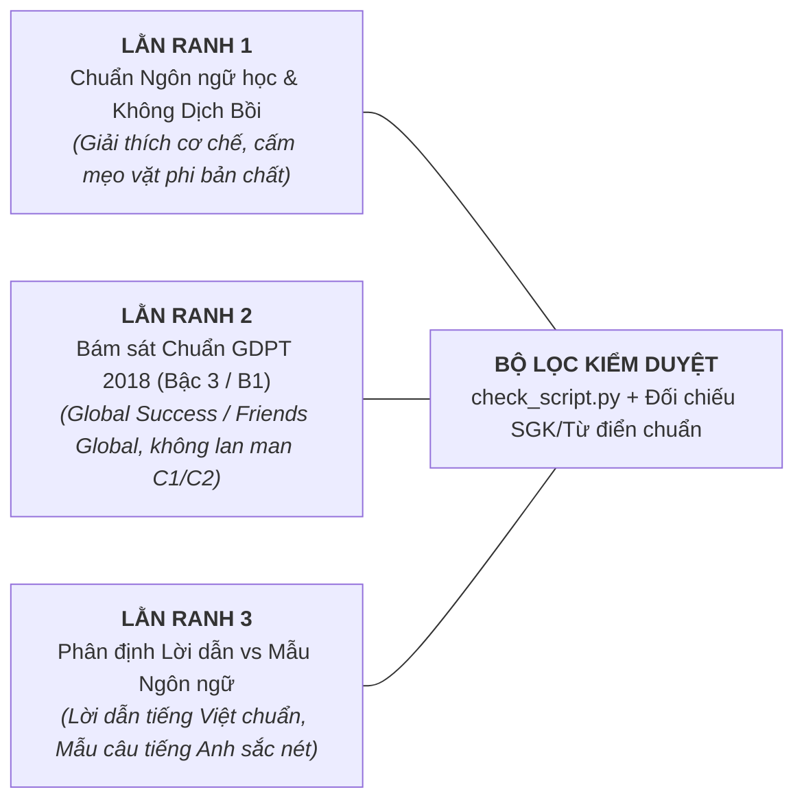
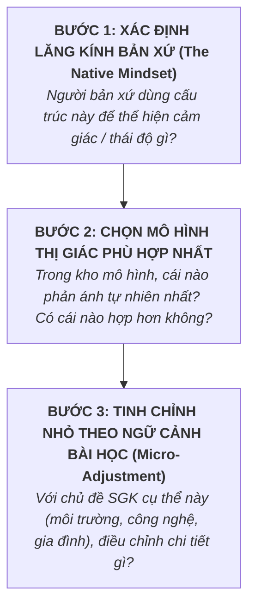

# Gói môn — Tiếng Anh (English — GDPT 2018 THPT)

Đọc kèm skill `viet-kich-ban` (B1), `tao-audio` (B2), `dung-video` (B3). Tài liệu này là **quy chuẩn cốt lõi** kết nối giữa **Biên kịch Tiếng Anh (Storyteller / Cognitive Linguist)** và **Hệ thống Dựng Video Remotion (Tech Builder)**.
Bài học kinh nghiệm thực tế ghi tại: `.agents/lessons.md`.
Gói **thêm vào** luật chung; chỉ dòng nào trong mục **"Thay luật chung"** mới thay luật chung (skill `viet-kich-ban` › mục 0 › Ba tầng luật). Gói chưa có mục đó → luật chung thắng khi hai bên nói khác.

## Thay luật chung
- **`viet-kich-ban` › `speak` không chứa ký hiệu `< >`**: môn Anh được dùng thẻ `<en>…</en>` để đánh dấu tiếng Anh đọc nguyên văn (mục 5). Trong `<en>` được dùng dấu nháy của dạng rút gọn (`don't`).
- **`tao-audio` › Cấu hình, giọng theo môn**: `--voice` là giọng Việt thuyết minh (nữ - c Nhi hoặc nam - c Bình), không phải giọng Anh. Giọng Anh cho phần `<en>` tự chọn cùng giới (mục 5.1).

---

## 1. Bản chất môn học & Tư duy kể chuyện (B1)

> [!IMPORTANT]
> **Mục tiêu tối thượng: Giải thích BẢN CHẤT NHẬN THỨC & CƠ CHẾ TƯ DUY CỦA NGƯỜI BẢN XỨ chứ không chỉ liệt kê công thức đại số khô khan hay bắt học vẹt từ vựng.**
> Học sinh Việt Nam thường sợ tiếng Anh hoặc làm bài như một cái máy vì:
> 1. *Ngữ pháp bị toán học hóa*: $S + V + O$, công thức 12 thì, công thức câu điều kiện... học sinh học vẹt nhưng không hiểu *vì sao người bản xứ lại chọn cách nói đó*.
> 2. *Nhiễu loạn tư duy mẹ đẻ (L1 Interference)*: Tiếng Việt là ngôn ngữ đơn lập, không biến hình, không có thì ngữ pháp (chỉ có từ chỉ thời gian: đã, đang, sẽ). Khi học sinh dịch máy móc từng từ, họ rơi vào mọi bẫy của đề thi.
> 3. *Học từ vựng cơ học*: Học thuộc danh sách hàng trăm phrasal verbs (*give up, look up, turn down...*) hay collocations như những sự kết hợp ngẫu nhiên, không biết rằng chúng tuân theo **ngữ pháp nhận thức không gian (Spatial Cognitive Grammar)**.
> Video của chúng ta dài **2:30 – 4:00**, tuyệt đối **KHÔNG biến video thành tiết học ngữ pháp truyền thống đọc chép hay mẹo khoanh bừa trắc nghiệm**.
> Chiến lược duy nhất: **GIẢI PHÃU GÓC NHÌN BẢN XỨ BẰNG MÔ HÌNH THỊ GIÁC (Visual Cognitive Explainer)** — Xuất phát từ một nghịch lý ngôn ngữ hoặc bẫy tư duy kinh điển $\to$ Dựng mô hình nhận thức không gian $\to$ Thấu hiểu vì sao người bản xứ tư duy như vậy $\to$ Chốt hạ bản chất và xử lý gọn gàng câu hỏi trong đề thi.

### 1.1. Năm Góc Vào Bài (Hook) Đắt Giá cho Tiếng Anh

Tùy vào chủ đề (Thì & Thể, Giới từ, Phrasal verbs, Cấu trúc câu hay Mạo từ), tự do lựa chọn 1 trong 5 góc vào bài tự nhiên và cuốn hút nhất:

1. **Nghịch lý Dịch thuật Hai Ngôn ngữ (Translation Paradox)**:
   - *Ví dụ*: "Cùng là câu 'Tôi đánh mất chìa khóa', tại sao người bản xứ khi thì nói 'I lost my key', khi lại nói 'I have lost my key'? Hai câu này khác gì nhau khi dịch sang tiếng Việt nghe y hệt? Nếu bạn nói nhầm câu thứ hai, người nghe có thể chạy đi tìm chìa khóa giúp bạn ngay lập tức!" (Bài Hiện tại hoàn thành vs Quá khứ đơn - Tiếng Anh 10).
2. **Bí mật Không gian Đời thường (Everyday Spatial Secret)**:
   - *Ví dụ*: "Tại sao chúng ta nói 'on the bus' (trên xe buýt), 'on the plane' (trên máy bay), nhưng lại bắt buộc phải nói 'in a taxi' (trong taxi) và 'in a car' (trong ô tô con)? Có phải do xe buýt to hơn xe taxi? Logic thực sự đằng sau quy ước này là gì?" (Bài Bản chất Giới từ IN vs ON - Tiếng Anh 10).
3. **Giải mã Cụm từ Kỳ quặc (Phrasal Verb Mystery)**:
   - *Ví dụ*: "Tại sao 'clean up' lại là dọn sạch bong, 'drink up' là uống cạn đáy cốc, còn 'give up' lại là từ bỏ? Chữ 'UP' vốn chỉ hướng lên trời, tại sao lại biến thành 'sự kết thúc' hay 'sự dọn sạch'? Người bản xứ đang nhìn thấy bức tranh gì trong đầu?" (Bài Bản chất hạt nhân UP trong Phrasal Verbs - Tiếng Anh 11).
4. **Bóc tách Bẫy Câu Phân hóa Đề thi (Exam Trap Demystified)**:
   - *Ví dụ*: "Trong đề thi tốt nghiệp THPT, có những câu dài 3 dòng chứa đầy từ mới khiến bạn hoang mang không biết chia động từ dạng nào. Nhưng nếu bạn biết cách bóc tách 'bộ khung xương' của câu tiếng Anh và loại bỏ lớp áo bổ nghĩa, đáp án đúng sẽ lộ diện chỉ trong 5 giây!" (Bài Rút gọn mệnh đề quan hệ V-ing / V-ed - Tiếng Anh 11/12).
5. **Nghịch lý Thời gian & Thực tại (Modal Reality Paradox)**:
   - *Ví dụ*: "Tại sao khi ước một điều ở ngay hiện tại, chúng ta lại phải dùng thì quá khứ: 'I wish I had a car'? Rõ ràng chiếc xe là mong muốn cho bây giờ, tại sao lại kéo quá khứ vào đây? Có phải người Anh bị nhầm lẫn thời gian?" (Bài Câu điều kiện loại 2 & Thức giả định - Tiếng Anh 12).

### 1.2. Ba Lằn Ranh Đỏ của Môn Tiếng Anh (Tuyệt Đối Tuân Thủ)



1. **Lằn ranh 1: Chuẩn Ngôn ngữ học Nhận thức — Tuyệt đối không dạy mẹo vặt phản khoa học**:
   - Mọi giải thích phải dựa trên cơ sở ngôn ngữ học nhận thức (Cognitive Linguistics) chuẩn xác.
   - CẤM các mẹo học vẹt vô căn cứ như "thấy chữ này thì auto khoanh chữ kia", "cứ có since là thì hiện tại hoàn thành không cần hiểu câu". Đề thi GDPT 2018 đã thay đổi triệt để để bẫy những học sinh học vẹt kiểu này.
2. **Lằn ranh 2: Chuẩn mực SGK GDPT 2018 & Khung Bậc 3 (B1)**:
   - Kiến thức và từ vựng bám sát các bộ SGK chính thức: *Global Success*, *Friends Global*, *Bright*, *i-Learn Smart World*.
   - Không lạm dụng các thuật ngữ ngôn ngữ học quá hàn lâm làm người xem hoảng sợ (ví dụ: dùng "Góc nhìn thời gian" thay vì "Telic Aspectuality", dùng "Khối bổ nghĩa" thay vì "Non-restrictive relative clause modifier").
3. **Lằn ranh 3: Phân định ranh giới Ngôn ngữ Lời dẫn (Vietnamese) và Ngôn ngữ Đích (English)**:
   - Lời giảng (`speak`) bằng tiếng Việt tự nhiên, mạch lạc, đóng vai trò người dẫn đường tư duy.
   - Từ, cụm, câu mẫu tiếng Anh hiện chuẩn xác trên hình (`text`, Typography), kèm IPA khi cần. Trong `speak`, chúng được **đọc nguyên văn bằng giọng Anh**, không dịch sang tiếng Việt (mục 5).

---

## 2. Phạm vi kiến thức & Tài liệu tham khảo SGK chuẩn (B1)

- **Tài liệu tham khảo SGK chuẩn**: Lưu tại `references/anh/lop-<lop>/` và `references/anh/de-thi-chinh-thuc-tot-nghiep-thpt-2025-2026.md`. Khi viết kịch bản, AI BẮT BUỘC tra cứu các file này trước để bám sát chủ đề từ vựng, điểm ngữ pháp và dạng bài trọng tâm.
- **Phạm vi trọng tâm 3 khối lớp**:
  * **Lớp 10**: Các thì cơ bản và sự phối hợp thì (Hiện tại đơn, Quá khứ đơn, Hiện tại hoàn thành); Câu bị động; Động từ khuyết thiếu (*Modals*); Giới từ không gian và thời gian (*in, on, at*).
  * **Lớp 11**: Cụm động từ (*Phrasal Verbs*); Mệnh đề quan hệ & Rút gọn mệnh đề quan hệ (V-ing, V-ed, To-V); Động từ nguyên mẫu và danh động từ (*Gerunds & Infinitives*); Liên từ & Trạng từ liên kết.
  * **Lớp 12**: Câu điều kiện (Loại 1, 2, 3 và hỗn hợp); Câu ước & Thức giả định; Đảo ngữ (*Inversions*); Câu so sánh kép (*The more..., the more...*); Mạo từ (*A/An, The, Zero Article*).

---

## 3. Tư duy Thị giác: Theme Môn Học, Quy Trình Thẩm Định & Kho 8 Mô Hình (B1 + B3)

### 3.1. Theme Cốt Lõi & Mood Của Môn Tiếng Anh
* **Theme cốt lõi**: **LĂNG KÍNH TƯ DUY BẢN XỨ (The Native Lens / Perspective)**.
* **Cảm giác mang lại cho người xem**: **"À, hóa ra người bản xứ họ NHÌN sự việc như thế này!"** — Gỡ bỏ hoàn toàn cảm giác dịch bồi từng chữ từ tiếng Việt, giúp người học nhìn thấy *logic ngầm* cách người bản xứ cảm nhận và đóng gói thông tin.
* **Mood hình ảnh**: Tối giản, hiện đại, sắc sảo (Clean, Editorial, Typographic, chuyển động SVG 60fps mượt mà theo nhịp nhả chữ). Cả màn hình 16:9 là một chiếc kính hiển vi ngôn ngữ học, nhìn xuyên qua mặt chữ để thấy cấu trúc nhận thức bên trong.

### 3.2. Quy Trình 3 Bước Thẩm Định Thiết Kế (Design Decision Framework)

Trước khi viết kịch bản và dựng hình cho bất kỳ bài học nào, Biên kịch/AI **BẮT BUỘC ĐI QUA 3 BƯỚC THẨM ĐỊNH**:



1. **Bước 1 — Xác định Lăng kính bản xứ**: Tìm ra động cơ nhận thức sâu xa (Tại sao người ta dùng thì này? Tại sao họ đổi sang bị động? Họ muốn nhấn mạnh điều gì?).
2. **Bước 2 — Chọn Mô hình thị giác tự nhiên nhất**: Không gò bó cứng nhắc; đối chiếu với kho 8 mô hình bên dưới xem mô hình nào phản ánh tự nhiên nhất; nếu có mô hình khác hợp lý hơn thì tự do đề xuất.
3. **Bước 3 — Tinh chỉnh nhỏ theo ngữ cảnh bài học (Micro-adjustment)**: Gắn mô hình vào chủ đề bài học cụ thể (thay đổi màu sắc, nhãn chỉ số, ví dụ sát thực tế) để mỗi video mang một sắc thái riêng biệt, không bao giờ lặp lại nhàm chán.

---

### 3.3. Kho 8 Mô Hình Thị Giác Bản Xứ (8 Native Visual Models)

```mermaid
graph TD
    M1["<b>1. Timeline & Viewpoint Lens</b><br/>(Thì & Khía cạnh thời gian)"]
    M2["<b>2. Spatial Geometry (Point/Surface/Container)</b><br/>(Giới từ không gian & thời gian)"]
    M3["<b>3. Directional Force & Particle Axis</b><br/>(Hướng lực tiểu từ Phrasal Verbs)"]
    M4["<b>4. Focus Spotlight / Camera Zoom</b><br/>(Thể bị động & Câu chẻ Cleft Sentence)"]
    M5["<b>5. Sentence Blocks & Dependency Arcs</b><br/>(Trật tự từ & Rút gọn mệnh đề)"]
    M6["<b>6. Epistemic Reality Ladder</b><br/>(Thước đo thực tại: Điều kiện & Giả định)"]
    M7["<b>7. Information Flow & Common Ground</b><br/>(Dòng chảy thông tin & Mạo từ A/The)"]
    M8["<b>8. Parallel Balance Scale</b><br/>(Cán cân song hành: So sánh kép The more...)"]
```



#### Model 1: Dòng Thời Gian & Thấu Kính Góc Nhìn (Timeline & Viewpoint Lens)
- **Áp dụng cho**: 12 thì, Sự phối hợp thì (*Past Simple vs Present Perfect, Past Continuous vs Past Simple*).
- **Thành phần hình ảnh**: Trục hoành thời gian vô tận, vạch mốc `NOW` phát sáng trung tâm (`#3D4AEF`). Quá khứ đơn là chiếc hộp thời gian đóng nắp tách rời; Hiện tại hoàn thành là cây cầu ánh sáng (Bridge / Stream) nối từ quá khứ chạm đỉnh vào `NOW` mang nhãn *Current Relevance*.

#### Model 2: Hình Học Không Gian (Point / Surface / Container)
- **Áp dụng cho**: Giới từ chỉ vị trí và thời gian (*IN, ON, AT*).
- **Thành phần hình ảnh**: Bộ ba hình học nhận thức: `AT` (Chấm tiêu điểm 0D radar `#EF4444`), `ON` (Mặt phẳng tiếp xúc 2D `#10B981`), `IN` (Chiếc hộp không gian bao bọc 3D trong suốt `#3B82F6`).

#### Model 3: Hướng Lực & Trục Tiểu Từ (Directional Force & Particle Axis)
- **Áp dụng cho**: Cụm động từ (*Phrasal Verbs với UP, DOWN, OUT, OFF, AWAY*).
- **Thành phần hình ảnh**: Trục hướng lực mang ý niệm: `UP` (mức năng lượng dâng đầy đỉnh điểm $\to$ hoàn tất / tăng tốc), `OUT` (hạt sáng bay ra khỏi hộp kín $\to$ lộ diện / sáng tỏ sự thật), `OFF` (ngắt tiếp xúc / rời bệ phóng).

#### Model 4: Tiêu Cự Chú Ý & Đèn Rọi Sân Khấu (Focus Spotlight / Camera Zoom)
- **Áp dụng cho**: Thể bị động (*Passive Voice*), Câu chẻ nhấn mạnh (*Cleft Sentences: It is/was... that...*).
- **Thành phần hình ảnh**: Ống kính máy quay zoom cận cảnh vào kết quả hoặc đối tượng chịu tác động; chủ thể thực hiện hành động bị làm mờ nhẹ (`blur: 3px`) ở hậu cảnh hoặc ẩn hoàn toàn. Đèn rọi spotlight bật sáng đúng phần thông tin quan trọng nhất.

#### Model 5: Khối Câu Tầng Bậc & Dòng Phụ Thuộc (Sentence Blocks & Dependency Arcs)
- **Áp dụng cho**: Trật tự câu tiếng Anh, Cụm danh từ (*Noun Phrase*), Mệnh đề quan hệ & Rút gọn mệnh đề (*V-ing / V-ed / To-V*).
- **Thành phần hình ảnh**: Chuỗi từ nằm ngang đóng trong các khối thẻ màu bo góc (*Sentence Block*); Cung tên phụ thuộc (*Dependency Arc*) uốn lượn phía trên nối từ bổ nghĩa về từ trung tâm; hiệu ứng thu nhỏ và tan biến khi rút gọn mệnh đề.

#### Model 6: Thang Bậc Khoảng Cách Thực Tại (Epistemic Reality Ladder)
- **Áp dụng cho**: Câu điều kiện Loại 0, 1, 2, 3; Câu điều kiện hỗn hợp; Thức giả định (*Wishes / Subjunctive*).
- **Thành phần hình ảnh**: Mặt phẳng Thực tại vững chắc bên dưới; Tầng không gian Giả định nét đứt mờ ảo phía trên. Mỗi bậc lùi thì là một bước lùi rời xa Thực tại.

#### Model 7: Dòng Chảy Thông Tin & Trường Nhận Thức (Information Flow & Common Ground)
- **Áp dụng cho**: Mạo từ (*A/An/The/Zero Article*), Kỹ năng sắp xếp trật tự câu/đoạn văn tạo tính mạch lạc.
- **Thành phần hình ảnh**: Hai vòng tròn tâm trí giao thoa (Người nói vs Người nghe); dòng thông tin trôi từ Trọng tâm đã biết (*Theme / Given Info*) sang Thông tin mới phát sinh (*Rheme / New Info*).

#### Model 8: Cán Cân Song Hành (Parallel Balance Scale)
- **Áp dụng cho**: So sánh kép (*The more..., the more...*), Cấu trúc song hành (*Not only... but also...*).
- **Thành phần hình ảnh**: Mô hình cân đĩa vật lý hai bên dao động nhịp nhàng theo hàm `spring`; đĩa bên trái chịu tác động kéo đĩa bên phải dịch chuyển đồng pha.
- **Thành phần hình ảnh**:
  * Hai vòng tròn giao thoa (Venn diagram): Vòng tròn A (Tâm trí người nói - Speaker's Mind), Vòng tròn B (Tâm trí người nghe - Listener's Mind).
  * `A / AN`: Một chấm sáng ngẫu nhiên nằm lơ lửng chỉ trong vòng tròn A (Người nói biết một vật thể bất kỳ, người nghe chưa từng thấy $\to$ *Indefinite*).
  * `THE`: Chấm sáng di chuyển vào vùng giao nhau rực rỡ giữa hai vòng tròn $\to$ Cả hai đều nhìn thấy cùng một vật thể duy nhất $\to$ *Definite*.
  * `ZERO ARTICLE`: Hai vòng tròn thu nhỏ lại thành 2 hạt bụi, toàn bộ màn hình mở rộng thành vũ trụ bao la đại diện cho toàn bộ chủng loài/khái niệm chung không đếm được.

---

## 4. Số, Ký hiệu Ngữ pháp & Phiên âm IPA (B1)

- **Ký hiệu thành phần câu**:
  * Trong kịch bản và màn hình: Dùng $S$ (Chủ ngữ), $V$ (Động từ), $O$ (Tân ngữ), $M$ (Bổ ngữ).
  * Không dùng các ký hiệu toán học rối rắm trong tiếng Anh.
- **Ký hiệu thì & dạng động từ**:
  * $V_0$ hoặc $V_{\text{bare}}$: Động từ nguyên thể không "to".
  * $V_1$: Động từ chia hiện tại ($V_{s/es}$).
  * $V_2$: Động từ quá khứ đơn ($V_{ed}$).
  * $V_3$ hoặc $V_{pp}$: Quá khứ phân từ (*Past Participle*).
  * $V_{\text{ing}}$: Hiện tại phân từ / Danh động từ.
- **Bảng phiên âm quốc tế (IPA)**:
  * Khi giới thiệu phát âm từ vựng, bắt buộc đặt trong hai dấu gạch chéo `/.../` (ví dụ: `/prɪˈzent/` vs `/ˈpreznt/`).
  * Sử dụng font chữ hỗ trợ ký tự ngữ âm quốc tế đầy đủ (Plus Jakarta Sans hiển thị chuẩn IPA).

---

## 5. Lời đọc hai thứ tiếng: tiếng Anh đọc nguyên văn bằng giọng Anh (B1, B2)

> [!CAUTION]
> **Đã gặp (12/11/2026, người xem thật):** lời đọc dịch câu mẫu sang tiếng Việt và giọng Việt đọc từ tiếng Anh. `play` thành "chỉ chơi"; *She is happy* thành "câu cô ấy vui"; `be` đọc "bê" thay vì /biː/. Người xem nói nội dung dễ hiểu nhưng câu chữ loạn, vì phải tự dịch ngược ra tiếng Anh.
> **Luật:** từ, cụm, câu tiếng Anh đang được dạy thì **đọc nguyên văn bằng giọng Anh**, không dịch, không phiên âm kiểu Việt (`ắp`, `đao`, `bi`).

### 5.1. Đánh dấu tiếng Anh trong `speak`

Bọc đúng phần tiếng Anh bằng `<en>…</en>`, phần còn lại là lời giảng tiếng Việt:

```json
{ "text": "play → plays", "speak": "Động từ <en>play</en> chỉ cần thêm <en>s</en>." }
{ "text": "She is happy", "speak": "<en>She is happy.</en>" }
{ "text": "is = be",      "speak": "<en>is</en> là một dạng của động từ <en>be</en>." }
```

- B2 đọc phần `<en>` bằng giọng tiếng Anh **cùng giới** với giọng Việt (nữ - c Nhi → `anh-female`, nam - c Bình → `anh-male`). Đổi giọng nam ↔ nữ giữa câu nghe như hai người chen lời. Bảng ghép ở `scripts/tts_config.json` › `englishVoice`, ghi đè bằng `--en-voice`.
- Không cần `caption`: phụ đề lấy `speak` đã bỏ thẻ ("Động từ play chỉ cần thêm s."). `cue` cũng viết không thẻ (`"cue": "play"`).
- Chữ cái đứng riêng (`<en>s</en>`) được đọc theo tên chữ /es/.
- Dạng rút gọn để nguyên trong `<en>`: `<en>I don't know.</en>`.
- Thuật ngữ ngữ pháp là **lời giảng**, nói tiếng Việt như SGK: "quá khứ đơn", "câu bị động", "tính từ". Chỉ bọc `<en>` khi đang dạy chính chữ tiếng Anh đó (vd. dạy đọc tên thì *Past Simple*).
- Nghĩa tiếng Việt (nếu cần) nói **sau** ví dụ gốc: "<en>give up</en>, nghĩa là từ bỏ."

### 5.2. Viết cho chỗ đổi giọng nghe liền

Mỗi chỗ đổi giọng là một đường nối hai bản ghi, nên nối càng ít và càng đúng chỗ ngắt tự nhiên thì càng êm.
- **Câu mẫu đứng riêng một dòng**, đọc trọn bằng giọng Anh (`<en>She is happy.</en>`). Dòng sau mới phân tích. Người xem nghe trọn câu trước rồi mới nghe tách.
- **≤ 2 đoạn `<en>` mỗi dòng** (≤ 4 chỗ nối). Nhiều hơn thì tách dòng.
- Đặt chỗ đổi giọng ở ranh giới cụm: sau dấu `:` hoặc `,`, hoặc từ mẫu đứng cuối cụm ("…của động từ <en>be</en>."). Tránh kẹp từ Anh giữa hai âm tiết Việt dính nhau ("cái <en>be</en> này nó").
- Không lồng câu giảng dài vào giữa hai đoạn Anh. Viết "<en>is</en> là một dạng của <en>be</en>." thì được, nhưng tránh "<en>is</en>, mà như đã thấy ở câu trên thì thực chất nó là <en>be</en>".
- Nghỉ ở chỗ đổi giọng do B2 tự chèn theo dấu câu ngay trước chỗ đổi (`scripts/song_ngu.py`): không dấu ≈ 0,14 s; `, ; :` ≈ 0,3 s; `. ? !` ≈ 0,45 s. Muốn ngắt dài hơn thì thêm dấu câu, không chèn `...`.

### 5.3. Kiểm và nghe thử

- B1: `py scripts/check_script.py <slug>`
  - **Lỗi** `[en-chua-boc]` khi `speak` có từ tiếng Anh chưa bọc `<en>`, ví dụ "Động từ play…".
  - **Cảnh báo** khi `text` hiện câu tiếng Anh mà `speak` không đọc nguyên văn từ nào, tức là đang dịch.
  - Mọi dòng có `<en>` vào danh sách **CẦN NGHE THỬ**.
- B2: `--estimate` báo riêng ký tự của giọng Việt và giọng Anh. Nghe thử các dòng ghép giọng (`--only b03-l02 …`) trước khi tạo cả bài. Cần nghe kỹ ba chỗ:
  - Từ Anh đọc đúng: `be` là /biː/, `s` là /es/.
  - Chỗ nối không gãy, không hụt hơi.
  - Giọng Anh không to hay nhỏ hơn giọng Việt. B2 tự cân độ to theo giọng Việt của dòng.
  Lỗi nhịp thì sửa chỗ đặt `<en>` hoặc dấu câu ở B1. Mỗi đoạn đã tạo được lưu lại (`out/_lam-viec/<slug>/doan-giong/`), nên chạy lại sau khi chỉnh cách ghép không tốn credit.

### 5.4. Bảng cách viết `speak`

| Trên hình (`text`) | `speak` |
|---|---|
| $S + V + O$ | `chủ ngữ, động từ, tân ngữ` |
| $V\text{-ing}$ | `động từ thêm <en>-ing</en>` |
| $V_3 / V_{pp}$ | `quá khứ phân từ` |
| Past Simple, Present Perfect | `quá khứ đơn, hiện tại hoàn thành` *(lời giảng)* |
| in / on / at | `<en>in</en>, <en>on</en>, <en>at</en>` |
| up / down / out | `<en>up</en>, <en>down</en>, <en>out</en>` |
| I have lost my key | `Người bản xứ nói: <en>I have lost my key.</en>` |
| /prɪˈzent/ vs /ˈpreznt/ | `<en>present</en>… và <en>present</en>` *(nghe thử: giọng Anh đọc theo ngữ cảnh, trọng âm có thể không đổi — cần thì đọc trong cụm: `<en>to present a gift</en>`)* |

---

## 6. Dựng hình Remotion & Thành phần Đồ họa (B3)

- **Brand Frame & Typography**:
  * Bọc toàn bộ video trong `BrandFrame` theo chuẩn 9Study.
  * Font chính: Plus Jakarta Sans (chữ tiếng Anh và tiếng Việt hiển thị hoàn hảo, đường nét hiện đại).
- **Bộ màu nhận diện theo vai trò (Roles)**:
  * Nền sáng chuẩn: `#F8FAFC` hoặc `#FFFFFF`.
  * Khối Chủ ngữ / Danh từ: Xanh Navy `#1E293B`.
  * Khối Động từ trung tâm: Xanh dương thương hiệu `#3D4AEF`.
  * Khối Bổ ngữ / Tính từ / Trạng từ: Tím hiện đại `#7C3AED`.
  * Điểm nhấn Cảnh báo / Bẫy đề thi: Đỏ cam `#EF4444`.
  * Điểm nhấn Bản chất / Đáp án đúng: Xanh lục bảo `#10B981`.
  * Tối đa 5 màu nhấn trong một cảnh để tránh gây rối mắt người học.
- **Component dùng lại**:
  * `SentenceBlock`: Khối thẻ từ vựng bo góc tự co giãn theo độ dài từ.
  * `TimelineAxis`: Trục thời gian có mốc NOW phát sáng và thấu kính góc nhìn.
  * `SpatialContainer`: Chiếc hộp 3D trong suốt cho giới từ `IN`.
  * `DependencyArc`: Mũi tên cong mượt mà nối giữa các khối từ bổ nghĩa.
  * `AutoLabels`: Tự động căn chỉnh nhãn giải thích không đè lên các khối từ của câu.
