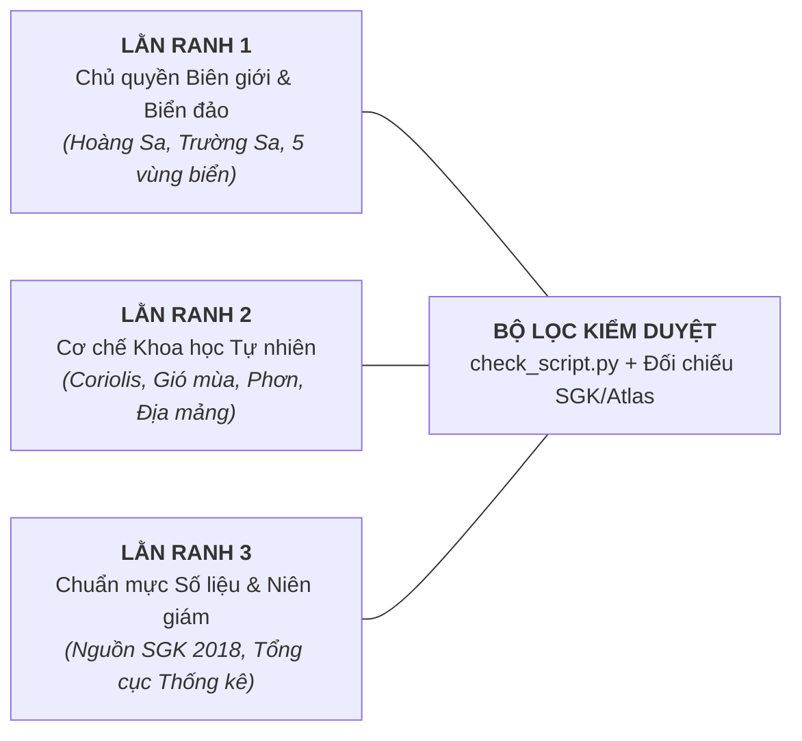

# Gói môn — Địa lí (GDPT 2018 THPT)

Đọc kèm skill `viet-kich-ban` (B1), `tao-audio` (B2), `dung-video` (B3). Tài liệu này là **quy chuẩn cốt lõi** kết nối giữa **Biên kịch Địa lí (Storyteller)** và **Hệ thống Dựng Video Remotion (Tech Builder)**.
Bài học kinh nghiệm thực tế ghi tại: `.agents/lessons.md`.

---

## 1. Tư duy kể chuyện & Trải nghiệm người xem (B1)

> [!IMPORTANT]
> **Mục tiêu tối thượng: Giải thích VÌ SAO chứ không chỉ CÁI GÌ / Ở ĐÂU.**
> Học sinh thường sợ môn Địa vì nghĩ là môn học vẹt số liệu, liệt kê tỉnh thành, khoáng sản, diện tích vô hồn.
> Video của chúng ta dài **2:30 – 4:00**, tuyệt đối **KHÔNG trình chiếu như một bài giảng thuyết minh liệt kê từ đầu đến cuối SGK**.
> Chiến lược duy nhất: **PHẪU THUẬT CƠ CHẾ BẢN CHẤT (The Mechanism Behind the Phenomenon)** — Đi tìm gốc rễ của **MỘT HIỆN TƯỢNG TỰ NHIÊN KỲ THÚ** hoặc **MỘT BÀI TOÁN KHÔNG GIAN ĐẶC THÙ**, giải thích rõ nguyên nhân $\to$ quá trình vận động $\to$ hệ quả cảnh quan & đời sống.

### 1.1. Hook linh hoạt (Tuyệt đối KHÔNG máy móc)
Tùy vào tính chất bài học (Địa lí Tự nhiên đại cương 10, Kinh tế - Xã hội thế giới 11, hay Địa lí Việt Nam 12), tự do chọn 1 trong 5 góc vào bài tự nhiên và cuốn hút nhất:
1. **Nghịch lý Cùng Vĩ độ**: So sánh hai vùng đất cùng vĩ độ nhưng hoàn toàn đối lập (*"Cùng nằm trên vĩ độ 12° đến 22° Bắc, trong khi bán đảo Ả Rập và sa mạc Sahara khô cằn toàn cát bỏng, thì dải đất Việt Nam lại là rừng xanh bạt ngàn và vựa lúa trù phú quanh năm... Điều gì đã tạo nên sự thiên vị kỳ lạ này của tạo hóa?"*).
2. **Hiện tượng Thời tiết Cực đoan Thường nhật**: Neo vào trải nghiệm khó chịu hay tò mò có thật của người xem (*"Tại sao cứ mỗi độ hè về, người dân miền Trung lại phải chịu đựng những cơn gió khô rang, nóng hầm hập như lò than phả vào mặt suốt ngày đêm, trong khi cùng lúc đó Tây Nguyên lại mưa xối xả ngập đường?"*).
3. **Bóc tách Hiểu lầm Phổ biến (Myth-Busting)**: Đính chính tư duy trực giác sai lầm (*"Nhiều người đinh ninh mùa hè nóng vì Trái Đất ở gần Mặt Trời hơn mùa đông. Nhưng sự thật hoàn toàn ngược lại: vào tháng 7 khi miền Bắc nóng nhất, Trái Đất lại đang ở điểm viễn nhật – cách xa Mặt Trời nhất trong năm!"*).
4. **Bí ẩn Lát cắt Địa hình / Thám hiểm Không gian**: Mở bằng một hành trình quan sát trực quan (*"Nếu bạn xuất phát từ bờ biển Quy Nhơn, leo thẳng lên đỉnh dãy Trường Sơn rồi hạ xuống cao nguyên Pleiku, bạn sẽ thấy thảm thực vật thay đổi ngỡ ngàng chỉ sau vài chục kilômét... Quy luật nào đang vẽ nên bức tranh thiên nhiên đó?"*).
5. **Yết hầu Địa kinh tế & Dòng chảy Hàng hải**: Dẫn dắt bằng bài toán vị thế không gian (*"Tại sao một eo biển nhỏ hẹp như Malacca hay vùng biển quanh quần đảo Trường Sa lại là huyết mạch sống còn, nơi trung chuyển hơn 80% lượng dầu mỏ và hàng hóa giao thương của cả vùng Đông Bắc Á?"*).

### 1.2. Ba nguyên tắc Storytelling của môn Địa
1. **Tư duy Không gian & Mối quan hệ Nhân quả Tổng hợp (Spatial Causality)**:
   - Địa lí là khoa học về mối liên hệ nhân quả: **Vị trí & Thiên văn $\to$ Địa hình & Khí hậu $\to$ Thủy văn & Thổ nhưỡng $\to$ Sinh vật $\to$ Phân bố Dân cư & Cơ cấu Kinh tế**.
   - Mọi hiện tượng đều phải giải thích từ mắt xích gốc (ví dụ: gió phơn miền Trung gốc từ gió mùa Tây Nam vượt qua bức tường chắn dãy Trường Sơn).
2. **Động hóa các Dòng chảy (Dynamic Flows)**:
   - Tuyệt đối không để bản đồ tĩnh như trang sách in. Bản đồ phải là **chiến trường của các luồng khí quyển, dòng biển, bức xạ mặt trời, luồng vận tải hàng hóa và di cư dân số**.
   - Mũi tên gió uốn lượn, mây ngưng kết thành giọt mưa rơi, khối khí tràn qua đèo bị ép hạ áp và bốc hơi khô nóng.
3. **Một Hiện tượng Xuyên suốt — Không nhảy bước**:
   - Dùng một địa bàn / hiện tượng cụ thể làm ví dụ dẫn dắt (ví dụ: giải thích gió mùa thì bám sát lãnh thổ Việt Nam; giải thích nội lực thì bám sát ranh giới mảng Thái Bình Dương hoặc sự hình thành dãy Himalaya).

### 1.3. Khung 4 Tầng Dẫn Chuyện: Từ Thực trạng Nóng tới Bản chất SGK (Lời khuyên từ HSGQG Địa)
> [!TIP]
> Người xem và học sinh không muốn nghe lý thuyết hàn lâm hay học vẹt bài học trong SGK.
> Hãy lấy **THỰC TRẠNG THỜI SỰ / HIỆN TƯỢNG CÓ THẬT** làm "mồi dẫn" để học sinh thấy kiến thức SGK chính là lời giải mã thế giới xung quanh:
> 1. **Tầng 1: Hiện trạng Thời sự (Hook)**: Nêu hiện tượng thực tế đang diễn ra (*El Niño làm mùa đông đến muộn, nắng nóng kỷ lục, hạn mặn miền Tây, bão dồn dập cuối năm*).
> 2. **Tầng 2: Cơ chế Địa lí Ngầm (Mechanism)**: Bóc tách quy luật tự nhiên chi phối (*chênh lệch khí áp, gió mùa, hoàn lưu Walker, dòng biển ấm/lạnh, chắn địa hình*).
> 3. **Tầng 3: Hệ quả Không gian & Đời sống (Impact)**: Trực quan hóa tác động trên bản đồ (*vùng chịu hạn, vệt bão đổ bộ, sụt giảm sản lượng cây công nghiệp*).
> 4. **Tầng 4: Chốt hạ Bản chất SGK & Đề thi (Payoff)**: Neo lại vào bài học SGK/đề thi tốt nghiệp THPT để học sinh hiểu sâu và không bao giờ quên.

---

## 2. Phạm vi kiến thức & Lằn ranh đỏ "Sai là hỏng luôn" (B1)

Địa lí là môn học gắn liền mật thiết với chủ quyền quốc gia, ranh giới lãnh thổ và tính chính xác khoa học tự nhiên. Mọi kịch bản phải tuân thủ nghiêm ngặt **3 LẰN RANH ĐỎ**:

1. **Lằn ranh 1: Chủ quyền Biên giới & Biển đảo Quốc gia (Nghiêm cấm tuyệt đối sai sót)**:
   - Mọi bản đồ xuất hiện lãnh thổ Việt Nam trên màn hình **BẮT BUỘC hiển thị đầy đủ hai quần đảo Hoàng Sa và Trường Sa** (chú thích rõ Hoàng Sa thuộc TP Đà Nẵng, Trường Sa thuộc tỉnh Khánh Hòa).
   - Đường biên giới trên đất liền (giáp Trung Quốc, Lào, Campuchia) và trên biển tuân thủ chuẩn theo Cục Đo đạc, Bản đồ và Thông tin địa lý Việt Nam. Tuyệt đối nghiêm cấm các bản đồ ngoại lai có "đường lưỡi bò" phi pháp hoặc làm mờ nhạt chủ quyền biển đảo.
   - Khi dạy về biển đảo: Nắm vững và thể hiện chuẩn xác 5 vùng biển theo Công ước LHQ về Luật Biển 1982 (UNCLOS) và Luật Biển Việt Nam 2012:
     * **Nội thủy**: Vùng nước phía trong đường cơ sở.
     * **Lãnh hải**: Vùng biển rộng 12 hải lý tính từ đường cơ sở (chủ quyền hoàn toàn, đầy đủ).
     * **Vùng tiếp giáp lãnh hải**: Rộng 12 hải lý tiếp theo (quyền tài phán hải quan, thuế, môi trường).
     * **Vùng đặc quyền kinh tế (EEZ)**: Rộng 200 hải lý tính từ đường cơ sở.
     * **Thềm lục địa**: Đáy biển và lòng đất dưới đáy biển mở rộng ra ngoài lãnh hải đến rìa ngoài lục địa.
2. **Lằn ranh 2: Tính Chính xác của Cơ chế Tự nhiên**:
   - Không được đơn giản hóa đến mức sai lệch bản chất vật lý khí quyển:
     * **Lực Coriolis**: Lệch sang phải ở bán cầu Bắc, lệch sang trái ở bán cầu Nam (nhìn theo hướng chuyển động).
     * **Hiệu ứng Phơn (Foehn)**: Không khí ẩm bốc lên sườn đón gió $\to$ nở đoạn nhiệt, nhiệt độ giảm $0.6^\circ\text{C}/100\text{m}$, ngưng kết sinh mưa $\to$ sang sườn khuất gió, không khí khô hạ xuống $\to$ nén đoạn nhiệt, nhiệt độ tăng vọt $1^\circ\text{C}/100\text{m}$ tạo gió khô nóng.
     * **Gió mùa**: Do sự chênh lệch nhiệt - ẩm và khí áp theo mùa giữa lục địa rộng lớn châu Á và đại dương bao la Thái Bình Dương - Ấn Độ Dương, kết hợp lực Coriolis khi khối khí xích đạo đổi hướng khi vượt qua bán cầu.
3. **Lằn ranh 3: Chuẩn xác về Số liệu & Niên giám Thống kê**:
   - Số liệu kinh tế - dân số (dân số, GDP, tỉ trọng nông - lâm - thủy sản...) phải bám theo SGK GDPT 2018 hoặc Niên giám Thống kê (Tổng cục Thống kê GSO).
   - Luôn kèm **mốc năm cụ thể** (vd: "Năm 2021", "Năm 2026") vì số liệu kinh tế - xã hội biến động theo thời gian, không bao giờ nói con số lơ lửng vô thời hạn.

---

## 3. Mẫu dựng khái niệm — 5 Khuôn mẫu Trực quan (B1 + B3)

Toàn bộ kiến thức Địa lí THPT (Lớp 10, 11, 12) được quy về 5 Archetypes với các component Remotion tương ứng:

### 3.1. Archetype 1: Bản đồ Chuyên đề & Động học Luồng di chuyển (Thematic Map & Dynamic Flows)
* **Áp dụng**: Hoàn lưu khí quyển, Gió mùa châu Á & Việt Nam, Bão & Dải hội tụ nhiệt đới; Vận tải hàng hải, Chuỗi cung ứng toàn cầu, Phân bố vùng kinh tế.
* **Thao tác dựng hình**:
  - `ThematicMap`: Bản đồ vector phẳng 2D chuẩn ranh giới hành chính, địa hình đồi núi/đồng bằng.
  - `AtmosphericFlow`: Các dải hạt khí chuyển động có hướng (Animated Particle Flow / Flow Arrows) thể hiện hướng gió mùa Đông Bắc (xanh lam, khô/lạnh), gió mùa Tây Nam (đỏ cam, nóng/ẩm).
  - `PressureCenter`: Tâm áp cao (H - màu xanh) và áp thấp (L - màu đỏ) với các vòng đẳng áp đồng tâm.

### 3.2. Archetype 2: Lát cắt Địa hình & Hiệu ứng Sườn gió (Topographic Profile & Orographic Lift)
* **Áp dụng**: Cấu trúc địa hình đồi núi Việt Nam (Tây Bắc - Đông Bắc, Trường Sơn Bắc - Trường Sơn Nam); Hiệu ứng phơn khô nóng; Các vành đai thực vật theo độ cao.
* **Thao tác dựng hình**:
  - `TerrainProfile`: Đường cong mặt cắt địa hình (núi cao, cao nguyên, thung lũng, đồng bằng bờ biển) với trục cao độ (mét).
  - `CloudCondensation`: Đám mây tích tụ dần khi lên cao ở sườn đón gió, hạt mưa rơi `animate`.
  - `FoehnEffect`: Mũi tên gió vượt đỉnh núi chuyển màu từ xanh ẩm sang đỏ khô nóng kèm nhãn nhiệt độ tăng vọt $+1^\circ\text{C}/100\text{m}$.

### 3.3. Archetype 3: Quả địa cầu & Cơ học Thiên văn (Celestial Mechanics & Globe)
* **Áp dụng**: Trái Đất tự quay quanh trục & quay quanh Mặt Trời; Hiện tượng ngày đêm dài ngắn theo mùa; Góc nhập xạ và các vành đai nhiệt; Lực Coriolis.
* **Thao tác dựng hình**:
  - `TiltedGlobe`: Mô hình Trái Đất nghiêng $23^\circ27'$ so với mặt phẳng quỹ đạo elip.
  - `SunRayParallel`: Chùm tia sáng song song từ Mặt Trời chiếu tới, phân định rõ vùng sáng / vùng tối và ranh giới đường phân chia sáng tối (terminator).
  - `SubsolarPoint`: Điểm Mặt Trời lên thiên đỉnh (di chuyển giữa Chí tuyến Bắc và Chí tuyến Nam trong năm).

### 3.4. Archetype 4: Biểu đồ Khí hậu & Cơ cấu Kinh tế (Climograph & Structure Charts)
* **Áp dụng**: Phân tích biểu đồ nhiệt độ - lượng mưa (Hà Nội, Huế, TP Hồ Chí Minh); Tháp dân số; Chuyển dịch cơ cấu GDP 3 khu vực kinh tế (Nông nghiệp - Công nghiệp - Dịch vụ).
* **Thao tác dựng hình**:
  - `Climograph`: Biểu đồ kết hợp 2 trục tung: trục trái lượng mưa (cột xanh nước biển, mm), trục phải nhiệt độ (đường cong đỏ, $^\circ\text{C}$).
  - `PopulationPyramid`: Tháp dân số 2 giới tính (Nam - Nữ) mở rộng, thu hẹp hay ổn định.
  - `StructureTransition`: Biểu đồ miền / tròn chuyển dịch tỷ trọng qua các mốc năm 1990 $\to$ 2026 mượt mà bằng `interpolate`.

### 3.5. Archetype 5: Mạng lưới Nhân Quả Địa lí (Geographical Causal Web)
* **Áp dụng**: Quy luật địa đới, phi địa đới; Quy luật thống nhất và hoàn chỉnh của vỏ địa lí (ví dụ: phá rừng đầu nguồn $\to$ xói mòn đất $\to$ lũ quét hạ lưu $\to$ bồi lắng lòng hồ thủy điện).
* **Thao tác dựng hình**:
  - `CausalNodeDiagram`: Sơ đồ các mắt xích tự nhiên liên kết nhau bằng mũi tên phát sáng khi giọng đọc nhắc tới.
  - `BeforeAfterComparison`: Chia đôi màn hình (Rừng nguyên sinh giữ nước vs Đồi trọc thoái hóa đất).

---

## 4. Số, Đơn vị và Quy chuẩn Địa lí

Môn Địa lí có hệ thống đại lượng vật lý và thống kê rất phong phú. Toàn bộ đơn vị **BẮT BUỘC** viết chuẩn theo hệ đo lường quốc tế và SGK:

| Đại lượng | Đơn vị trong `text` / `caption` | Viết trong `speak` | Ví dụ |
| :--- | :--- | :--- | :--- |
| **Tọa độ địa lí** | $^{\circ}$, $'$(độ, phút) | ... độ ... phút | $23^\circ23'\text{B}$ $\to$ "hai mươi ba độ hai mươi ba phút Bắc" |
| **Nhiệt độ** | $^\circ\text{C}$ | độ Cê | $27^\circ\text{C}$ $\to$ "hai mươi bảy độ Cê" |
| **Lượng mưa** | $\text{mm}$ | mi-li-mét | $2000\text{ mm}$ $\to$ "hai nghìn mi-li-mét" |
| **Độ cao / Khoảng cách** | $\text{m}$, $\text{km}$, hải lý | mét, ki-lô-mét, hải lý | $3143\text{ m}$ $\to$ "ba nghìn một trăm bốn mươi ba mét" |
| **Khí áp** | $\text{hPa}$, $\text{mmHg}$ | héc-tô-pát-xcan / mi-li-mét thủy ngân | $1013\text{ hPa}$ $\to$ "một nghìn không trăm mười ba héc-tô-pát-xcan" |
| **Diện tích** | $\text{km}^2$, $\text{ha}$ | ki-lô-mét vuông, héc-ta | $331.344\text{ km}^2$ $\to$ "ba trăm ba mươi mốt nghìn ba trăm bốn mươi tư ki-lô-mét vuông" |
| **Dân số** | triệu người, người/$\text{km}^2$ | triệu người, người trên một ki-lô-mét vuông | $100\text{ triệu người}$ |
| **Kinh tế** | tỷ USD, % | tỷ đô la Mỹ, phần trăm | $400\text{ tỷ USD}$ $\to$ "bốn trăm tỷ đô la Mỹ" |

---

## 5. Đọc ký hiệu, Tên riêng & Phiên âm (B2)

Giọng đọc AI (Vivibe) cần được phiên âm chính xác các thuật ngữ khí tượng, địa mảng và địa danh:

| Thuật ngữ / Địa danh | Viết trong `text` / `caption` | Viết trong `speak` | Lưu ý phát âm AI |
| :--- | :--- | :--- | :--- |
| **Coriolis** | Coriolis | Cô-ri-ô-lít | Lực lệch hướng do Trái Đất quay |
| **Foehn / Phơn** | Gió phơn / Foehn | gió phơn | Không để đọc tiếng Đức |
| **El Niño** | El Niño | En Ni-nhô | Hiện tượng ấm lên khác thường |
| **La Niña** | La Niña | La Ni-nha | Hiện tượng lạnh đi khác thường |
| **ITCZ** | Dải hội tụ nhiệt đới (ITCZ) | dải hội tụ nhiệt đới | Không đọc từng chữ tiếng Anh |
| **Frông (Front)** | Frông khí団 | frông | Ranh giới giữa hai khối khí |
| **Hoàng Sa / Trường Sa**| Hoàng Sa, Trường Sa | Hoàng Sa, Trường Sa | Đọc rõ ràng, trang nghiêm |
| **Fansipan** | Fansipan / Phan-xi-păng | Phan-xi-păng | Đỉnh núi cao nhất Đông Dương |
| **Malacca** | Malacca / Ma-lắc-ca | Ma-lắc-ca | Eo biển huyết mạch |
| **Himalaya** | Himalaya / Hi-ma-lay-a | Hi-ma-lay-a | Dãy núi trẻ cao nhất thế giới |
| **ASEAN** | ASEAN | A-xê-an | CẤM để nguyên chữ rời |

- **Ngắt nhịp tư duy**: Dùng dấu ba chấm `...` trước các mắt xích mấu chốt để tạo khoảng lặng giúp học sinh kịp suy ngẫm cơ chế địa lí.
- **Khoảng dừng (`pauseAfter`)**: Thêm `"pauseAfter": 1.5` sau câu hỏi kích thích suy đoán hiện tượng (ví dụ: *"Đố bạn biết ngọn gió này đến từ đâu?"*).

---

## 6. Dựng hình Remotion & Cơ chế Phối hợp Asset (B3)

### 6.1. Workflow Đóng góp & Đồng bộ Asset/Component (Request User → Maintainer Push)
> [!IMPORTANT]
> **Cơ chế Phối hợp Asset Bản đồ & Địa hình**:
> 1. **Khi User làm video ở Local mà thiếu Asset Bản đồ chuẩn**:
>    - AI chủ động **Request trực tiếp từ User**: Yêu cầu User gửi ảnh bản đồ phân vùng, lát cắt địa hình hoặc file SVG bản đồ (*"Bạn gửi cho tôi hình ảnh bản đồ hoặc lược đồ vùng này từ SGK/Atlas nhé"*).
>    - AI trích xuất toạ độ vector và code thành component React/SVG dùng chung trong `src/components/dia/`.
> 2. **Cơ chế Đóng góp & Đồng bộ Framework (Maintainer Push)**:
>    - Sau khi hoàn thành và kiểm tra chất lượng hiển thị, component mới được bàn giao cho Maintainer để **push lên nhánh default (`main-codex`)**.
>    - Mọi Creator khác chỉ cần `git pull origin main-codex` là có sẵn bộ component bản đồ/khí hậu chuẩn xác để dùng ngay!

### 6.2. Bộ Core Components chuyên dụng môn Địa (Đặt tại `src/components/dia/`)
- `VietnamBorderMap.tsx`: Khung bản đồ Việt Nam chuẩn SVG có đầy đủ Hoàng Sa, Trường Sa và ranh giới các vùng kinh tế/sinh thái.
- `Climograph.tsx`: Biểu đồ nhiệt độ - lượng mưa chuẩn 2 trục tung, hỗ trợ animation cột mưa và đường nhiệt độ mượt mà.
- `TopographicProfile.tsx`: Lát cắt địa hình trực quan có trục cao độ, mây tích tụ và hiệu ứng gió phơn.
- `WindStreamField.tsx`: Trường gió động lực học (mũi tên uốn lượn / dòng hạt lướt trên bản đồ theo frame).
- `SubsolarDiagram.tsx`: Sơ đồ góc chiếu Mặt Trời và chuyển động biểu kiến hàng năm.

### 6.3. Màu sắc & Mood hình ảnh (Theme Địa lí)
- Bảng màu Địa lí lấy cảm hứng từ tự nhiên và bản đồ học hiện đại (không lòe loẹt, có tính biểu đạt cao):
  * **Biển & Nước**: Xanh lam đại dương (`#0284C7` / `#2563EB`).
  * **Đồng bằng & Rừng**: Xanh lục dịu (`#10B981` / `#059669`).
  * **Đồi núi & Cao nguyên**: Vàng đồng, Cam đất hoặc Nâu trầm (`#D97706` / `#B45309`).
  * **Khối khí Lạnh / Ẩm**: Xanh lơ nhạt (`#38BDF8`).
  * **Khối khí Nóng / Khô**: Đỏ san hô / Cam rực (`#EF4444` / `#F97316`).
- Font chữ: Plus Jakarta Sans; tên các đại dương, sơn nguyên, dãy núi lớn có thể dùng font in hoa giãn cách trang nhã (`letter-spacing: 0.1em`).
