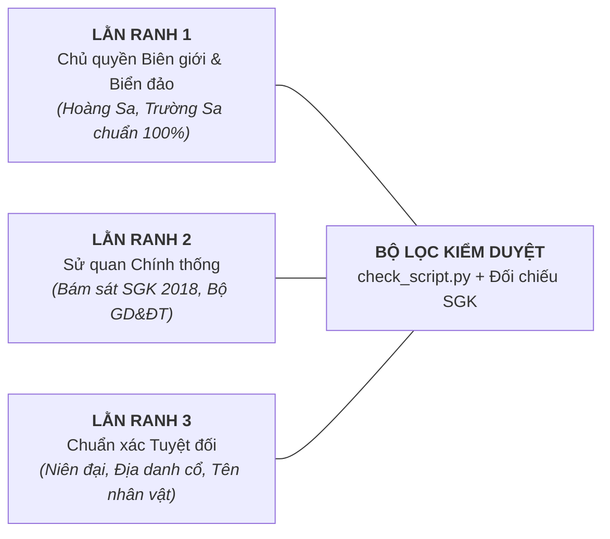

# Gói môn — Lịch sử (GDPT 2018 THPT)

Đọc kèm skill `viet-kich-ban` (B1), `tao-audio` (B2), `dung-video` (B3). Tài liệu này là **quy chuẩn cốt lõi** kết nối giữa **Biên kịch Sử (Storyteller)** và **Hệ thống Dựng Video Remotion (Tech Builder)**.
Bài học kinh nghiệm thực tế ghi tại: `.agents/lessons.md`.
Gói **thêm vào** luật chung; các ngoại lệ của môn Sử nằm trong mục **"Thay luật chung"**.

## 0. Thay luật chung

- **B1 › `scene`, `visual`, `show`, `at`; B3 › quy tắc 6** — Khi đổi điểm nhìn trên cùng bản đồ, hiện vật hay bối cảnh, cho camera dịch và zoom trên chính sân khấu đó. Giữ một mốc nhận ra được trong lúc chuyển hoặc chỉ rõ vùng sắp soi trước khi zoom. Kính lúp vẫn dùng khi cần nhìn toàn thể và chi tiết cùng lúc.
- **B3 › Bước 2, quy tắc 9** — Một hành động mang thông tin có thể chạy hết dòng hoặc qua các dòng kế tiếp nếu cần để thấy diễn biến. `show` ghi điểm bắt đầu, phần tiếp diễn và lúc dừng ở các dòng liên quan. Mỗi dòng vẫn có tối đa một thay đổi chính. Camera bám vật đang chạy được tính cùng hành động khi nó giúp giữ vật trong tầm mắt. Chừa thời gian nhìn ở trạng thái kết quả.

---

## 1. Tư duy kể chuyện & Trải nghiệm người xem (B1)

> [!IMPORTANT]
> **Mục tiêu tối thượng: Giải thích VÌ SAO chứ không chỉ CÁI GÌ / KHI NÀO.**
> Học sinh không chán lịch sử, chỉ chán việc học vẹt mốc năm vô hồn và nghe liệt kê sự kiện dàn trải.
> Video của chúng ta dài **2:30 – 4:00**, tuyệt đối **KHÔNG làm phim tài liệu 30 phút kể lể từ A đến Z**.
> Chiến lược duy nhất: **PHẪU THUẬT BƯỚC NGOẶT BẢN CHẤT (The Crucial Pivot)** — Khoét sâu vào đúng **MỘT NÚT THẮT SINH TỬ** hoặc **MỘT QUYẾT ĐỊNH ĐỊNH MỆNH** làm thay đổi toàn bộ cục diện của bài học trong SGK.

### 1.1. Hook linh hoạt (Tuyệt đối KHÔNG máy móc ép thành "Nghịch lý")
Tùy vào tính chất của bài học, tự do lựa chọn 1 trong 5 góc vào bài tự nhiên và cuốn hút nhất (học tập tinh hoa dẫn chuyện của *EZ Sử*):
1. **Khoảnh khắc Nghẹt thở / Tình thế Nguy nan**: Ném người xem ngay vào giây phút nước sôi lửa bỏng (*"Nửa đêm ngày 9/3/1945, toàn thành phố Hà Nội đột ngột mất điện... Phát xít Nhật chính thức nổ súng đảo chính Pháp!"*).
2. **Câu nói / Lời thề Lịch sử Chấn động**: Khởi đầu bằng một tuyên ngôn làm rung chuyển thời đại (*"Nếu bệ hạ muốn hàng, xin hãy chém đầu thần trước!"*).
3. **Con số / Quy mô Biết nói**: Dùng dữ liệu đắt giá để kích thích trí tưởng tượng (*"Chỉ trong vỏn vẹn 55 ngày đêm, một chiến dịch đã đập tan tập đoàn cứ điểm bất khả xâm phạm và làm sụp đổ hoàn toàn chủ nghĩa thực dân cũ..."*).
4. **Chi tiết Thân quen nhưng Uẩn khúc Chưa biết**: Neo vào thứ người xem thấy hàng ngày nhưng không hiểu gốc rễ (*"Tại sao hầu như mọi thành phố lớn ở Việt Nam đều có một đại lộ mang tên Quang Trung hoặc Trần Hưng Đạo?"*).
5. **Bóc tách Hiểu lầm (Myth-Busting)**: Đính chính một cách hiểu sai phổ biến của học sinh (*"Nhiều người nghĩ quân ta chiến thắng chỉ nhờ lòng dũng cảm, nhưng thực tế đằng sau là một bài toán hậu cần và khoa học địa hình cực kỳ chuẩn xác."*).

### 1.2. Ba nguyên tắc Storytelling của môn Sử
1. **Nhân cách hóa Động cơ (Character-driven Motives)**:
   - Không biến các nhân vật hay quốc gia thành những pho tượng đồng lạnh lẽo hay khái niệm trừu tượng.
   - Giải thích hành động dựa trên **nỗi sợ, mục tiêu và tình thế thực tế của con người**: Cả hai bên đều có toan tính logic trong hoàn cảnh lịch sử của họ.
2. **Tôn trọng Tương quan Thực tế (Không hạ thấp đối thủ)**:
   - Không biến đối phương thành những kẻ ngu ngốc hay yếu ớt vô lý. Kẻ thù càng tinh nhuệ, vũ khí càng tối tân thì chiến thắng bằng mưu lược và ý chí của dân tộc ta mới càng hiển hách và thuyết phục.
3. **Tiết tấu Dồn dập & Chốt hạ Đắt giá**:
   - Sử dụng ngôn từ giàu hình ảnh, gãy gọn, có nhịp thở (nhấn nhá bằng dấu chấm, dấu phẩy để giọng đọc AI ngắt nghỉ đúng chỗ kịch tính). Không dùng những câu văn hành chính dài dòng, sáo rỗng.

---

## 2. Phạm vi kiến thức & Lằn ranh đỏ "Sai là hỏng luôn" (B1)

Lịch sử có tính nhạy cảm đặc biệt về chính trị, chủ quyền và tư tưởng. Mọi kịch bản phải vượt qua **3 LẰN RANH ĐỎ**:

1. **Lằn ranh 1: Chủ quyền Biên giới & Biển đảo Quốc gia**:
   - Mọi bản đồ xuất hiện lãnh thổ Việt Nam trên màn hình **BẮT BUỘC hiển thị đầy đủ hai quần đảo Hoàng Sa và Trường Sa**.
   - Biên giới đất liền và vùng biển tuân thủ chuẩn theo Cục Đo đạc, Bản đồ và Thông tin địa lý Việt Nam. Nghiêm cấm dùng các bản đồ ngoại lai sai lệch biên giới hoặc có đường lưỡi bò phi pháp.
2. **Lằn ranh 2: Quan điểm Sử học Chính thống**:
   - Bám sát 100% tài liệu SGK chuẩn lưu tại `references/su/lop-<lop>/tap-<tap>/` (theo chương trình GDPT 2018).
   - Đánh giá nhân vật lịch sử (Hồ Quý Ly, các vua triều Nguyễn, Phan Bội Châu, Phan Châu Trinh...) công tâm, biện chứng: ghi nhận đóng góp tiến bộ đồng thời chỉ rõ hạn chế lịch sử theo chuẩn SGK; tuyệt đối không đưa tin đồn giang hồ, quan điểm xét lại hay suy diễn bôi nhọ.
3. **Lằn ranh 3: Tính Chuẩn xác Tuyệt đối**:
   - **Địa danh theo thời kỳ**: Không dùng lẫn lộn địa danh hiện đại vào bối cảnh cổ xưa:
     * Thời Ngô Quyền, Trần Hưng Đạo: Sông Bạch Đằng, Vạn Kiếp, Thăng Long.
     * Thời Tây Sơn: Phú Xuân, Quy Nhơn, Thăng Long.
     * Thời Nguyễn: Kinh đô Huế / Phú Xuân, Gia Định thành.
   - **Tên riêng & Tước hiệu**: Viết đúng chính tả, tước hiệu (Hưng Đạo Đại vương Trần Quốc Tuấn, Vua Minh Mạng, Chủ tịch Hồ Chí Minh).
   - **Số liệu**: Quân số, thương vong, diện tích phải trích dẫn theo SGK hoặc nguồn chính sử được thừa nhận, không tự phóng đại số liệu.

---

## 3. Mẫu dựng khái niệm — 5 Khuôn mẫu Trực quan (B1 + B3)

Toàn bộ 25 chủ đề SGK Sử THPT được quy về 5 Archetypes với các component Remotion tương ứng:

### 3.1. Archetype 1: Sa bàn Tác chiến & Quân sự (Tactical Sandbox)
* **Áp dụng**: Khởi nghĩa & Chiến tranh bảo vệ TQ (11.4); CMT8, Kháng chiến chống Pháp (Điện Biên Phủ), chống Mỹ (12.3).
* **Thao tác dựng hình**:
  - `TacticalMap`: Bản đồ phẳng 2D tối giản (sông, núi, biển, thung lũng) vẽ bằng vector SVG.
  - `TroopManeuver`: Mũi tên hành quân uốn lượn có đầu nhọn động, gọng kìm khép lại, đường bao vây siết chặt bằng `interpolate` và `spring`.
  - `TerrainFeature`: Địa hình đặc thù sáng lên đồng bộ với giọng đọc (bãi cọc nhọn nhô lên theo mức thủy triều rút; sườn núi cao nơi đặt pháo; đường giao thông hào).
  - `PowerBalance`: Cán cân lực lượng (quân số, hỏa lực) giữa 2 bên.

### 3.2. Archetype 2: Bàn cờ Địa chính trị & Ngoại giao (Geopolitics & Alliances)
* **Áp dụng**: Độc lập ĐNA (11.3); Biển Đông (11.6); Chiến tranh Lạnh & Trật tự thế giới (12.1); ASEAN (12.2); Lịch sử ngoại giao VN (12.5).
* **Thao tác dựng hình**:
  - `GeopoliticalMap`: Bản đồ thế giới/khu vực phân cực bằng màu sắc (phe Tư bản, phe XHCN, khối Không liên kết, các nước ASEAN).
  - `InfluenceFlow`: Các luồng dịch chuyển ảnh hưởng chính trị và viện trợ.
  - `TreatyTable`: Sơ đồ bàn cờ hiệp định ngoại giao (Geneva 1954, Paris 1973) với các điều khoản then chốt và lằn ranh phân chia tạm thời (vĩ tuyến 17).

### 3.3. Archetype 3: Giải phẫu Thể chế & Cơ chế Cải cách (Reform & Systems)
* **Áp dụng**: Cách mạng công nghiệp (10.4); Cách mạng tư sản (11.1); CNXH từ 1917 (11.2); Cải cách Hồ Quý Ly, Lê Thánh Tông, Minh Mạng (11.5); Đổi mới 1986 đến nay (12.4).
* **Thao tác dựng hình**:
  - `SystemWireframe`: Sơ đồ bộ máy quyền lực Before vs After cải cách.
  - `BottleneckResolver`: Mô hình hóa "nút thắt kìm hãm" (ngăn sông cấm chợ, bao cấp) $\to$ chiếc chìa khóa tháo gỡ (Khoán 10, mở cửa thị trường) $\to$ kết quả sản lượng vọt tăng.

### 3.4. Archetype 4: Tiến trình Văn minh & Dòng thời gian Song song (Civilization & Multi-track)
* **Áp dụng**: Nền văn minh cổ trên đất nước VN & Văn minh Đại Việt (10.1); Cộng đồng các dân tộc VN (10.2); Văn minh Đông Nam Á (10.3).
* **Thao tác dựng hình**:
  - `MultiTrackTimeline`: Trục thời gian 2 tầng song song (Tiến trình Đại Việt đối chiếu với Thế giới cùng thời kỳ).
  - `ArtifactDossier`: Thẻ hồ sơ hiện vật khảo cổ / di sản kiến trúc (Trống đồng Đông Sơn, tháp Chăm, Chùa Một Cột, bia Tiến sĩ Văn Miếu) nổi bật với typography trang trọng.

### 3.5. Archetype 5: Hành trình Danh nhân & Tư tưởng (Journey & Vision)
* **Áp dụng**: Hồ Chí Minh trong lịch sử VN (12.6); Các anh hùng dân tộc kiệt xuất (Trần Hưng Đạo, Nguyễn Trãi, Quang Trung, Võ Nguyên Giáp).
* **Thao tác dựng hình**:
  - `JourneyMap`: Bản đồ hải trình tìm đường cứu nước (Hồ Chí Minh: Sài Gòn $\to$ Pháp $\to$ Anh $\to$ Mỹ $\to$ Liên Xô $\to$ Trung Quốc $\to$ Pác Bó).
  - `IdeologyEvolution`: Sơ đồ bước chuyển tư tưởng từ chủ nghĩa yêu nước truyền thống sang chân lý thời đại.

---

## 4. Số và Quy chuẩn Niên đại

- **Mốc năm**: Viết số Ả Rập trong `text` và `caption` (vd: "Năm 1945", "1288"), trong `speak` viết rõ chữ ("năm một chín bốn lăm", "năm một hai tám tám" hoặc "năm một nghìn chín trăm bốn lăm" tùy nhịp câu).
- **Thế kỷ**: Viết số La Mã trong `text` và `caption` (vd: "Thế kỷ X", "Thế kỷ XX"), trong `speak` đọc thuần Việt ("thế kỷ mười", "thế kỷ hai mươi").
- **Trước và sau Công nguyên**: Viết tắt "TCN", "SCN" trong `text`, trong `speak` đọc đầy đủ: "trước Công nguyên", "sau Công nguyên".
- **Quân số và số liệu**: Viết số kèm đơn vị rõ ràng (vd: "30 vạn quân", "55 ngày đêm"), trong `speak` diễn giải tròn trịa, dễ nghe.

---

## 5. Đọc ký hiệu, Tên riêng & Phiên âm (B2)

Giọng đọc AI (Vivibe) cần được kiểm soát chặt chẽ khi đọc tên tướng lĩnh, vua chúa, lãnh tụ và tên nước ngoài:

| Danh từ / Tên riêng | Viết trong `text` / `caption` | Viết trong `speak` | Lưu ý phát âm AI |
| :--- | :--- | :--- | :--- |
| **Navarre** | Navarre | Na-va | Không để đọc tiếng Anh |
| **De Castries** | De Castries | Đờ Cát-xtơ-ri / Đờ Cát | Tên quen thuộc |
| **MacArthur** | MacArthur | Mác-Ác-thơ | Phiên âm gạch nối |
| **Trần Quốc Tuấn** | Trần Quốc Tuấn | Trần Quốc Tuấn | Đọc trang trọng |
| **Quang Trung** | Quang Trung | Quang Trung | Không ngắt chữ |
| **Vĩ tuyến 17** | Vĩ tuyến 17 | vĩ tuyến mười bảy | Viết chữ trong speak |
| **ASEAN** | ASEAN | A-xê-an | CẤM để nguyên chữ rời |
| **NATO** | NATO | Na-tô | Đọc chuẩn âm tiếng Việt |
| **Hiệp định Geneva** | Hiệp định Geneva | Hiệp định Giơ-ne-vơ | Đọc phiên âm SGK |

- **Ngắt nhịp kịch tính**: Dùng dấu ba chấm `...` trước các từ then chốt để tạo khoảng lặng hồi hộp trước khi chốt bước ngoặt.
- **Khoảng dừng (`pauseAfter`)**: Thêm `"pauseAfter": 1.5` sau câu hỏi mở đầu hoặc trước khi công bố mưu kế quyết định.

---

## 6. Dựng hình Remotion & Cơ chế Phối hợp Asset (B3)

### 6.1. Lên cảnh và tạo từng lớp ảnh để diễn hoạt

Tham khảo [EZ Sử](https://www.youtube.com/@ezsu) về cách dùng đồ họa chuyển động để kể diễn biến. B1 ghi ngay trong dàn ý mỗi đoạn dùng sân khấu nào, vật gì giữ qua các beat, hành động nào giải thích ý đang nói. Trong `visual` ghi khung nhìn, mốc neo và trạng thái các lớp lúc vào beat. Trong `show` ghi vật nào xuất hiện từ đâu, đi đâu, dừng ở đâu hoặc camera bám theo mốc nào. Nếu nhiều dòng liên tiếp chỉ đổi chữ trong khi lời đang kể diễn biến, thiết kế lại bằng hình trước khi chốt.

- **Bản đồ** — Dùng một nền đã đối chiếu địa lý cho cả đoạn. Cho bản đồ phủ khung. Nếu cần tên cảnh hoặc niên đại, đặt chữ ngay trên bản đồ cạnh vùng đang giới thiệu. Với eo biển, cửa sông hoặc vùng nước khó nhận ra, khoanh đúng phần nước và cho thấy hai bờ trước khi cho tàu chạy. Đặt địa danh, tàu, biểu tượng các bên và đường đi bằng cùng hệ tọa độ. Khi đổi camera, nền và vật thể cùng đổi theo; nhãn vẫn neo đúng chỗ và giữ cỡ chữ dễ đọc. Biểu tượng xuất hiện ở vị trí có căn cứ và ở lại nếu cảnh sau còn cần đến. Với Malacca, mở rộng để thấy tuyến nối hai vùng biển, cho tàu đi vào từ phía tây bắc, bám theo tàu khi soi chỗ hẹp giữa Sumatra và bán đảo Mã Lai, rồi lùi ra trên cùng nền để thấy tuyến đi tiếp.
- **Hiện vật, nhân vật, cải cách** — Giữ ảnh hiện vật rồi mở vùng soi đúng trên ảnh gốc. Trong cảnh tái hiện, tách người và đạo cụ khỏi phông để diễn hành động có ý nghĩa. Khi giải thích một chính sách, giữ cùng nhà, ruộng hay quầy hàng và cho thấy vật được chuyển, chia hoặc đổi chủ thế nào. Chọn tư liệu thật cho chi tiết cần quan sát; ảnh dựng lại ghi “Ảnh minh họa” theo B1.
- **Trước khi tạo ảnh** — Chốt khung rộng nhất, mức zoom gần nhất, hướng nhìn, điểm neo và lớp nào cần di chuyển hay che khuất. Tạo nền sạch, đủ vùng đệm và độ nét ở khung gần nhất. Xuất nhân vật, tàu, đạo cụ cần động thành lớp riêng có nền trong suốt hoặc SVG. Dùng ảnh gốc làm tham chiếu nếu cần thêm góc nhìn; giữ nhận dạng, tỷ lệ, hướng sáng và bảng màu nhất quán. Chữ, đường đi và ký hiệu cần hiện theo lời dựng bằng Remotion.
- **Vòng đời nhãn** — Ghi lúc hiện và lúc tắt trong kế hoạch cảnh. Tên phe, nhân vật và phương hướng hiện lúc cần định danh, rồi tắt khi người xem đã nhận ra bằng màu, dáng hoặc vị trí. Với nhãn ngắn, thử giữ khoảng 2 giây ở tốc độ thật rồi chỉnh theo độ dài chữ. Khi hai nhóm gặp nhau hoặc camera bám chuyển động, gỡ nhãn đã đọc. Chỉ gọi lại tên nếu cảnh đã đổi đủ nhiều để người xem có thể nhầm.
- **Bản nháp** — Ngoài storyboard tĩnh, xem đoạn qua ranh giới beat ở tốc độ thật và tắt tiếng. Kiểm tra có nhận ra mốc cũ trong khung mới, theo được vật đang chuyển động và thấy hành động làm đổi tình thế. Soát cả giữa cú zoom hoặc đoạn di chuyển để bắt nhảy vị trí, khung hở, ảnh vỡ và nhãn che vật. Bước khó có thể giữ hình cho người xem quan sát.

Ưu tiên tư liệu sẵn có, ảnh tạo riêng hoặc hình vector theo nhu cầu của cảnh. Nếu thiếu tư liệu lịch sử cần xác thực, tìm nguồn phù hợp hoặc xin người dùng bản gốc nếu họ có. Khi có component dùng chung đủ chín, maintainer kiểm duyệt và tích hợp vào `main-codex`.

Đặt ảnh dùng thật trong `public/` của dự án và nạp qua `staticFile` để Studio và render dùng cùng file. Trước khi duyệt, mở bản nháp từ workspace và kiểm tra các lớp ảnh đã tải đủ.

### 6.2. Bộ Core Components chuyên dụng môn Sử (Đặt tại `src/components/su/`)
> **Chưa có trong bản chính (10/11/2026).** Bản nháp `TacticalMap`, `DossierCard`, `ReformDiagram`, `PowerBalance` mới nằm ở một nhánh lưu trữ trên máy người quản trị, chưa đưa lên GitHub. Trước khi dùng, kiểm `src/components/su/` có tồn tại không; chưa có thì dựng trong thư mục video.

- `TacticalMap.tsx`: Khung bản đồ chiến sự vector SVG tối giản hỗ trợ vẽ mũi tên hành quân động.
- `DynamicTimeline.tsx`: Trục thời gian mượt mà, zoom vào mốc sự kiện theo frame.
- `DossierCard.tsx`: Thẻ hồ sơ tư liệu lịch sử, chân dung lãnh tụ, trích dẫn chuẩn SGK.
- `PowerGauge.tsx`: Cán cân so sánh tương quan lực lượng hai bên.
- `ReformDiagram.tsx`: Sơ đồ chuyển dịch thể chế Before $\to$ After.

### 6.3. Màu sắc & Mood hình ảnh
- Không dùng màu mè sặc sỡ kiểu hoạt hình trẻ con.
- Nền theo brand như mọi môn (`style.md`): nền sáng, chữ navy. Không dùng nền tối hay nền giấy dó toàn khung. Không khí trang trọng đến từ màu nhấn, bản đồ và tư liệu, không đến từ màu nền.
- Màu nhấn lịch sử trang trọng, hiện đại: quân ta dùng Đỏ son (`#DC2626`) / Vàng đồng (`#D97706`), phe đối phương dùng Xanh lam đậm / Xám thép (`#475569`). Bản đồ/sa bàn có thể tô nền đất, nước nhạt bên trong `StagePanel`.
- Font chữ: Plus Jakarta Sans làm chủ đạo; các tiêu đề chiến dịch hay trích dẫn có thể dùng font Serif hoặc nét dày uy nghiêm.
