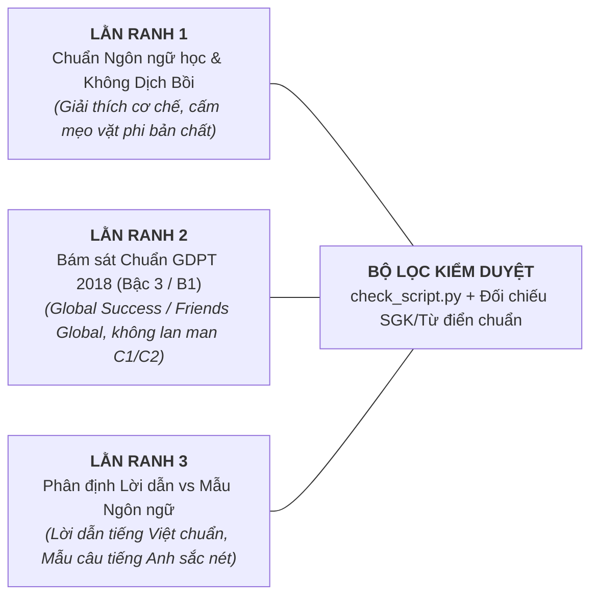
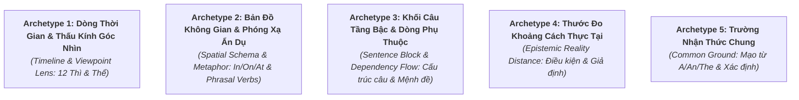

# Gói môn — Tiếng Anh (English — GDPT 2018 THPT)

Đọc kèm skill `viet-kich-ban` (B1), `tao-audio` (B2), `dung-video` (B3). Tài liệu này là **quy chuẩn cốt lõi** kết nối giữa **Biên kịch Tiếng Anh (Storyteller / Cognitive Linguist)** và **Hệ thống Dựng Video Remotion (Tech Builder)**.
Bài học kinh nghiệm thực tế ghi tại: `.gemini/lessons.md`.

---

## 1. Bản chất môn học & Tư duy kể chuyện (B1)

> [!IMPORTANT]
> **Mục tiêu tối thượng: Giải thích BẢN CHẤT NHẬN THỨC & CƠ CHẾ TƯ DUY CỦA NGƯỜI BẢN XỨ chứ không chỉ liệt kê công thức đại số khô khan hay bắt học vẹt từ vựng.**
> Học sinh Việt Nam thường sợ tiếng Anh hoặc làm bài như một cái máy vì:
> 1. *Ngữ pháp bị toán học hóa*: $S + V + O$, công thức 12 thì, công thức câu điều kiện... học sinh học vẹt nhưng không hiểu *vì sao người bản xứ lại chọn cách nói đó*.
> 2. *Nhiễu loạn tư duy mẹ đẻ (L1 Interference)*: Tiếng Việt là ngôn ngữ đơn lập, không biến hình, không có thì ngữ pháp (chỉ có từ chỉ thời gian: đã, đang, sẽ). Khi học sinh dịch máy móc từng từ, họ rơi vào mọi bẫy của đề thi.
> 3. *Học từ vựng cơ học*: Học thuộc danh sách hàng trăm phrasal verbs (*give up, look up, turn down...*) hay collocations như những sự kết hợp ngẫu nhiên, không biết rằng chúng tuân theo **ngữ pháp nhận thức không gian (Spatial Cognitive Grammar)**.
> Video của chúng ta dài **2:30 – 4:00**, tuyệt đối **KHÔNG biến video thành tiết học ngữ pháp truyền thống đọc chép hay mẹo khoanh bừa trắc nghiệm**.
> Chiến lược duy nhất: **GIẢI PHÃU GÓC NHÌN BẢN XỨ BẰNG MÔ HÌNH THỊ GIÁC (Visual Cognitive Explainer)** — Xuất phát từ một nghịch lý ngôn ngữ hoặc bẫy tư duy kinh điển $\to$ Dựng mô hình nhận thức không gian $\to$ Thấu hiểu vì sao người bản xứ tư duy như vậy $\to$ Chốt hạ bản chất và xử lý gọn gàng câu hỏi trong đề thi.

### 1.1. Năm Góc Vào Bài (Hook) Đắt Giá cho Tiếng Anh

Tùy vào chủ đề (Thì & Thể, Giới từ, Phrasal verbs, Cấu trúc câu hay Mạo từ), tự do lựa chọn 1 trong 5 góc vào bài tự nhiên và cuốn hút nhất:

1. **Nghịch lý Dịch thuật Hai Ngôn ngữ (Translation Paradox)**:
   - *Ví dụ*: "Cùng là câu 'Tôi đánh mất chìa khóa', tại sao người bản xứ khi thì nói 'I lost my key', khi lại nói 'I have lost my key'? Hai câu này khác gì nhau khi dịch sang tiếng Việt nghe y hệt? Nếu bạn nói nhầm câu thứ hai, người nghe có thể chạy đi tìm chìa khóa giúp bạn ngay lập tức!" (Bài Hiện tại hoàn thành vs Quá khứ đơn - Tiếng Anh 10).
2. **Bí mật Không gian Đời thường (Everyday Spatial Secret)**:
   - *Ví dụ*: "Tại sao chúng ta nói 'on the bus' (trên xe buýt), 'on the plane' (trên máy bay), nhưng lại bắt buộc phải nói 'in a taxi' (trong taxi) và 'in a car' (trong ô tô con)? Có phải do xe buýt to hơn xe taxi? Logic thực sự đằng sau quy ước này là gì?" (Bài Bản chất Giới từ IN vs ON - Tiếng Anh 10).
3. **Giải mã Cụm từ Kỳ quặc (Phrasal Verb Mystery)**:
   - *Ví dụ*: "Tại sao 'clean up' lại là dọn sạch bong, 'drink up' là uống cạn đáy cốc, còn 'give up' lại là từ bỏ? Chữ 'UP' vốn chỉ hướng lên trời, tại sao lại biến thành 'sự kết thúc' hay 'sự dọn sạch'? Người bản xứ đang nhìn thấy bức tranh gì trong đầu?" (Bài Bản chất hạt nhân UP trong Phrasal Verbs - Tiếng Anh 11).
4. **Bóc tách Bẫy Câu Phân hóa Đề thi (Exam Trap Demystified)**:
   - *Ví dụ*: "Trong đề thi tốt nghiệp THPT, có những câu dài 3 dòng chứa đầy từ mới khiến bạn hoang mang không biết chia động từ dạng nào. Nhưng nếu bạn biết cách bóc tách 'bộ khung xương' của câu tiếng Anh và loại bỏ lớp áo bổ nghĩa, đáp án đúng sẽ lộ diện chỉ trong 5 giây!" (Bài Rút gọn mệnh đề quan hệ V-ing / V-ed - Tiếng Anh 11/12).
5. **Nghịch lý Thời gian & Thực tại (Modal Reality Paradox)**:
   - *Ví dụ*: "Tại sao khi ước một điều ở ngay hiện tại, chúng ta lại phải dùng thì quá khứ: 'I wish I had a car'? Rõ ràng chiếc xe là mong muốn cho bây giờ, tại sao lại kéo quá khứ vào đây? Có phải người Anh bị nhầm lẫn thời gian?" (Bài Câu điều kiện loại 2 & Thức giả định - Tiếng Anh 12).

### 1.2. Ba Lằn Ranh Đỏ của Môn Tiếng Anh (Tuyệt Đối Tuân Thủ)

1. **Lằn ranh 1: Chuẩn Ngôn ngữ học Nhận thức — Tuyệt đối không dạy mẹo vặt phản khoa học**:
   - Mọi giải thích phải dựa trên cơ sở ngôn ngữ học nhận thức (Cognitive Linguistics) chuẩn xác.
   - CẤM các mẹo học vẹt vô căn cứ như "thấy chữ này thì auto khoanh chữ kia", "cứ có since là thì hiện tại hoàn thành không cần hiểu câu". Đề thi GDPT 2018 đã thay đổi triệt để để bẫy những học sinh học vẹt kiểu này.
2. **Lằn ranh 2: Chuẩn mực SGK GDPT 2018 & Khung Bậc 3 (B1)**:
   - Kiến thức và từ vựng bám sát các bộ SGK chính thức: *Global Success*, *Friends Global*, *Bright*, *i-Learn Smart World*.
   - Không lạm dụng các thuật ngữ ngôn ngữ học quá hàn lâm làm người xem hoảng sợ (ví dụ: dùng "Góc nhìn thời gian" thay vì "Telic Aspectuality", dùng "Khối bổ nghĩa" thay vì "Non-restrictive relative clause modifier").
3. **Lằn ranh 3: Phân định ranh giới Ngôn ngữ Lời dẫn (Vietnamese) và Ngôn ngữ Đích (English)**:
   - Lời thuyết minh (`speak`) sử dụng tiếng Việt tự nhiên, mạch lạc, đóng vai trò người dẫn đường tư duy.
   - Các từ ngữ, cụm từ, câu mẫu tiếng Anh phải được trình bày trang trọng, chuẩn xác trên hình ảnh (`text`, Typography) kèm phiên âm IPA khi cần thiết.

---

## 2. Phạm vi kiến thức & Tài liệu tham khảo SGK chuẩn (B1)

- **Tài liệu tham khảo SGK chuẩn**: Lưu tại `references/anh/lop-<lop>/` và `references/anh/de-thi-chinh-thuc-tot-nghiep-thpt-2025-2026.md`. Khi viết kịch bản, AI BẮT BUỘC tra cứu các file này trước để bám sát chủ đề từ vựng, điểm ngữ pháp và dạng bài trọng tâm.
- **Phạm vi trọng tâm 3 khối lớp**:
  * **Lớp 10**: Các thì cơ bản và sự phối hợp thì (Hiện tại đơn, Quá khứ đơn, Hiện tại hoàn thành); Câu bị động; Động từ khuyết thiếu (*Modals*); Giới từ không gian và thời gian (*in, on, at*).
  * **Lớp 11**: Cụm động từ (*Phrasal Verbs*); Mệnh đề quan hệ & Rút gọn mệnh đề quan hệ (V-ing, V-ed, To-V); Động từ nguyên mẫu và danh động từ (*Gerunds & Infinitives*); Liên từ & Trạng từ liên kết.
  * **Lớp 12**: Câu điều kiện (Loại 1, 2, 3 và hỗn hợp); Câu ước & Thức giả định; Đảo ngữ (*Inversions*); Câu so sánh kép (*The more..., the more...*); Mạo từ (*A/An, The, Zero Article*).

---

## 3. Mẫu dựng khái niệm — 5 Archetypes Trực quan Remotion SVG (B1 + B3)

Toàn bộ các hiện tượng ngữ pháp tiếng Anh được chuyển hóa thành 5 Archetypes hình học động trên Remotion:

### 3.1. Archetype 1: Dòng Thời Gian & Thấu Kính Góc Nhìn (Timeline & Viewpoint Lens)
- **Áp dụng cho**: 12 thì, Sự phối hợp thì (*Past Simple vs Present Perfect, Past Continuous vs Past Simple*).
- **Thành phần hình ảnh**:
  * **Trục thời gian nằm ngang**: Trục thẳng có mũi tên hướng về tương lai bên phải.
  * **Mốc NOW (Hiện tại)**: Vạch đứng phát sáng trung tâm (`#3D4AEF`), phân chia vùng Quá khứ (Past - bên trái) và Tương lai (Future - bên phải).
  * **Thấu kính quan sát (Lens / Focus)**:
    - *Past Simple*: Một khối chấm tròn cố định nằm trọn vẹn trong vùng quá khứ, hoàn toàn tách rời khỏi vạch NOW. Có nhãn thời gian đóng khung: `in 2020`, `yesterday`.
    - *Present Perfect*: Một cây cầu ánh sáng (Glowing Bridge / Stream) bắt đầu từ quá khứ và chạm đỉnh vào vạch NOW. Đầu mũi tên chạm mốc NOW sáng bừng lên, hiện nhãn: `Current Result / Relevance` (Hệ quả hiện tại).
    - *Continuous Aspect*: Khung kính lúp phóng to vào giữa khoảng thời gian, bên trong là các đường sóng chuyển động lượn sóng (`sine wave`), hai đầu mở, nhãn: `In Progress (Chưa hoàn tất)`.
- **Chuyển động (Animation)**: Dùng `interpolate` cho vệt sáng chạy dọc trục thời gian, khi nói đến "hệ quả", vệt sáng chạm vào vạch `NOW` kích hoạt nhãn kết quả bật lên sống động bằng `spring`.

### 3.2. Archetype 2: Bản Đồ Không Gian & Phóng Xạ Ẩn Dụ (Spatial Schema & Metaphor Projection)
- **Áp dụng cho**: Giới từ (*IN, ON, AT*); Cụm động từ (*Phrasal Verbs với UP, DOWN, OUT, OFF*).
- **Thành phần hình ảnh**:
  * **Bộ ba hình học cơ bản**:
    - `AT`: Chấm tiêu điểm màu đỏ (`#EF4444`) với các vòng tròn đồng tâm thu nhỏ (Target radar).
    - `ON`: Mặt phẳng tiếp xúc nằm ngang màu xanh lá (`#10B981`) với bóng tiếp xúc vật thể.
    - `IN`: Khối hộp 3 chiều màu xanh dương (`#3B82F6`) trong suốt với vật thể nằm an toàn bên trong.
  * **Cột hướng lực (Vertical Force Axis) cho Phrasal Verbs**:
    - `UP`: Trục thẳng đứng hướng lên, mức năng lượng đổ đầy từ đáy lên miệng bình $\to$ Nhãn: `MAX / COMPLETE` (*eat up, clean up*).
    - `OUT`: Hộp kín mở nắp, quả cầu sáng từ đáy bay vút ra không gian ngoài $\to$ Nhãn: `VISIBLE / REVEALED` (*find out, figure out*).
- **Chuyển động (Animation)**: Vật thể chuyển động tương tác với hình học không gian (rơi vào hộp, chạm lên mặt phẳng, bay ra ngoài).

### 3.3. Archetype 3: Khối Câu Tầng Bậc & Dòng Phụ Thuộc (Sentence Block & Dependency Flow)
- **Áp dụng cho**: Trật tự câu tiếng Anh, Cụm danh từ (*Noun Phrase*), Mệnh đề quan hệ (*Relative Clauses*), Rút gọn mệnh đề (*V-ing / V-ed*).
- **Thành phần hình ảnh**:
  * Chuỗi từ nằm ngang tự nhiên của câu. Mỗi từ/cụm từ là một Card chữ bo góc (`Sentence Block`):
    - Chủ ngữ (Subject): Màu tím than `#1E293B`.
    - Động từ chính (Main Verb): Màu xanh dương đậm `#3D4AEF` (có vương miện hoặc viền phát sáng biểu thị "Trái tim của câu").
    - Tân ngữ (Object): Màu ngọc bích `#0D9488`.
    - Cụm bổ nghĩa (Modifier / Relative Clause): Màu xám nhạt `#64748B`.
  * **Cung tên phụ thuộc (Dependency Arc)**: Mũi tên cong vút phía trên liên kết khối bổ nghĩa với từ trung tâm mà nó miêu tả.
- **Chuyển động (Animation)**:
  * Khi rút gọn mệnh đề: Hai khối chữ đại từ quan hệ (*which / who*) và trợ động từ (*is / was*) co nhỏ dần và tan biến (`opacity: 0`, `scale: 0.8`), khối động từ chính chuyển thành dạng `V-ing` (chủ động) hoặc `V-ed` (bị động) rồi trượt nhẹ vào áp sát danh từ phía trước.

### 3.4. Archetype 4: Thước Đo Khoảng Cách Thực Tại (Epistemic Reality Distance)
- **Áp dụng cho**: Câu điều kiện Loại 0, 1, 2, 3; Câu điều kiện hỗn hợp; Thức giả định (*Wishes / As if*).
- **Thành phần hình ảnh**:
  * **Mặt phẳng Thực tại (Reality Ground)**: Đường nền vững chắc màu xanh đậm, đại diện cho những gì có thật ở hiện tại và sự thật hiển nhiên.
  * **Tầng mây Giả định (Hypothetical Sky / Alternate Universe)**: Tầng không gian lơ lửng phía trên vẽ bằng nét đứt mờ ảo.
  * **Thước đo khoảng cách (Distance Marker)**: Mỗi bậc lùi thì tương ứng với một nấc thang rời xa thực tại:
    - Hiện tại đơn $\to$ Thực tại 100% (Loại 0 & 1).
    - Quá khứ đơn $\to$ Lùi 1 bước: Giả định trái ngược hiện tại (Loại 2).
    - Quá khứ hoàn thành $\to$ Lùi 2 bước: Giả định trái ngược quá khứ hoàn toàn không thể cứu vãn (Loại 3).
- **Chuyển động (Animation)**: Nhân vật hoặc tình huống bước lên các nấc thang khoảng cách. Càng lên cao, màu sắc càng chuyển sang tông tím pastel mờ ảo, làm bật lên bản chất: "Lùi thì = Lùi xa khỏi hiện thực".

### 3.5. Archetype 5: Trường Nhận Thức Chung (Common Ground Scope)
- **Áp dụng cho**: Mạo từ (*A / AN, THE, ZERO ARTICLE*).
- **Thành phần hình ảnh**:
  * Hai vòng tròn giao thoa (Venn diagram): Vòng tròn A (Tâm trí người nói - Speaker's Mind), Vòng tròn B (Tâm trí người nghe - Listener's Mind).
  * `A / AN`: Một chấm sáng ngẫu nhiên nằm lơ lửng chỉ trong vòng tròn A (Người nói biết một vật thể bất kỳ, người nghe chưa từng thấy $\to$ *Indefinite*).
  * `THE`: Chấm sáng di chuyển vào vùng giao nhau rực rỡ giữa hai vòng tròn $\to$ Cả hai đều nhìn thấy cùng một vật thể duy nhất $\to$ *Definite*.
  * `ZERO ARTICLE`: Hai vòng tròn thu nhỏ lại thành 2 hạt bụi, toàn bộ màn hình mở rộng thành vũ trụ bao la đại diện cho toàn bộ chủng loài/khái niệm chung không đếm được.

---

## 4. Số, Ký hiệu Ngữ pháp & Phiên âm IPA (B1)

- **Ký hiệu thành phần câu**:
  * Trong kịch bản và màn hình: Dùng $S$ (Chủ ngữ), $V$ (Động từ), $O$ (Tân ngữ), $M$ (Bổ ngữ).
  * Không dùng các ký hiệu toán học rối rắm trong tiếng Anh.
- **Ký hiệu thì & dạng động từ**:
  * $V_0$ hoặc $V_{\text{bare}}$: Động từ nguyên thể không "to".
  * $V_1$: Động từ chia hiện tại ($V_{s/es}$).
  * $V_2$: Động từ quá khứ đơn ($V_{ed}$).
  * $V_3$ hoặc $V_{pp}$: Quá khứ phân từ (*Past Participle*).
  * $V_{\text{ing}}$: Hiện tại phân từ / Danh động từ.
- **Bảng phiên âm quốc tế (IPA)**:
  * Khi giới thiệu phát âm từ vựng, bắt buộc đặt trong hai dấu gạch chéo `/.../` (ví dụ: `/prɪˈzent/` vs `/ˈpreznt/`).
  * Sử dụng font chữ hỗ trợ ký tự ngữ âm quốc tế đầy đủ (Plus Jakarta Sans hiển thị chuẩn IPA).

---

## 5. Đọc Tiếng Anh trong Giọng đọc Vivibe TTS (B2)

> [!CAUTION]
> **Vivibe TTS là mô hình giọng clone Tiếng Việt.**  
> Khi đọc tiếng Anh, nếu đưa nguyên câu tiếng Anh vào `speak`, mô hình sẽ đọc theo kiểu bẹt âm hoặc phát âm sai trọng âm.  
> Vì vậy, kịch bản môn Tiếng Anh bắt buộc tuân thủ bộ quy chuẩn phiên âm và chia dòng dưới đây:

### 5.1. Bảng Quy chuẩn Phiên âm cho Lời đọc (`speak`)

| Cụm ngữ pháp / Từ tiếng Anh | Viết trong `text` | Viết trong `speak` | Viết trong `caption` |
|---|---|---|---|
| $S + V + O$ | $S + V + O$ | chủ ngữ, động từ, tân ngữ | S + V + O |
| $V\text{-ing}$ | $V\text{-ing}$ | vê-ing | V-ing |
| $V\text{-ed}$ | $V\text{-ed}$ | vê-ê-đê *(hoặc "động từ quá khứ")* | V-ed |
| $V_3 / V_{pp}$ | $V_3$ | vê ba *(hoặc "quá khứ phân từ")* | V3 / Past participle |
| Past Simple | Past Simple | quá khứ đơn | Past Simple |
| Present Perfect | Present Perfect | hiện tại hoàn thành | Present Perfect |
| Past Continuous | Past Continuous | quá khứ tiếp diễn | Past Continuous |
| Passive Voice | Passive Voice | câu bị động | Passive Voice |
| Relative Clause | Relative Clause | mệnh đề quan hệ | Relative Clause |
| In / On / At | in, on, at | in... on... at | in, on, at |
| Up / Down / Out | up, down, out | ắp... đao... ao *(hoặc đọc giải nghĩa)* | up, down, out |
| Modal Verbs | Modal Verbs | động từ khuyết thiếu | Modal Verbs |

### 5.2. Chiến lược Xử lý Câu Ví Dụ Mẫu Tiếng Anh
Khi cần đưa ra một câu ví dụ tiếng Anh hoàn chỉnh (vd: *"I have lost my key"*):
1. **Visual Display là chủ đạo**: Câu tiếng Anh hoàn chỉnh hiển thị sắc nét trên màn hình bằng Typography sang trọng, có highlight màu từng cụm từ theo nhịp giải thích.
2. **Lời đọc dẫn dắt bằng nghĩa & cấu trúc**: Giọng thuyết minh tập trung phân tích nghĩa và vị trí từ thay vì cố đọc cả câu dài bằng giọng clone tiếng Việt:
   - *Ví dụ*: Thay vì ép Vivibe đọc *"Ai hæv lɔst maɪ ki"*, viết lời đọc: `"Người bản xứ nói... I have lost my key... với thì hiện tại hoàn thành."` (cho từ ngắn vào giữa dấu ngắt `...`).
3. **Mọi dòng có từ tiếng Anh BẮT BUỘC có `caption`** và phải được liệt kê vào danh sách `CẦN NGHE THỬ` để người dùng thẩm định trước khi tạo toàn bài.

---

## 6. Dựng hình Remotion & Thành phần Đồ họa (B3)

- **Brand Frame & Typography**:
  * Bọc toàn bộ video trong `BrandFrame` theo chuẩn 9Study.
  * Font chính: Plus Jakarta Sans (chữ tiếng Anh và tiếng Việt hiển thị hoàn hảo, đường nét hiện đại).
- **Bộ màu nhận diện theo vai trò (Roles)**:
  * Nền sáng chuẩn: `#F8FAFC` hoặc `#FFFFFF`.
  * Khối Chủ ngữ / Danh từ: Xanh Navy `#1E293B`.
  * Khối Động từ trung tâm: Xanh dương thương hiệu `#3D4AEF`.
  * Khối Bổ ngữ / Tính từ / Trạng từ: Tím hiện đại `#7C3AED`.
  * Điểm nhấn Cảnh báo / Bẫy đề thi: Đỏ cam `#EF4444`.
  * Điểm nhấn Bản chất / Đáp án đúng: Xanh lục bảo `#10B981`.
  * Tối đa 5 màu nhấn trong một cảnh để tránh gây rối mắt người học.
- **Component dùng lại**:
  * `SentenceBlock`: Khối thẻ từ vựng bo góc tự co giãn theo độ dài từ.
  * `TimelineAxis`: Trục thời gian có mốc NOW phát sáng và thấu kính góc nhìn.
  * `SpatialContainer`: Chiếc hộp 3D trong suốt cho giới từ `IN`.
  * `DependencyArc`: Mũi tên cong mượt mà nối giữa các khối từ bổ nghĩa.
  * `AutoLabels`: Tự động căn chỉnh nhãn giải thích không đè lên các khối từ của câu.
