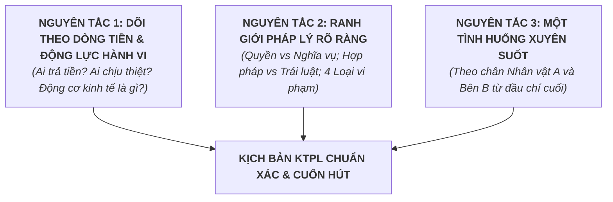
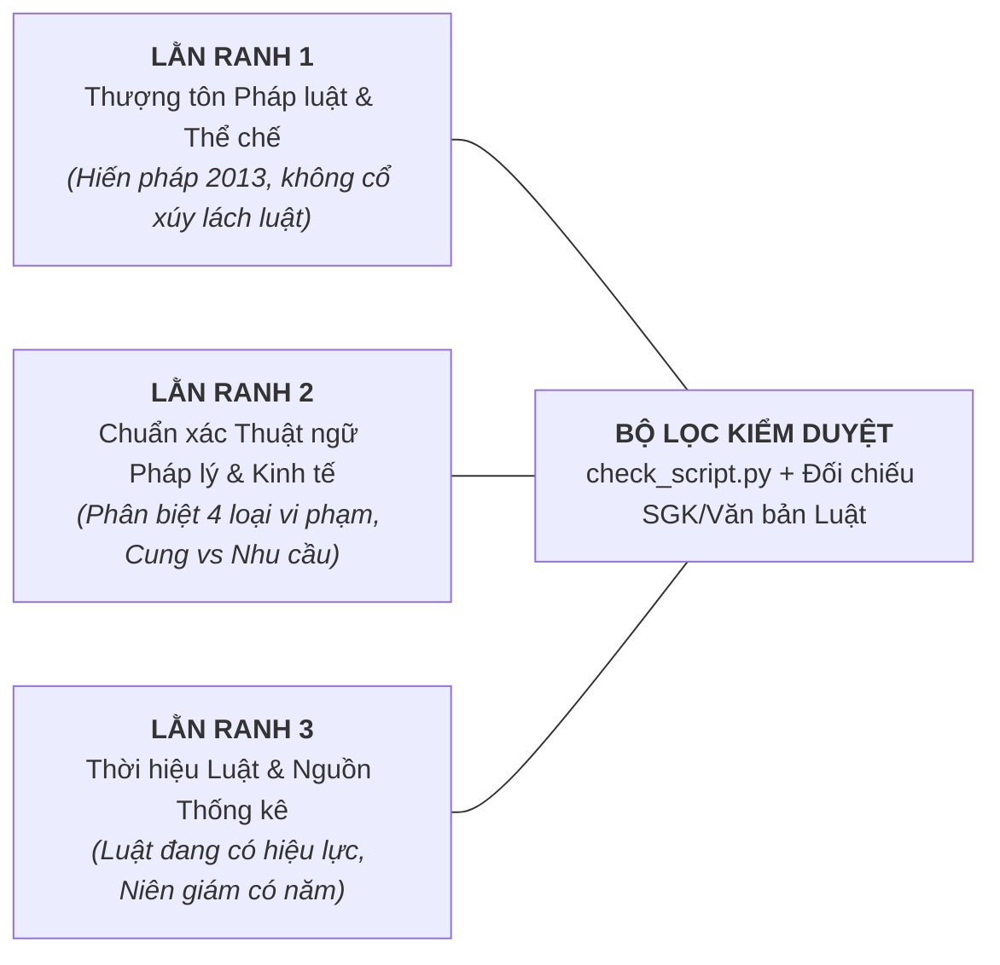
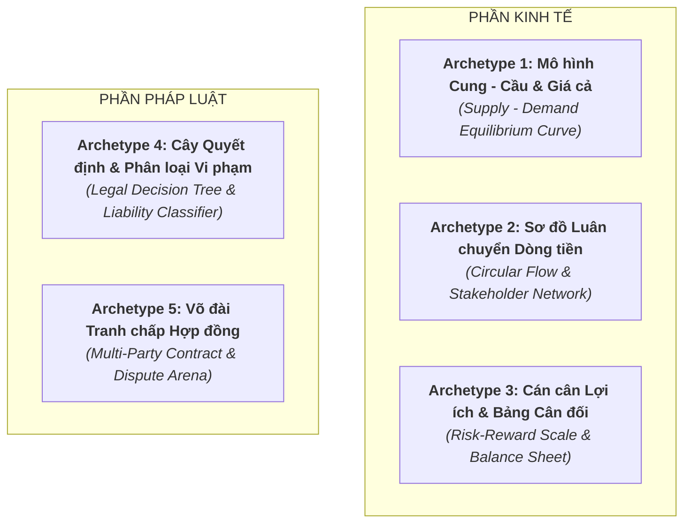

# Gói môn — Giáo dục Kinh tế và Pháp luật (GDKT&PL / KTPL — GDPT 2018 THPT)

Đọc kèm skill `viet-kich-ban` (B1), `tao-audio` (B2), `dung-video` (B3). Tài liệu này là **quy chuẩn cốt lõi** kết nối giữa **Biên kịch KTPL (Storyteller / Legal & Economic Analyst)** và **Hệ thống Dựng Video Remotion (Tech Builder)**.
Bài học kinh nghiệm thực tế ghi tại: `.gemini/lessons.md`.

---

## 1. Bản chất môn học & Tư duy kể chuyện (B1)

> [!IMPORTANT]
> **Mục tiêu tối thượng: Giải thích CƠ CHẾ VẬN HÀNH DÒNG TIỀN & BẢN CHẤT RANH GIỚI PHÁP LÝ chứ không chỉ liệt kê điều luật hay lý thuyết sách vở.**
> Học sinh thường sợ môn này vì:
> 1. *Phần Kinh tế*: Cảm giác trừu tượng, giáo điều, không thấy dòng tiền chạy đi đâu ngoài đời thực.
> 2. *Phần Pháp luật*: Sợ học vẹt từng điều khoản luật khô cứng; dễ nhầm lẫn các chủ thể và loại vi phạm trong câu hỏi tình huống đề thi.
> Video của chúng ta dài **2:30 – 4:00**, tuyệt đối **KHÔNG biến video thành giờ đọc văn bản luật hay bài giảng kinh tế học hàn lâm**.
> Chiến lược duy nhất: **GIẢI PHÃU TÌNH HUỐNG THỰC TẾ & NGHỊCH LÝ ĐỜI THƯỜNG (The Real-World Micro Case Study)** — Dùng một tình huống va chạm thực tiễn sát sườn học sinh/công dân trẻ để bóc tách: *Động lực kinh tế ngầm thúc đẩy hành vi* $\to$ *Quy luật chi phối* $\to$ *Ranh giới pháp lý điều chỉnh* $\to$ *Bài học đắt giá cho bản thân và đề thi*.

### 1.1. Năm Góc Vào Bài (Hook) Đắt Giá cho KTPL

Tùy vào chủ đề (Kinh tế đại cương, Tài chính cá nhân, Quyền công dân hay Xử lý vi phạm pháp luật), tự do lựa chọn 1 trong 5 góc vào bài tự nhiên và cuốn hút nhất:

1. **Nghịch lý Giá cả & Thị trường (Market Paradox)**:
   - *Ví dụ*: "Tại sao cùng một cốc trà sữa, 3 năm trước giá 50.000đ ly to đùng đầy ắp topping, hôm nay vẫn 50.000đ nhưng ly lại nhỏ đi một nửa và đá chiếm hết hai phần ba? Tiền của bạn đã bốc hơi đi đâu khi giá niêm yết không hề tăng?" (Bài Lạm phát - KTPL 11).
2. **Tình huống Tranh chấp Pháp lý Đời thường (Everyday Legal Dilemma)**:
   - *Ví dụ*: "Bạn vừa dọn vào phòng trọ thuê một tuần thì hôm nay đi học về thấy chủ nhà tự ý dùng chìa khóa sơ-cua mở cửa phòng vào kiểm tra đồ đạc. Liệu chủ nhà trọ có quyền làm thế không khi họ là chủ sở hữu ngôi nhà? Pháp luật bảo vệ bạn ở ranh giới nào?" (Bài Quyền bất khả xâm phạm về chỗ ở - KTPL 11).
3. **Chiếc Bẫy "Miễn phí" / Lợi nhuận Bất thường (Financial Trap & Opportunity Cost)**:
   - *Ví dụ*: "Một app cho vay tiền quảng cáo 'lãi suất 0% tháng đầu', chỉ cần chụp căn cước công dân là nhận ngay 10 triệu đồng vào tài khoản trong 5 phút. Nếu không tính lãi, họ lấy tiền đâu để nuôi bộ máy và thu lợi nhuận? Đằng sau chữ 'miễn phí' là cơ chế tín dụng ngầm nào?" (Bài Tín dụng & Dịch vụ tín dụng - KTPL 10).
4. **Bóc tách Bẫy Đề thi / Hiểu lầm Phổ biến (Exam Myth-Busting)**:
   - *Ví dụ*: "Nhiều bạn đinh ninh cứ phạm luật là bị xử phạt hành chính, hoặc hễ gây thiệt hại tiền bạc thì phải ra tòa hình sự. Sự thật là một hành vi vượt đèn đỏ đâm gãy chân người khác có thể kéo theo cùng lúc 3 loại trách nhiệm pháp lý khác nhau... Làm sao để không bị mất điểm oan ở câu trắc nghiệm Đúng/Sai?" (Bài Vi phạm pháp luật và trách nhiệm pháp lý - KTPL 12).
5. **Cán cân Xung đột Lợi ích Đa bên (Stakeholder Clash)**:
   - *Ví dụ*: "Người tiêu dùng muốn mua rau củ giá rẻ nhất; nông dân muốn bán giá cao nhất để có lãi; thương lái muốn ăn chênh lệch dày nhất; còn nhà nước muốn giữ giá ổn định để kiềm chế lạm phát. Bàn tay vô hình nào đang điều hòa cuộc giằng co này mỗi buổi sáng ở chợ?" (Bài Cơ chế thị trường & Cung - Cầu - KTPL 10/11).

### 1.2. Ba Nguyên Tắc Storytelling của Môn KTPL

1. **Dõi theo Dòng tiền & Động lực Lợi ích (Follow the Money & Incentive)**:
   - Mọi hiện tượng kinh tế đều xuất phát từ động lực: cá nhân muốn tối đa hóa tiện ích, doanh nghiệp muốn tối đa hóa lợi nhuận. Khi giải thích kinh tế, luôn làm rõ: *Tiền chảy từ túi ai sang túi ai? Ai được lợi, ai chịu rủi ro?*
2. **Ranh giới Pháp lý Rõ ràng — Khách quan, Chuẩn xác (Objective Legal Boundaries)**:
   - Pháp luật là lằn ranh trắng đen: có hiệu lực hay vô hiệu, có quyền hay có nghĩa vụ, vi phạm hay không vi phạm. Không giải thích cảm tính hay dùng đạo đức thay cho quy phạm pháp luật.
3. **Một Tình huống Xuyên suốt — Không nhảy bối cảnh**:
   - Sử dụng một cặp chủ thể cụ thể (vd: Nam mua hàng online của Shop Hoa; Chị Mai ký hợp đồng lao động với Công ty X) để dẫn dắt toàn bộ diễn biến từ lúc phát sinh nhu cầu $\to$ ký kết $\to$ xảy ra sự cố/tranh chấp $\to$ áp dụng luật để giải quyết.

---

## 2. Phạm vi kiến thức & 3 Lằn Ranh Đỏ "Sai là hỏng luôn" (B1)

KTPL gắn liền với thể chế chính trị, pháp luật thực định và quyền lợi thiết thân của công dân. Mọi kịch bản phải tuân thủ nghiêm ngặt **3 LẰN RANH ĐỎ**:

### Lằn ranh 1: Thượng tôn Pháp luật & Thể chế Chính trị Quốc gia (Tuyệt đối không vi phạm)
- Bám sát Hiến pháp nước CHXHCN Việt Nam năm 2013 và hệ thống văn bản quy phạm pháp luật hiện hành.
- **Nghiêm cấm tuyệt đối**:
  * Các nội dung hướng dẫn "lách luật", "trốn thuế", xúi giục vi phạm hợp đồng hoặc làm sai quy định nhà nước.
  * Các phát ngôn xuyên tạc vai trò lãnh đạo của Đảng, Nhà nước, bộ máy tư pháp và lực lượng vũ trang.
  * Các bình luận công kích cá nhân hay can thiệp vào các vụ án đang được xét xử chưa có bản án phúc thẩm.

### Lằn ranh 2: Chuẩn xác Tuyệt đối về Thuật ngữ Pháp lý & Khái niệm Kinh tế
- **Về Pháp luật — Không được dùng lẫn lộn các thuật ngữ**:
  * `Tạm giữ` (biện pháp ngăn chặn khẩn cấp tối đa 3-9 ngày) $\ne$ `Tạm giam` (áp dụng với bị can, bị cáo trong giai đoạn điều tra/truy tố).
  * `Khởi tố` (bắt đầu tiến trình tố tụng) $\ne$ `Truy tố` (Viện kiểm sát ra cáo trạng truy tố trước Tòa án) $\ne$ `Xét xử` (Tòa án tuyên án).
  * `Hủy bỏ hợp đồng` (hợp đồng chấm dứt từ thời điểm ký, trả lại nhau những gì đã nhận) $\ne$ `Đơn phương chấm dứt hợp đồng` (hợp đồng chấm dứt từ thời điểm nhận thông báo, phần đã thực hiện vẫn có hiệu lực).
  * `Quyền nhân thân` (gắn liền với con người: tên gọi, danh dự, hình ảnh) $\ne$ `Quyền tài sản` (quyền sở hữu, quyền sử dụng trị giá được bằng tiền).
  * Phân biệt rõ **4 loại vi phạm pháp luật**:
    1. *Vi phạm Hình sự*: Hành vi nguy hiểm cho xã hội bị quy định trong Bộ luật Hình sự (gọi là Tội phạm).
    2. *Vi phạm Hành chính*: Hành vi vi phạm quy tắc quản lý nhà nước mà không phải tội phạm.
    3. *Vi phạm Dân sự*: Xâm phạm quan hệ tài sản và quan hệ nhân thân phi tài sản.
    4. *Vi phạm Kỷ luật*: Xâm phạm quan hệ nội bộ cơ quan, tổ chức, trường học, doanh nghiệp (quy chế lao động).
- **Về Kinh tế — Chuẩn hóa tư duy logic**:
  * `Cung (Supply)`: Khối lượng hàng hóa, dịch vụ mà người bán **sẵn sàng và có khả năng bán** ở các mức giá khác nhau ($\ne$ tổng lượng hàng tồn trong kho).
  * `Cầu (Demand)`: Khối lượng hàng hóa, dịch vụ mà người mua **sẵn sàng và có khả năng chi trả** ở các mức giá khác nhau ($\ne$ mong muốn ước mơ suông).
  * `Lạm phát`: Mức giá chung của nền kinh tế tăng liên tục trong một khoảng thời gian dài ($\ne$ việc 1 mặt hàng đơn lẻ tăng giá do khan hiếm mùa vụ).

### Lằn ranh 3: Tính Thời hiệu của Văn bản Luật & Số liệu Kinh tế
- Văn bản luật viện dẫn phải là **luật hiện đang có hiệu lực** (ví dụ: Bộ luật Dân sự 2015, Bộ luật Hình sự 2015 sửa đổi bổ sung 2017, Bộ luật Lao động 2019, Luật Doanh nghiệp 2020, Luật Đất đai 2024). Tuyệt đối không dùng các văn bản luật cũ đã hết hiệu lực.
- Số liệu kinh tế (GDP, tốc độ tăng trưởng kinh tế, chỉ số giá tiêu dùng CPI, tỷ lệ thất nghiệp, vốn đầu tư nước ngoài FDI) phải có **mốc năm cụ thể** (nguồn: Tổng cục Thống kê GSO, Ngân hàng Nhà nước, Bộ Kế hoạch & Đầu tư).

---

## 3. Mẫu dựng khái niệm — 5 Archetypes Trực quan (B1 + B3)

Toàn bộ kiến thức KTPL THPT được ánh xạ thành 5 Archetypes trực quan trên Remotion SVG:

### 3.1. Archetype 1: Mô hình Cung - Cầu & Điểm Cân Bằng (Supply - Demand Equilibrium)
- **Áp dụng cho**: Thị trường và cơ chế thị trường (Lớp 10); Cung - cầu, Cạnh tranh, Giá cả, Lạm phát (Lớp 11).
- **Thành phần hình ảnh**:
  * Trục toạ độ phẳng: Trục tung $P$ (Price - Mức giá), trục hoành $Q$ (Quantity - Sản lượng).
  * Đường Cầu $D$ (Demand): Đường dốc xuống từ trái qua phải (màu xanh dương đậm `#3D4AEF`).
  * Đường Cung $S$ (Supply): Đường dốc lên từ trái qua phải (màu cam đỏ `#F45B69`).
  * Giao điểm $E_0(P_0, Q_0)$: Điểm cân bằng thị trường (chấm tròn nổi bật với đường dóng đứt nét về 2 trục).
- **Chuyển động (Animation)**:
  * Khi có cú sốc thị trường (ví dụ: mất mùa hạn hán $\to$ cung giảm): Toàn bộ đường $S$ trượt sang trái thành $S'$. Giao điểm mới $E_1(P_1, Q_1)$ hình thành sống động $\to$ đường dóng cho thấy $P$ tăng vọt lên $P_1$, sản lượng $Q$ tụt xuống $Q_1$.
  * Nhãn giải thích xuất hiện cạnh điểm: `Dư cung (Thừa hàng)` hoặc `Dư cầu (Khan hiếm)`.

### 3.2. Archetype 2: Sơ đồ Luân chuyển Dòng tiền Đa chủ thể (Circular Flow & Stakeholders)
- **Áp dụng cho**: Các chủ thể kinh tế (Lớp 10); Ngân sách nhà nước và thuế (Lớp 10); Thị trường lao động (Lớp 11); Tăng trưởng kinh tế & Hội nhập quốc tế (Lớp 12).
- **Thành phần hình ảnh**:
  * 4 Card chủ thể chính ở 4 góc/trung tâm: `Hộ gia đình / Người tiêu dùng`, `Doanh nghiệp / Người sản xuất`, `Nhà nước`, `Thị trường tài chính / Ngân hàng`.
  * Mũi tên cong khép kín kết nối các trạm.
- **Chuyển động (Animation)**:
  * Hai dòng chảy ngược chiều nhau:
    - **Dòng tiền tệ (Green Stream `#10B981`)**: Hạt particle chuyển động mang ký hiệu tiền lương $\to$ tiền mua hàng $\to$ tiền đóng thuế $\to$ tiền trợ cấp xã hội.
    - **Dòng hiện vật & Dịch vụ (Blue Stream `#4B87F4`)**: Sức lao động $\to$ Hàng hóa/dịch vụ $\to$ Cơ sở hạ tầng công cộng.
  * Hiệu ứng nghẽn mạch: Khi ngân hàng thắt chặt tín dụng hoặc người tiêu dùng giảm chi tiêu, hạt particle đi chậm lại hoặc đỏ lên cảnh báo `Suy thoái / Đóng băng`.

### 3.3. Archetype 3: Cán cân Lợi ích & Bảng Cân đối Thu - Chi (Balance Sheet & Risk Scale)
- **Áp dụng cho**: Lập kế hoạch tài chính cá nhân (Lớp 10); Tín dụng & Dịch vụ tín dụng (Lớp 10); Quản lý thu - chi trong gia đình (Lớp 11); Bảo hiểm & An sinh xã hội (Lớp 12).
- **Thành phần hình ảnh**:
  * Mô hình Cân đĩa vật lý (Cán cân công lý / Cân đối tài chính):
    - Đĩa bên trái: `Thu nhập cố định + Thu nhập phụ` (hoặc `Lợi nhuận kỳ vọng`).
    - Đĩa bên phải: `Chi tiêu thiết yếu + Chi tiêu linh hoạt + Dự phòng rủi ro` (hoặc `Chi phí cơ hội + Lãi vay`).
- **Chuyển động (Animation)**:
  * Kim cân lắc lư theo lực quán tính (`spring`). Khi nạp thêm khoản chi tiêu bốc đồng hoặc lãi vay tín dụng đen, đĩa bên phải chìm sâu xuống, báo động đỏ `Mất cân đối / Vỡ nợ`.
  * Thẻ quy tắc tài chính hiện ra cạnh cân: vd: *Quy tắc 50/30/20*, *Quỹ khẩn cấp 3–6 tháng*.

### 3.4. Archetype 4: Cây Quyết định Pháp lý & Phân loại Vi phạm (Legal Decision Tree)
- **Áp dụng cho**: Pháp luật và đời sống, Thực hiện pháp luật (Lớp 10); Quyền tự do cơ bản, Quyền bình đẳng (Lớp 11); Vi phạm pháp luật và trách nhiệm pháp lý (Lớp 12).
- **Thành phần hình ảnh**:
  * Sơ đồ phân nhánh logic dạng thác nước (Decision Flowchart) từ trên xuống dưới:
    - Nút 1: `Hành vi xảy ra` (Hành động hoặc không hành động).
    - Cổng điều kiện: `Có trái pháp luật không?` $\to$ `Có lỗi không (cố ý/vô ý)?` $\to$ `Chủ thể có năng lực trách nhiệm pháp lý không?`
    - Nút phân loại 4 nhánh:
      1. **Vi phạm Hình sự** (Badge đỏ `#EF4444`): Tội phạm nguy hiểm $\to$ Khởi tố, Tuyên phạt tù.
      2. **Vi phạm Hành chính** (Badge vàng cam `#F59E0B`): Xâm phạm trật tự quản lý $\to$ Phạt tiền, tước giấy phép.
      3. **Vi phạm Dân sự** (Badge xanh dương `#3B82F6`): Xâm phạm hợp đồng, tài sản, nhân thân $\to$ Bồi thường thiệt hại.
      4. **Vi phạm Kỷ luật** (Badge tím `#8B5CF6`): Vi phạm nội quy lao động, học tập $\to$ Khiển trách, sa thải.
- **Chuyển động (Animation)**:
  * Điểm sáng (Highlight node) di chuyển dọc theo từng câu hỏi phân tích tình huống thực tế của đề thi, dẫn người xem đến đáp án không thể chối cãi.

### 3.5. Archetype 5: Võ đài Tranh chấp Hợp đồng & Xử lý Tình huống (Contract & Dispute Arena)
- **Áp dụng cho**: Hợp đồng kinh tế, quyền và nghĩa vụ công dân (Lớp 11, 12); Giải bài tập tình huống Đúng/Sai Đề thi TN THPT.
- **Thành phần hình ảnh**:
  * Tờ Hợp đồng / Văn bản thỏa thuận nằm giữa màn hình.
  * Hai hoặc ba nhân vật / chủ thể đứng hai bên (ví dụ: `Bên A: Công ty may mặc` vs `Bên B: Người lao động 17 tuổi`).
  * Dấu mộc pháp lý đỏ đập xuống màn hình: `HỢP PHÁP` / `VÔ HIỆU TOÀN PHẦN` / `ĐƠN PHƯƠNG CHẤM DỨT TRÁI PHÁP LUẬT`.
- **Chuyển động (Animation)**:
  * Kính lúp phóng to vào một điều khoản cụ thể trong hợp đồng (vd: "Không được mang thai trong 2 năm đầu"), điều khoản này đỏ lên và gạch chéo đỏ $\to$ Thẻ pháp lý hiện ra trích dẫn: `Trái Khoản 3 Điều 137 Bộ luật Lao động 2019 $\to$ Điều khoản vô hiệu`.

---

## 4. Bảng Tra cứu Cấu trúc Chương trình THPT & Bộ SGK (Tham khảo B1)

| Lớp | Trụ cột | Tên chủ đề chính (GDPT 2018) | Bài học cốt lõi tiêu biểu |
| :---: | :---: | :--- | :--- |
| **10** | **Kinh tế** | Nền kinh tế và các chủ thể | Các chủ thể trong nền kinh tế; Thị trường và cơ chế thị trường; Giá cả thị trường; Ngân sách nhà nước; Thuế; Sản xuất kinh doanh; Tín dụng; Kế hoạch tài chính cá nhân. |
| **10** | **Pháp luật** | Hệ thống chính trị & Hiến pháp 2013 | Hệ thống chính trị nước CHXHCN Việt Nam; Bộ máy nhà nước (Quốc hội, Chủ tịch nước, Chính phủ, Tòa án); Pháp luật và đời sống; Hiến pháp 2013. |
| **11** | **Kinh tế** | Cơ chế thị trường & Kinh tế vĩ mô | Cạnh tranh trong kinh tế thị trường; Cung - cầu trong kinh tế thị trường; Lạm phát; Thất nghiệp; Thị trường lao động và việc làm; Ý tưởng kinh doanh; Đạo đức kinh doanh; Văn hóa tiêu dùng. |
| **11** | **Pháp luật** | Quyền bình đẳng & Quyền tự do cơ bản | Bình đẳng trước pháp luật; Bình đẳng giới; Bình đẳng các dân tộc, tôn giáo; Quyền bất khả xâm phạm về thân thể, chỗ ở; Quyền được bảo hộ tính mạng, sức khỏe, danh dự, nhân phẩm; Quyền bí mật thư tín; Quyền bầu cử, ứng cử, khiếu nại, tố cáo. |
| **12** | **Kinh tế** | Tăng trưởng, Hội nhập & An sinh | Tăng trưởng và phát triển kinh tế; Hội nhập kinh tế quốc tế; Bảo hiểm; An sinh xã hội; Quản lý thu - chi trong gia đình. |
| **12** | **Pháp luật** | Quyền công dân về kinh tế & Xử lý vi phạm | Quyền và nghĩa vụ về kinh tế (kinh doanh, nộp thuế); Quyền về văn hóa - xã hội; Pháp luật bảo vệ môi trường; Pháp luật về lao động, hôn nhân gia đình; **Vi phạm pháp luật và trách nhiệm pháp lý (Trọng tâm đề thi)**. |

---

## 5. Quy tắc Đọc Ký hiệu, Thuật ngữ & TTS Vivibe (B2)

Giọng đọc AI (Vivibe) cần được phiên âm chính xác để không đọc sai các ký hiệu kinh tế và văn bản luật:

### 5.1. Ký hiệu Kinh tế học
- $P$ (Price): Viết trong `speak` là `mức giá p` hoặc `giá cả`, không đọc trơ trọi chữ "pê".
- $Q$ (Quantity): Viết là `sản lượng quy` hoặc `lượng hàng hóa`.
- $S$ (Supply): Viết là `đường cung ét-sơ` hoặc `lực cung`.
- $D$ (Demand): Viết là `đường cầu đê` hoặc `lực cầu`.
- $E_0, E_1$: Viết là `điểm cân bằng e-không`, `điểm cân bằng e-một`.
- GDP: Viết là `gê-đê-pê` hoặc `tổng sản phẩm quốc nội`.
- CPI: Viết là `xê-pê-i` hoặc `chỉ số giá tiêu dùng`.
- FDI: Viết là `ép-đê-i` hoặc `vốn đầu tư trực tiếp nước ngoài`.

### 5.2. Đơn vị Tiền tệ & Tỉ lệ Phần trăm
- `50.000 VNĐ` / `50.000đ`: Viết trong `speak` là `năm mươi nghìn đồng` (tuyệt đối không viết "vê-nờ-đê").
- `10%`: Viết là `mười phần trăm`.
- `3,5 tỷ USD`: Viết là `ba phẩy năm tỷ đô-la`.

### 5.3. Viết tắt Văn bản Quy phạm Pháp luật
- `BLDS 2015`: Viết là `Bộ luật Dân sự năm hai nghìn không trăm mười lăm`.
- `BLHS 2015`: Viết là `Bộ luật Hình sự`.
- `Khoản 1 Điều 158`: Viết là `khoản một, điều một trăm năm mươi tám`.
- `Bên A`, `Bên B`: Viết là `bên a`, `bên bê`.
- `TNHH`: Viết là `trách nhiệm hữu hạn`.

---

## 6. Chiến lược Chinh phục Đề thi Tốt nghiệp THPT từ năm 2025 (B1 & B3)

Cấu trúc đề thi mới của Bộ GD&ĐT gồm 2 phần trong 50 phút:
1. **Phần I: 24 câu trắc nghiệm 4 lựa chọn (6,0 điểm)**:
   - Đánh giá Nhận biết & Thông hiểu các khái niệm cơ bản.
   - Video giúp học sinh: Khắc sâu bản chất bằng hình ảnh trực quan (vd: nhìn mô hình Cung - Cầu là nhớ ngay nguyên nhân giá tăng, không cần học vẹt).
2. **Phần II: 4 câu hỏi dạng Đúng/Sai với 16 lệnh hỏi (4,0 điểm)**:
   - Đây là phần **phân hóa quyết định học sinh giỏi/xuất sắc**. Đề bài đưa ra một đoạn văn bản Case Study thực tế phức tạp từ 150-250 từ với 4-6 nhân vật tương tác (doanh nghiệp, người tiêu dùng, cơ quan chức năng, nhân viên...).
   - **Bẫy thường gặp nhất**: Học sinh thường quy chụp sai tư cách pháp lý (nhầm lỗi cố ý thành vô ý, nhầm vi phạm dân sự sang hình sự, nhầm giữa quyền và nghĩa vụ).
   - **Nhiệm vụ của Video Remotion**:
     - Beat "TRONG ĐỀ THI" hoặc "BẪY THƯỜNG GẶP": Dựng lại nguyên mẫu một câu trắc nghiệm Đúng/Sai trích từ đề minh họa/đề thi chính thức của Bộ GD&ĐT.
     - Dùng Archetype 4 (Cây quyết định) hoặc Archetype 5 (Võ đài hợp đồng) để giải mã từng lệnh hỏi a, b, c, d với dấu tick xanh `✓ ĐÚNG` hoặc gạch đỏ `✗ SAI` kèm lý do thuyết phục đến từng chân tơ kẽ tóc.
