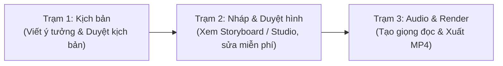

# Hướng dẫn Dành cho Creator / User (Chỉ cần Prompt)

> **Dành cho**: Giáo viên, biên tập viên nội dung, học sinh hoặc thành viên trong nhóm chỉ cần clone repo về, đưa đề bài và ra lệnh (prompt) cho AI để tạo video giải thích bản chất hoàn chỉnh từ A đến Z.
>
> [!NOTE]
> **Làm video KHÔNG CẦN tạo nhánh Git**:
> Bạn chỉ cần làm việc trực tiếp trên bản clone nhánh chính tại máy của mình (`local`). Toàn bộ kịch bản và video render ra (`out/`) sẽ nằm trên máy bạn để bạn tự lưu trữ/sử dụng. Bạn không cần bận tâm về việc chia nhánh hay quản lý Git!
>
> Xem chi tiết: [Đối chiếu bản Git vs Bản Local & Cách xử lý Output](LOCAL_VS_GIT_VA_OUTPUT.md)

---

## 1. Chuẩn bị Môi trường (Chỉ làm 1 lần duy nhất)

### Bước 1: Clone dự án về máy
Mở Terminal / PowerShell và chạy:
```bash
git clone https://github.com/PhcdY/remotion_claudecode.git "Video AI"
cd "Video AI"
```

### Bước 2: Cài đặt thư viện
```bash
npm install
```

### Bước 3: Cấu hình file `.env` (API Key & Nơi lưu Video tự động)
Tạo một file tên là `.env` ở ngay thư mục gốc của dự án với nội dung:
```env
# 1. API Key giọng đọc Vivibe (TTS)
VIVIBE_API_KEY=dien_api_key_cua_ban_vao_day

# 2. (Khuyên dùng) Nơi tự động lưu Video thành phẩm ra ổ riêng hoặc Google Drive:
# Nếu bỏ trống, mặc định sẽ lưu vào thư mục 'out/' bên trong dự án.
OUTPUT_DIR="D:/Video_Thanh_Pham"
# hoặc Google Drive: OUTPUT_DIR="G:/My Drive/9Study_Videos"
```

> [!TIP]
> **Điểm tiện lợi của `OUTPUT_DIR`**: Khi cài đặt dòng này, toàn bộ video `.mp4` và ảnh storyboard khi render sẽ **tự động xuất thẳng vào ổ cá nhân hoặc Google Drive của bạn**, hoàn toàn tách biệt khỏi thư mục code. Bạn không bao giờ phải kéo file thủ công và không bao giờ lo mất video!
*(Nếu bạn chưa có key Vivibe, bạn vẫn có thể tạo kịch bản, dựng hình nháp và xem video hoàn toàn miễn phí trên Remotion Studio).*

---

## 2. Quy trình 3 Trạm Làm Video (100% bằng Prompt)

Quy trình được thiết kế theo 3 trạm rõ ràng. Bạn chỉ cần copy các câu prompt mẫu dưới đây gửi cho AI:



---

### 🟢 Trạm 1: Viết kịch bản giải thích bản chất

Bạn chỉ cần đưa chủ đề, môn học và ý cốt lõi bạn muốn giải thích. AI sẽ tự động đọc tài liệu SGK chuẩn trong thư mục `references/<môn>/...` trước khi viết kịch bản.

**Prompt mẫu gửi AI:**
> *"Tôi muốn làm video giải thích bản chất cho bài: **[Tên bài học]** (Môn: [Toán/Lý/Hoá...], Lớp: [10/11/12]).*  
> *Hiện tượng thực tế: [Mô tả hiện tượng đời thực dẫn dắt, ví dụ: định vị GPS, máy bay cất cánh...].*  
> *Bản chất cốt lõi cần giải thích: [Ý vì sao cần truyền tải].*  
> *Hãy tham khảo SGK tương ứng trong references/ và lên kịch bản chi tiết theo skill viet-kich-ban."*

**Sau khi AI phản hồi:**
1. AI sẽ tạo file kịch bản `script.json` và tự động kiểm tra cú pháp bằng script `check_script.py`.
2. Bạn đọc qua kịch bản, nếu muốn thêm/bớt ý nào, chỉ cần bảo AI chỉnh sửa.
3. Khi bạn thấy ưng ý, chốt bằng câu: *"Kịch bản này duyệt, chuyển sang dựng nháp!"*

---

### 🟡 Trạm 2: Dựng hình nháp & Duyệt giao diện (Storyboard)

> [!TIP]
> **Điểm ưu việt**: Ở bước này, AI dựng toàn bộ chuyển động, đồ thị, vector với thời gian giả lập. **Bạn chưa mất 1 đồng credit giọng đọc nào**, có thể yêu cầu AI đổi màu, chỉnh toạ độ, thay layout thoải mái!

**Prompt mẫu gửi AI:**
> *"Kịch bản đã duyệt, hãy dựng video nháp và xuất storyboard cho bài này."*

**Cách bạn xem và duyệt sản phẩm:**
- **Cách 1 (Xem nhanh dạng ảnh)**: Mở ảnh storyboard được sinh ra tại:
  `out/_lam-viec/<slug>/storyboard.png` để nhìn tổng thể các cảnh từ đầu đến cuối.
- **Cách 2 (Xem chuyển động trực tiếp)**: Mở một terminal gõ:
  ```bash
  npm run dev
  ```
  Trình duyệt sẽ mở **Remotion Studio** (tại `http://localhost:3000`). Bạn nhấn Play để xem video chạy như thật.

**Nếu cần sửa giao diện, prompt mẫu:**
> *"Ở beat 2 dòng 3, hãy đổi màu vector sang màu xanh chàm và tăng cỡ chữ to lên một chút cho dễ nhìn."*

---

### 🔴 Trạm 3: Tạo giọng đọc (TTS) & Render video thành phẩm

Khi hình ảnh đã vừa mắt, bạn tiến hành tạo âm thanh thật và xuất file video. Hệ thống tích hợp Roster 3 giọng đọc Vivibe chuẩn hóa theo từng bộ môn:
- **`nam - c Bình`**: Giọng nam dứt khoát, logic, chuẩn mực — Khuyên dùng cho môn Tự nhiên (Toán, Lý, Hóa, Sinh).
- **`nữ - c Nhi`**: Giọng nữ truyền cảm, ấm áp, nhịp nhàng — Khuyên dùng cho môn Xã hội (Sử, Địa, Văn, KTPL).
- **`anh-male`**: Giọng bản xứ chuẩn IPA song ngữ — Khuyên dùng cho môn Tiếng Anh.

> [!TIP]
> **Đa giọng (Multi-Voice)**: Bạn có thể yêu cầu kịch bản đổi giọng đọc linh hoạt theo từng cảnh/dòng (ví dụ: cảnh dẫn chuyện dùng giọng nữ, cảnh giải thích công thức dùng giọng nam, câu hội thoại tiếng Anh dùng giọng bản xứ). Hệ thống tự động xử lý chuyển giọng mượt mà!

**Prompt mẫu gửi AI:**
> *"Hình ảnh và kịch bản đã duyệt hoàn toàn. Hãy tạo giọng đọc audio qua Vivibe TTS (dùng giọng [nam - c Bình / nữ - c Nhi / anh-male]) và render video thành phẩm."*

**Kết quả nhận được:**
Video MP4 độ phân giải cao 1080p kèm phụ đề tự động sẽ được xuất vào thư mục:
`out/<Môn>/Lớp <lop>/<Chương>/<Bài>/...mp4`

---

## 3. Các Prompt Tiện ích Hỗ trợ Rất Hay Dùng

### 1. Nhờ "Học sinh ảo" phản biện kịch bản
Muốn biết kịch bản của bạn có bị quá khó hiểu hoặc nhảy cóc kiến thức không:
> *"Hãy đóng vai học sinh ảo (skill hoc-sinh-ao) đọc kịch bản bài này và chỉ ra các điểm nhảy bước hoặc khó hiểu đối với học sinh trung bình."*

### 2. Thu gọn bộ nhớ AI (Tiết kiệm Token & tránh lag)
Sau khi kết thúc mỗi trạm (ví dụ xong Trạm 1 chốt kịch bản), hãy gõ lệnh:
> `/compact`  
*(Lệnh này giúp AI dọn dẹp ngữ cảnh cũ, giữ lại các quyết định quan trọng để làm trạm tiếp theo nhanh và thông minh hơn).*

### 3. Kiểm tra xem video đang render đến đâu
Nếu video đang render ở chế độ nền:
> *"Kiểm tra giúp tôi render đã xong chưa và báo tiến độ hiện tại."*

---

## 4. Bảng Tra cứu Mã Môn & Quy tắc Chung

- **Bảng mã môn chuẩn**:
  - `toan`: Toán học (Đồ thị hàm số, hình không gian Oxyz, vector, giải tích)
  - `ly`: Vật lí (Cơ học, điện từ, sóng, quang học, nhiệt động lực)
  - `hoa`: Hóa học (Cơ chế phản ứng, liên kết, danh pháp IUPAC, công thức cấu tạo)
  - `sinh`: Sinh học (Di truyền học, tế bào, tiến hóa, sinh thái)
  - `su`: Lịch sử (Dòng chảy sự kiện, bản đồ chiến dịch, tư liệu lịch sử)
  - `dia`: Địa lí (Khung 4 tầng thời sự nóng, cơ chế địa lí, bản đồ chủ quyền chuẩn UNCLOS 1982)
  - `van`: Ngữ văn (Cấu trúc văn bản nghệ thuật, thi pháp, phong cách ngôn ngữ)
  - `ktpl` (hoặc `gtktpl`): Giáo dục Kinh tế và Pháp luật (Micro Case Study đời thường, cây quyết định pháp lý)
  - `anh` (hoặc `tienganh`): Tiếng Anh (5 Archetypes Ngữ pháp nhận thức Cognitive Grammar)
- **Roster giọng đọc Vivibe**:
  - `nam - c Bình`: Dành cho các môn Tự nhiên.
  - `nữ - c Nhi`: Dành cho các môn Xã hội.
  - `anh-male`: Dành cho Tiếng Anh (chuẩn IPA).
- **Từ điển phát âm tự động**: `scripts/phonetic_dict.json` tự động chuẩn hoá cách đọc danh pháp IUPAC, công thức cấu tạo, từ viết tắt và ký hiệu khoa học.
- **Tài liệu tham khảo SGK**: Nằm tại `references/<môn>/...` (đã trích xuất sẵn nội dung cốt lõi).
- **Tỷ lệ khung hình chuẩn**: 16:9 (1920 × 1080), 30 fps.
- **Thời lượng tối ưu**: Từ 2 phút 30 giây đến 4 phút (giải thích sâu bản chất, không nhảy cóc).
- **Bộ màu chuẩn 9Study**: Xanh chủ đạo `#4B87F4`, Chàm `#3D4AEF`, Chữ xanh đen Navy, Nền sáng hiện đại.
- **Chi tiết về Output & Khác biệt bản Git**: Xem [LOCAL_VS_GIT_VA_OUTPUT.md](LOCAL_VS_GIT_VA_OUTPUT.md).

---

## 5. Cập nhật Hệ thống (Không sợ mất bài cũ)

Khi hệ thống cập nhật thêm component đồ hoạ mới, sửa lỗi script hoặc bổ sung gói môn mới, bạn **không cần cài lại hay xoá thư mục đi clone lại**.

Chỉ cần mở Terminal tại thư mục dự án và chạy:
```bash
git pull origin gemini   # hoặc git pull origin main
```
- **Không bao giờ mất bài cũ**: Toàn bộ kịch bản và video bạn đã làm trong máy vẫn còn nguyên vẹn 100%.
- **Nhận công cụ mới**: Máy bạn sẽ tự động có thêm các component và tính năng mới nhất từ hệ thống!
