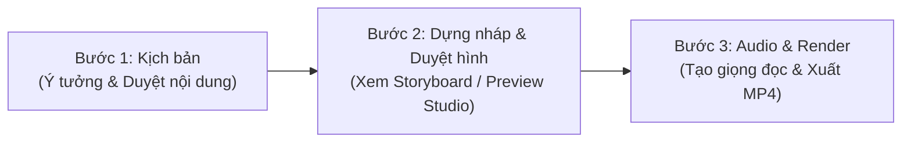

# Hướng dẫn Dành cho Cộng tác viên Làm Video

> **Dành cho cộng tác viên**: Chỉ cần clone dự án về, đưa đề bài/ý tưởng bài học và duyệt từng bước để cùng AI hoàn thành video giải thích bản chất chuẩn chỉnh từ A đến Z.
>
> [!NOTE]
> **Làm video KHÔNG CẦN tạo nhánh Git**:
> Bạn chỉ cần làm việc trực tiếp trên bản clone nhánh chính tại máy cá nhân (`local`). Toàn bộ kịch bản và video render ra (`out/`) sẽ nằm trên máy bạn để bạn tự lưu trữ và sử dụng. Bạn không cần bận tâm về việc chia nhánh hay quản lý Git!
>
> Xem chi tiết: [Đối chiếu bản Git vs Bản Local & Cách xử lý Output](LOCAL_VS_GIT_VA_OUTPUT.md)

---

## 1. Chuẩn bị Môi trường & Codex (Chỉ làm 1 lần duy nhất)

### 1.1. Tải & Cài đặt 4 Công cụ Cần thiết
Trước khi bắt đầu, hãy cài đặt 4 công cụ chuẩn sau trên máy tính của bạn:

1. **[Node.js](https://nodejs.org/) (Bắt buộc chọn bản LTS)**:
   - **Tác dụng**: Bộ máy thực thi JavaScript/TypeScript để render video đồ hoạ Remotion.
   - **Cách tải & cài**: Vào [nodejs.org](https://nodejs.org/), bấm vào ô màu xanh **LTS** (phiên bản ổn định lâu dài, ví dụ v20 hoặc v22). Tải file cài đặt về (`.msi` trên Windows), mở lên và bấm *Next* liên tục với các tuỳ chọn mặc định cho đến khi hoàn tất.
   - **Kiểm tra**: Mở Terminal/PowerShell gõ `node -v` và `npm -v` thấy hiện phiên bản là đã xong.

2. **[Git](https://git-scm.com/)**:
   - **Tác dụng**: Dùng để tải mã nguồn dự án về máy và cập nhật tính năng mới từ hệ thống.
   - **Cách tải & cài**: Vào [git-scm.com/download/win](https://git-scm.com/download/win), tải bản *64-bit Git for Windows Setup*. Chạy file cài đặt, giữ nguyên toàn bộ tuỳ chọn mặc định và bấm *Next* đến hết.
   - **Kiểm tra**: Mở Terminal gõ `git --version` thấy hiện `git version 2.x.x` là thành công.

3. **[Python 3](https://www.python.org/) (Bản 3.10 trở lên)**:
   - **Tác dụng**: Chạy các script tự động kiểm tra kịch bản (`check_script.py`), đối soát phát âm danh pháp và kết nối giọng đọc Vivibe TTS.
   - **Cách tải**: Vào [python.org/downloads](https://www.python.org/downloads/), bấm nút tải bản Python mới nhất.
   - ⚠️ **LƯU Ý CỰC KỲ QUAN TRỌNG KHI CÀI TRÊN WINDOWS**:  
     Ngay tại màn hình đầu tiên khi vừa mở file cài đặt Python, bạn **BẮT BUỘC PHẢI TÍCH CHỌN** vào ô vuông:  
     `☑ Add python.exe to PATH` (nằm ở mép dưới cùng cửa sổ). Sau đó mới bấm *Install Now*. *(Nếu quên tích ô này, máy tính sẽ báo lỗi không nhận diện được lệnh `py` hay `python` trong Terminal)*.
   - **Kiểm tra**: Mở Terminal gõ `py --version` (hoặc `python --version`) thấy hiện phiên bản Python là chuẩn.

4. **[Codex](https://developers.openai.com/codex)** (khuyên dùng extension Codex trong [VS Code](https://code.visualstudio.com/)):
   - **Tác dụng**: Trợ lý AI bạn trò chuyện cùng để viết kịch bản, dựng hình, tạo giọng đọc và render video.
   - **Cách cài**: VS Code → Extensions (`Ctrl + Shift + X`) → tìm **Codex** (OpenAI) → Install → đăng nhập tài khoản ChatGPT. Hoặc dùng bản dòng lệnh: `npm install -g @openai/codex`.
   - Chi tiết: [Hướng dẫn dùng Codex](HUONG_DAN_CODEX.md).

---

### 1.2. Chọn Thư mục Lưu & Tải Dự án về Máy (Clone Repo)

Bạn hoàn toàn chủ động chọn lưu dự án ở bất kỳ ổ đĩa nào bạn muốn (ví dụ ổ `D:`, `E:` hoặc thư mục làm việc riêng để không chiếm dung lượng ổ hệ thống `C:`):

1. Mở **Terminal** (hoặc **PowerShell** trên Windows).
2. Điều hướng (`cd`) đến thư mục bạn muốn lưu dự án:
   ```bash
   # Ví dụ: Bạn muốn lưu dự án trong thư mục Projects ở ổ D:
   cd D:\
   mkdir "Projects"      # (Tùy chọn) Tạo thư mục Projects nếu chưa có
   cd "Projects"
   ```
3. Chạy lệnh clone toàn bộ dự án từ GitHub:
   ```bash
   git clone -b main-codex https://github.com/PhcdY/remotion_claudecode.git "Video AI"
   cd "Video AI"
   ```
4. Cài đặt các thư viện đồ họa và công cụ toán học:
   ```bash
   npm install
   ```

> [!IMPORTANT]
> **Dùng nhánh chính `main-codex`** (lệnh clone ở trên đã chọn sẵn nhánh này).
> Tag `v1.0.0` là bản cũ dùng với Gemini/Antigravity: không có `AGENTS.md` nên Codex không đọc được quy chuẩn dự án. **Không checkout `v1.0.0` khi làm với Codex.**
> Khi đội ngũ phát hành bản ổn định mới cho Codex, bạn cập nhật bằng `git fetch --tags && git checkout <tag-mới>`.

---

### 1.3. Làm việc với Codex (Không gian Làm việc Chính)

> [!TIP]
> **Xem hướng dẫn chi tiết**: [Hướng dẫn dùng Codex](HUONG_DAN_CODEX.md) (cài đặt, gọi skill, lệnh `/`, agent con, quyền chạy lệnh).

1. **Mở dự án trong Codex**:
   - **VS Code**: `File` $	o$ `Open Folder...` $	o$ chọn đúng thư mục `Video AI` vừa clone $	o$ mở khung Codex ở thanh bên.
   - **Dòng lệnh**: `cd` vào thư mục `Video AI` rồi gõ `codex`.
   - Phải mở đúng thư mục gốc (nơi có `AGENTS.md`) thì Codex mới đọc được quy chuẩn và skill.
2. **Trò chuyện bằng tiếng Việt**: đưa đề bài bài học, Codex làm từng trạm và dừng chờ bạn duyệt.
3. **Gọi skill bằng `$ten-skill`** (không bắt buộc, Codex thường tự chọn đúng):
   - `$viet-kich-ban`: Bước 1, viết kịch bản.
   - `$dung-video <slug>`: dựng nháp, storyboard, hoàn thiện video.
   - `$tao-audio <slug>`: tạo giọng đọc Vivibe.
4. **Thẩm định 3 cổng tự động**: Codex đọc SGK trong `references/`, kiểm tra kịch bản bằng `check_script.py`, rồi giao cho agent con "Học sinh ảo" (`hoc-sinh-ao`, định nghĩa ở `.codex/agents/hoc-sinh-ao.toml`) phản biện trước khi bạn tạo audio.
5. **Gõ `/compact` sau mỗi trạm** (chốt kịch bản, duyệt storyboard, có audio) để Codex làm nhanh và đỡ tốn lượt dùng.
6. **Xem video chuyển động**: mở một Terminal riêng tại thư mục dự án, chạy `npm run dev`, rồi mở `http://localhost:3000`.

---

### 1.4. Cấu hình file `.env` (API Key & Thư mục xuất Video)

Tạo một file tên là `.env` ở ngay thư mục gốc của dự án (`Video AI/.env`) với nội dung:
```env
# 1. API Key giọng đọc Vivibe (TTS) - Bắt buộc khi tạo âm thanh thật (Bước 3)
VIVIBE_API_KEY=dien_api_key_cua_ban_vao_day

# 2. (Tùy chọn) Nơi tự động lưu Video thành phẩm ra ổ riêng hoặc Google Drive:
# Nếu bỏ trống, video mặc định sẽ xuất vào thư mục 'out/' bên trong dự án.
OUTPUT_DIR="D:/Video_Thanh_Pham"
# hoặc Google Drive: OUTPUT_DIR="G:/My Drive/9Study_Videos"
```

> [!TIP]
> **Làm sao để lấy đường dẫn Google Drive cho `OUTPUT_DIR`?**
> 1. Tải và cài đặt phần mềm [**Google Drive for Desktop**](https://www.google.com/drive/download/) trên máy tính.
> 2. Đăng nhập tài khoản Google của bạn. Google Drive sẽ tự động xuất hiện dưới dạng một **ổ đĩa ảo** trong máy (thường là ổ `G:\My Drive\` trên Windows hoặc `~/Google Drive/` trên macOS).
> 3. Mở File Explorer, vào ổ `G:\My Drive\` tạo một thư mục (ví dụ `9Study_Videos`).
> 4. Copy đường dẫn thư mục đó và dán vào `.env` (dùng dấu gạch chéo `/`):
>    ```env
>    OUTPUT_DIR="G:/My Drive/9Study_Videos"
>    ```
>    Toàn bộ video `.mp4` và ảnh khi render xong sẽ **tự động lưu thẳng vào Google Drive và đồng bộ lên mây**, hoàn toàn không lo đầy ổ C hay mất dữ liệu!

*(Nếu bạn chưa có API key Vivibe, bạn vẫn có thể làm Bước 1 và Bước 2 để lên kịch bản, dựng nháp và xem trước video hoàn toàn miễn phí).*

---

## 2. Quy trình 3 Bước Làm Video

Quy trình sản xuất được chuẩn hóa thành **3 bước tuần tự**. Mọi câu prompt mẫu dưới đây đều là **tùy chọn (optional)** — bạn có thể trò chuyện tự nhiên với AI bằng tiếng Việt theo cách của bạn, hoặc bảo AI tự mở công cụ xem trước mà không cần nhớ câu lệnh.



---

### 🟢 Bước 1: Viết kịch bản giải thích bản chất

- **Bắt buộc**:
  - Cung cấp: Tên bài học, môn học, lớp học và hiện tượng/ý bản chất cần truyền tải.
  - Kiểm tra cú pháp kịch bản: File `src/videos/<slug>/script.json` phải đạt 0 lỗi khi chạy `py scripts/check_script.py <slug>`.
  - Bạn đọc duyệt nội dung kịch bản trước khi chuyển bước.
- **Tùy chọn (Prompt gợi ý tham khảo)**:
  > *"Tôi muốn làm video giải thích bản chất cho bài: **[Tên bài học]** (Môn: [Toán/Lý/Hóa...], Lớp: [10/11/12]).*  
  > *Hiện tượng thực tế: [Ví dụ: định vị GPS, máy bay cất cánh, sạc pin...].*  
  > *Bản chất cốt lõi: [Ý vì sao cần truyền tải].*  
  > *Hãy tham khảo SGK tương ứng trong references/ và lên kịch bản chi tiết."*  
  *(Hoặc bạn chỉ cần nói ngắn gọn: "Hãy viết kịch bản bài Khảo sát hàm số Toán 12 theo chuẩn bản chất giúp tôi").*
- **Cách chốt Bước 1**:
  AI sẽ tạo file kịch bản `script.json`. Bạn đọc qua nội dung, bảo AI thêm bớt ý nếu muốn. Khi vừa ý, bạn chỉ cần nhắn: *"Kịch bản duyệt rồi, sang bước dựng nháp nhé!"*

---

### 🟡 Bước 2: Dựng hình nháp & Duyệt giao diện (Storyboard / Preview)

> [!TIP]
> **Điểm ưu việt tuyệt đối**: Ở bước này, AI dựng toàn bộ chuyển động, đồ thị, không gian Oxyz và hiệu ứng với thời gian giả lập (`draft: true`). **Bạn chưa tốn một đồng credit âm thanh nào**, có thể yêu cầu AI đổi màu, chỉnh toạ độ, thay bố cục thoải mái!

- **Bắt buộc**:
  - Duyệt tổng thể hình ảnh, nhãn chữ, công thức xem có bị đè nét, lệch toạ độ hay tràn thẻ hay không trước khi tốn credit tạo giọng đọc thật.
- **Cách bạn xem sản phẩm**:
  1. **Storyboard (xem nhanh mọi cảnh)**:  
     Ở bước nháp, skill `dung-video` tự xuất storyboard và gửi bạn đường dẫn. Muốn xuất lại thì nhắn:  
     > *"Xuất lại storyboard các cảnh cho tôi xem."*  
     *(Mở file `out/_lam-viec/<id>/storyboard/index.html` bằng trình duyệt: mỗi dòng lời đọc một ảnh, kèm chữ và thay đổi trên hình).*
  2. **Remotion Studio (xem chuyển động)**:  
     Mở một Terminal riêng tại thư mục dự án (trong VS Code: `Ctrl + J`), chạy `npm run dev`, rồi mở `http://localhost:3000` và bấm Play. Để Terminal đó chạy suốt lúc làm; Codex sửa code thì Studio tự cập nhật.
- **Tùy chọn (Yêu cầu chỉnh sửa giao diện nếu chưa ưng ý)**:
  > *"Ở cảnh 2, hãy đổi màu vector sang màu xanh chàm và tăng cỡ chữ nhãn to lên một chút."*

---

### 🔴 Bước 3: Tạo giọng đọc (TTS) & Render video thành phẩm

Khi kịch bản và hình ảnh đã được bạn duyệt hoàn toàn, tiến hành tạo âm thanh thật và xuất file video.

- **Bắt buộc**:
  - Đã có `VIVIBE_API_KEY` trong file `.env`.
  - Chọn giọng đọc chuẩn hóa theo bộ môn trong Roster:
    - **`nam - c Bình`**: Giọng nam dứt khoát, logic, chuẩn mực — Khuyên dùng cho môn Tự nhiên (Toán, Lý, Hóa, Sinh).
    - **`nữ - c Nhi`**: Giọng nữ truyền cảm, ấm áp, nhịp nhàng — Khuyên dùng cho môn Xã hội (Sử, Địa, Văn, KTPL).
    - **`anh-male`**: Giọng bản xứ chuẩn IPA song ngữ — Khuyên dùng cho môn Tiếng Anh.
- **Tùy chọn (Đa giọng - Multi-Voice)**:
  Bạn có thể yêu cầu đổi giọng theo từng cảnh/nhân vật (ví dụ: người dẫn chuyện giọng nữ, công thức giọng nam, hội thoại tiếng Anh giọng bản xứ). Hệ thống tự động chuyển đổi mượt mà!
- **Prompt mẫu gửi AI (Tùy chọn)**:
  > *"Hình ảnh và kịch bản đã duyệt hoàn toàn. Hãy tạo giọng đọc audio Vivibe (dùng giọng [nam - c Bình / nữ - c Nhi / anh-male]) và render video thành phẩm giúp tôi."*
- **Kết quả nhận được**:
  Video MP4 Full HD 1080p, 30fps kèm phụ đề tự động sẽ được xuất vào:
  - `out/<Môn>/Lớp <lop>/<Chương>/<Bài>/...mp4`
  - Hoặc lưu thẳng vào thư mục `OUTPUT_DIR` (ổ riêng hoặc Google Drive) nếu bạn đã cài đặt trong `.env`.

---

## 3. Các Tiện ích Hỗ trợ Rất Hay Dùng (Tất cả đều Tùy chọn - Optional)

### 1. Nhờ "Học sinh ảo" phản biện kịch bản
Muốn biết kịch bản của bạn có bị quá khó hiểu, hàn lâm hoặc nhảy cóc kiến thức không:
> *"Giao cho agent con `hoc-sinh-ao` đọc kịch bản bài này và chỉ ra các điểm nhảy bước. Tiền đề: học sinh đã học [...], chưa học [...]."*

*(Agent con này định nghĩa ở `.codex/agents/hoc-sinh-ao.toml`. Các skill `viet-kich-ban` và `dung-video` đã tự gọi nó; chỉ nhắn thêm khi bạn muốn soát lại một lượt.)*

### 2. Thu gọn bộ nhớ AI (Tiết kiệm Token & tránh lag)
Sau khi kết thúc mỗi bước (ví dụ xong Bước 1 chốt kịch bản), bạn có thể gõ lệnh:
> `/compact`  
*(Lệnh này giúp AI dọn dẹp bộ nhớ ngữ cảnh cũ, giữ lại các quyết định quan trọng để làm bước tiếp theo nhanh và thông minh hơn).*

### 3. Nhờ AI kiểm tra tiến độ render
Nếu video đang render ở chế độ nền:
> *"Kiểm tra giúp tôi video render đã xong chưa và báo tiến độ hiện tại."*

---

## 4. Bảng Tra cứu Mã Môn & Quy tắc Chung

- **Bảng mã môn chuẩn GDPT 2018**:
  - `toan`: Toán học (Đồ thị hàm số, hình không gian Oxyz, vector, giải tích)
  - `ly`: Vật lí (Cơ học, điện từ, sóng, quang học, nhiệt động lực)
  - `hoa`: Hóa học (Cơ chế phản ứng, liên kết, danh pháp IUPAC, công thức cấu tạo)
  - `sinh`: Sinh học (Di truyền học, tế bào, tiến hóa, sinh thái)
  - `su`: Lịch sử (Dòng chảy sự kiện, bản đồ chiến dịch, tư liệu lịch sử)
  - `dia`: Địa lí (Khung 4 tầng thời sự nóng, cơ chế địa lí, bản đồ chủ quyền chuẩn UNCLOS 1982)
  - `van`: Ngữ văn (Cấu trúc văn bản nghệ thuật, thi pháp, phong cách ngôn ngữ)
  - `ktpl` (hoặc `gtktpl`): Giáo dục Kinh tế và Pháp luật (Micro Case Study đời thường, cây quyết định pháp lý)
  - `anh` (hoặc `tienganh`): Tiếng Anh (5 Archetypes Ngữ pháp nhận thức Cognitive Grammar)
- **Roster giọng đọc Vivibe**:
  - `nam - c Bình`: Dành cho các môn Tự nhiên.
  - `nữ - c Nhi`: Dành cho các môn Xã hội.
  - `anh-male`: Dành cho Tiếng Anh (chuẩn IPA).
- **Từ điển phát âm tự động**: `scripts/phonetic_dict.json` tự động chuẩn hoá cách đọc danh pháp IUPAC, công thức cấu tạo, từ viết tắt và ký hiệu khoa học.
- **Tài liệu tham khảo SGK**: Nằm tại `references/<môn>/...` (đã trích xuất sẵn nội dung cốt lõi).
- **Tỷ lệ khung hình chuẩn**: 16:9 (1920 × 1080), 30 fps.
- **Thời lượng tối ưu**: Từ 2 phút 30 giây đến 4 phút (giải thích sâu bản chất, không nhảy cóc).
- **Bộ màu chuẩn 9Study**: Xanh chủ đạo `#4B87F4`, Chàm `#3D4AEF`, Chữ xanh đen Navy, Nền sáng hiện đại.
- **Chi tiết về Output & Khác biệt bản Git**: Xem [LOCAL_VS_GIT_VA_OUTPUT.md](LOCAL_VS_GIT_VA_OUTPUT.md).

---

## 5. Cập nhật Hệ thống (Không sợ mất bài cũ)

Khi hệ sinh thái cập nhật thêm component đồ hoạ mới, sửa lỗi script hoặc bổ sung gói môn mới, bạn **không cần cài lại hay xoá thư mục đi clone lại**.

Chỉ cần mở Terminal tại thư mục `Video AI` và chạy:
```bash
git pull origin main-codex
```
- **Không bao giờ mất bài cũ**: Toàn bộ kịch bản và video bạn đã làm trong máy vẫn còn nguyên vẹn 100%.
- **Nhận công cụ mới**: Máy bạn sẽ tự động có thêm các component và tính năng mới nhất từ hệ thống!
