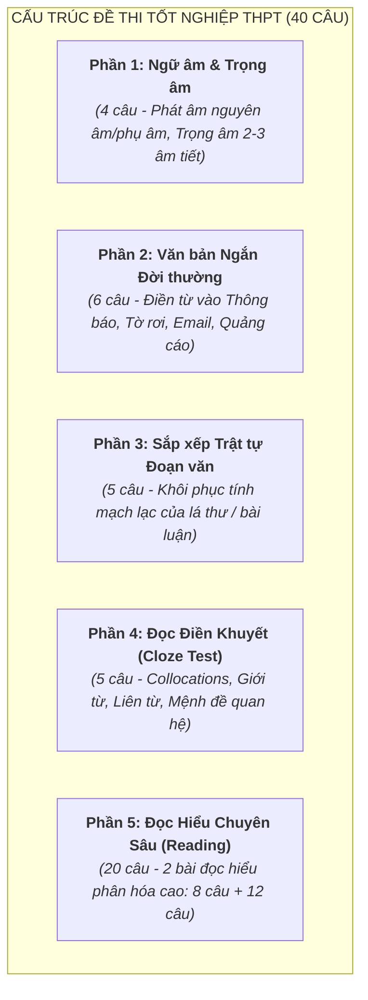

# Giải Mã Ma Trận Đề Thi Tốt Nghiệp THPT 2025–2026 Môn Tiếng Anh

Tài liệu phân tích cấu trúc định dạng đề thi mới của Bộ Giáo dục và Đào tạo áp dụng từ kỳ thi Tốt nghiệp THPT năm 2025 (Chương trình GDPT 2018), các bẫy tư duy kinh điển và phương pháp giải phẫu bản chất ngôn ngữ.

---

## 1. Cấu trúc Ma Trận Đề Thi Mới (40 Câu — 50 Phút)

Định dạng đề thi từ năm 2025 đã **bãi bỏ hoàn toàn các câu hỏi kiểm tra ngữ pháp đơn lẻ dạng mẹo cổ điển** (như tìm lỗi sai riêng lẻ hay biến đổi câu máy móc). Thay vào đó, 100% câu hỏi được tích hợp trong **văn bản và ngữ cảnh thực tiễn**:

| Phần | Dạng bài | Số câu | Bản chất năng lực kiểm tra |
| :---: | :--- | :---: | :--- |
| **I** | Ngữ âm & Trọng âm | 4 | Quy luật nhấn trọng âm theo từ loại (Danh từ vs Động từ), đuôi phát âm (*-s/es, -ed*), nguyên âm đôi. |
| **II** | Đọc điền văn bản ngắn (Quảng cáo / Thông báo) | 6 | Từ loại trong cấu trúc thực tế, giới từ chỉ nơi chốn/thời gian, mạo từ, động từ khuyết thiếu thực tế. |
| **III** | Sắp xếp trật tự câu / đoạn văn | 5 | Tính liên kết ngôn ngữ (*Cohesion & Coherence*), đại từ chỉ định (*this/that/these*), từ nối tư duy (*However, Therefore*). |
| **IV** | Đọc điền khuyết (Cloze Test) | 5 | Sự phối hợp thì, Mệnh đề quan hệ rút gọn, Cụm từ cố định (*Collocations*), Phrasal Verbs. |
| **V** | Đọc hiểu văn bản (2 bài đọc) | 20 | Kỹ năng đọc lướt (*Skimming*), quét chi tiết (*Scanning*), suy luận ngữ nghĩa (*Inference*), đại từ quy chiếu. |

---

## 2. Bốn Bẫy Tư Duy Kinh Điển Trong Đề Thi Mới & Cách Hóa Giải Bằng Video Bản Chất

### Bẫy 1: Bẫy Động từ Chính vs Mệnh đề Rút Gọn (Sentence Fragmentation Trap)
* **Hiện tượng trong đề**: Một câu dài 2–3 dòng với nhiều danh từ liên tiếp và học sinh bị lúng túng không biết động từ ở chỗ trống cần chia theo thì (Tense) hay chia ở dạng phân từ rút gọn (Participle).
  - *Ví dụ*: `The newly developed solar panels ________ on the roof of the laboratory generate enough clean energy for the entire campus.`  
    A. installed  
    B. install  
    C. were installed  
    D. are installing  
* **Sai lầm học sinh**: Nhìn thấy `solar panels` là số nhiều, lập tức chọn `were installed` hoặc `install` vì tưởng chỗ trống là động từ chính của câu.
* **Bản chất ngôn ngữ**: Động từ chính của câu là `generate` (ở phía sau). Toàn bộ cụm từ `________ on the roof...` chỉ là một **Khối thẻ bổ nghĩa (Sentence Block Modifier)** rút gọn cho danh từ `solar panels`. Vì tấm pin được lắp đặt (bị động) $\to$ Đáp án bắt buộc là phân từ hai `installed` ($V_{ed}$).
* **Cách thể hiện trên Remotion (Archetype 3)**: Khối thẻ câu trượt ngang, làm nổi bật động từ chính `generate` bằng màu chàm `#3D4AEF` có viền sáng. Cụm bổ nghĩa được đóng trong hộp nét đứt và co nhỏ lại, cho thấy câu đã có động từ chính, chỗ trống chỉ là mảnh ghép phụ.

---

### Bẫy 2: Bẫy Mạo từ & Trường Nhận Thức Chung (The Definite Article Trap)
* **Hiện tượng trong đề**: Điền mạo từ `a, an, the, Ø` trước các danh từ địa danh, phương tiện giao thông, hoặc danh từ trừu tượng.
  - *Ví dụ 1*: `She went to ________ hospital to visit her sick grandmother.` (Đáp án: `the` - vì người nói và người nghe đều xác định được bệnh viện cụ thể nơi bà đang nằm).
  - *Ví dụ 2*: `He was taken to ________ hospital after the car accident.` (Đáp án: `Ø` - không dùng mạo từ vì đi đến bệnh viện với tư cách là bệnh nhân cần chữa trị, mang tính thể chế).
* **Sai lầm học sinh**: Học vẹt quy tắc "trước tên bệnh viện/trường học thì có the hay không the" mà không hiểu khái niệm **Mục đích thể chế (Institutional Function)** vs **Địa điểm vật lý cụ thể (Physical Location)**.
* **Cách thể hiện trên Remotion (Archetype 5)**: Mô hình chiếc hộp trường nhận thức: Khi nói về cơ sở thể chế phục vụ mục đích nguyên bản (học tập, chữa bệnh, thụ án tù), không gian mở rộng không biên giới (`Zero article`). Khi nói về một tòa nhà gạch vữa cụ thể mà cả hai người đều định vị được trên bản đồ, điểm sáng kéo vào vùng giao thoa (`THE`).

---

### Bẫy 3: Bẫy Sự Phối Hợp Thì Quá Khứ (Past Aspect Interference)
* **Hiện tượng trong đề**: Kết hợp giữa Quá khứ đơn, Quá khứ tiếp diễn và Quá khứ hoàn thành trong câu có liên từ `when, while, by the time, as soon as`.
  - *Ví dụ*: `By the time the rescue team arrived at the isolated village, the floodwaters ________ to a dangerous level.`  
    A. rose  
    B. had risen  
    C. were rising  
    D. would rise  
* **Sai lầm học sinh**: Không phân biệt được trật tự xảy ra trước - sau và chọn bừa thì quá khứ đơn `rose`.
* **Bản chất ngôn ngữ**: Cụm từ `By the time` tạo ra một vạch mốc chặn trong quá khứ (`arrived`). Hành động nước lũ dâng cao đã hoàn tất và đạt tới đỉnh điểm **trước** khi đội cứu hộ tới $\to$ Sự kiện xảy ra trước một mốc quá khứ bắt buộc dùng Quá khứ hoàn thành (`had risen`).
* **Cách thể hiện trên Remotion (Archetype 1)**: Trục thời gian có vạch đỏ `Arrived`. Một vệt sáng chạy từ phía trước vạch đỏ và dừng lại tạo thành một khối kết quả hoàn tất trước khi đội cứu hộ đặt chân tới.

---

### Bẫy 4: Bẫy Ý Niệm Hạt Nhân của Cụm Động Từ (Phrasal Verb Metaphor Trap)
* **Hiện tượng trong đề**: Phân biệt các cụm động từ đi với tiểu từ *up, down, off, out* trong ngữ cảnh thực tế.
  - *Ví dụ*: `The factory had to ________ production because of a shortage of raw materials.`  
    A. slow down  
    B. speed up  
    C. bring about  
    D. carry out  
* **Bản chất ngôn ngữ**: Ẩn dụ ý niệm `DOWN IS LESS / SLOWER / DECREASE`. Thiếu hụt nguyên liệu dẫn đến việc hạ nhịp độ sản xuất $\to$ Chọn ngay `slow down` mà không cần tra từ điển máy móc.
* **Cách thể hiện trên Remotion (Archetype 2)**: Cột đo năng lượng và tốc độ tụt áp suất xuống dưới, kích hoạt nhãn màu đỏ cảnh báo giảm sút.
