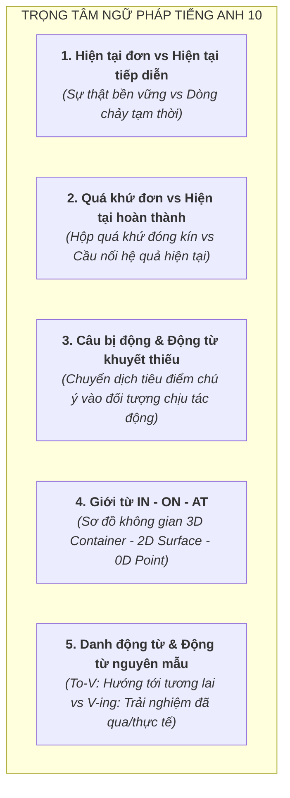

# Tổng Quan Chương Trình Tiếng Anh Lớp 10 (GDPT 2018)

Tài liệu chuẩn hóa kiến thức, cơ chế ngữ pháp nhận thức, từ vựng theo chủ điểm và các bẫy đề thi môn Tiếng Anh Lớp 10 theo Chương trình GDPT 2018 (SGK Kết nối tri thức - *Global Success*, Chân trời sáng tạo - *Friends Global*, Cánh diều - *Explore New Worlds*).

---

## 1. Hệ Thống Chủ Điểm (Themes & Units) Lớp 10

Chương trình Tiếng Anh 10 xoay quanh 10 chủ đề mang tính ứng dụng thực tiễn cao:
1. **Unit 1: Family Life** (Đời sống gia đình, phân chia công việc nhà, sự gắn kết thế hệ).
2. **Unit 2: Humans and the Environment** (Con người và môi trường, lối sống xanh, giảm dấu chân carbon).
3. **Unit 3: Music** (Âm nhạc, nghệ sĩ truyền cảm hứng, các chương trình truyền hình âm nhạc).
4. **Unit 4: For a Better Community** (Cộng đồng tốt đẹp hơn, hoạt động tình nguyện, sẻ chia xã hội).
5. **Unit 5: Inventions** (Các phát minh công nghệ, trí tuệ nhân tạo, thiết bị di động trong đời sống).
6. **Unit 6: Gender Equality** (Bình đẳng giới, quyền tiếp cận giáo dục và nghề nghiệp của phụ nữ).
7. **Unit 7: Viet Nam and International Organisations** (Việt Nam và các tổ chức quốc tế: UN, UNICEF, WTO, ASEAN).
8. **Unit 8: New Ways to Learn** (Phương pháp học tập mới, học trực tuyến, ứng dụng công nghệ).
9. **Unit 9: Protecting the Environment** (Bảo vệ môi trường, động vật hoang dã, bảo tồn thiên nhiên).
10. **Unit 10: Ecotourism** (Du lịch sinh thái, du lịch có trách nhiệm, bảo tồn văn hóa địa phương).

---

## 2. Các Chuyên Đề Ngữ Pháp Trọng Tâm & Bản Chất Nhận Thức

### 2.1. Hiện tại đơn (Present Simple) vs Hiện tại tiếp diễn (Present Continuous)
* **Bản chất nhận thức**:
  - *Hiện tại đơn*: Ống kính bao quát (Wide Shot). Diễn tả quy luật tự nhiên, chân lý vĩnh cửu, đặc tính cố định của chủ thể. Sự việc không có ranh giới bắt đầu hay kết thúc cụ thể trong nhận thức người nói.
  - *Hiện tại tiếp diễn*: Ống kính zoom cận cảnh (Close-up Zoom). Người nói đặt mình vào **bên trong dòng chảy** của hành động. Sự việc mang tính tạm thời, đang dang dở và chưa hoàn tất.
* **Bẫy đề thi kinh điển**: Động từ chỉ trạng thái (*Stative Verbs*: know, understand, believe, love, smell, taste). Người bản xứ không dùng dạng tiếp diễn cho trạng thái tinh thần vì chúng không phải là một chuỗi hành động cơ học.
  - *Ví dụ*: `I understand the lesson now` (Đúng) $\ne$ `I am understanding the lesson now` (Sai).

---

### 2.2. Quá khứ đơn (Past Simple) vs Hiện tại hoàn thành (Present Perfect)
* **Bản chất nhận thức**:
  - *Quá khứ đơn*: Chiếc hộp thời gian đã đóng nắp (`Finished Past Container`). Hành động đã hoàn toàn chấm dứt tại một thời điểm xác định trong quá khứ (`yesterday, in 2020, 2 days ago`). Không có bất kỳ sợi dây liên kết nào kéo tới hiện tại.
  - *Hiện tại hoàn thành*: Cây cầu nối hệ quả (`Current Relevance Bridge`). Thời điểm hành động xảy ra không quan trọng, điều người nói quan tâm duy nhất là **hệ quả hoặc trải nghiệm của hành động đó vẫn đang tồn tại sống động ở mốc NOW**.
* **So sánh đối chiếu kinh điển**:
  - `I lost my wallet yesterday`: Tôi đánh mất ví hôm qua (Đó là một câu chuyện kể lịch sử; có thể hôm nay tôi đã tìm thấy rồi).
  - `I have lost my wallet!`: Tôi mất ví rồi! (Hệ quả hiện tại: Hiện giờ tôi không có tiền, tôi đang không thể thanh toán được).

---

### 2.3. Bản chất Giới từ Không gian & Thời gian (IN, ON, AT)
* **Sơ đồ hình ảnh (Image Schemas)**:
  - `AT` (Point): Tiêu điểm không gian 0 chiều hoặc thời điểm chính xác (*at the bus stop, at 8:00 AM*).
  - `ON` (Surface): Mặt phẳng tiếp xúc 2 chiều hoặc ngày trên lịch (*on the table, on the floor, on Monday, on October 10th*).
  - `IN` (Container): Chiếc hộp bao bọc 3 chiều hoặc khoảng thời gian dài (*in the room, in the box, in May, in 2026, in the morning*).
* **Nghịch lý phương tiện giao thông**:
  - `ON the bus / ON the train / ON the plane`: Vì sàn xe buýt/tàu hỏa là một bề mặt phẳng lớn mà bạn có thể **đứng thẳng và bước đi trên đó** (Surface schema).
  - `IN a car / IN a taxi`: Vì trần xe thấp, bạn phải **thu mình ngồi lọt thỏm vào bên trong lòng chiếc xe** (Container schema).

---

### 2.4. Bản chất Động từ Nguyên mẫu (To-V) vs Danh động từ (V-ing)
* **Bản chất nhận thức**:
  - `TO-V` mang hướng lực mũi tên (`Forward Path`): Hướng tới tương lai, mục tiêu, hành động chưa xảy ra (*plan to do, hope to do, decide to do*).
  - `V-ING` mang tính trải nghiệm hiện thực (`Factual / Past Experience`): Hành động đã, đang hoặc gắn liền với cảm xúc trải nghiệm thực tế (*enjoy doing, avoid doing, admit doing*).
* **Cặp từ đổi nghĩa nổi tiếng**:
  - `Remember to lock the door`: Nhớ phải khóa cửa (Hướng tới hành động tương lai chưa làm).
  - `Remember locking the door`: Nhớ là mình đã khóa cửa rồi (Hồi tưởng trải nghiệm đã làm trong quá khứ).
