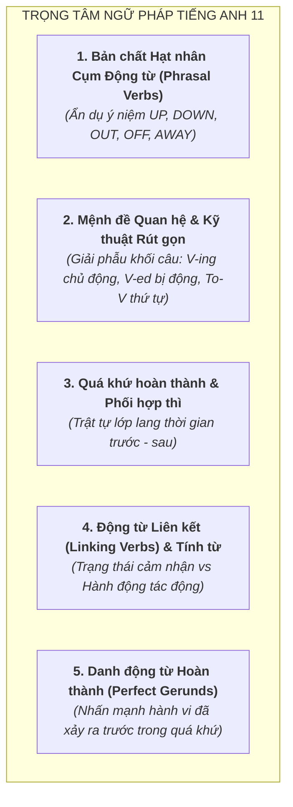

# Tổng Quan Chương Trình Tiếng Anh Lớp 11 (GDPT 2018)

Tài liệu chuẩn hóa kiến thức, cơ chế ngữ pháp nhận thức, từ vựng theo chủ điểm và các bẫy đề thi môn Tiếng Anh Lớp 11 theo Chương trình GDPT 2018 (SGK Kết nối tri thức - *Global Success*, Chân trời sáng tạo - *Friends Global*, Cánh diều - *Explore New Worlds*).

---

## 1. Hệ Thống Chủ Điểm (Themes & Units) Lớp 11

Chương trình Tiếng Anh 11 mở rộng sang các vấn đề xã hội, văn hóa và tương lai:
1. **Unit 1: A Long and Healthy Life** (Sức khỏe, dinh dưỡng, lối sống lành mạnh, kháng kháng sinh).
2. **Unit 2: The Generation Gap** (Khoảng cách thế hệ, xung đột giá trị gia đình, quan điểm sống).
3. **Unit 3: Cities of the Future** (Đô thị tương lai, thành phố thông minh, công nghệ xanh).
4. **Unit 4: ASEAN and Viet Nam** (Cộng đồng ASEAN, giao lưu văn hóa và kinh tế khu vực).
5. **Unit 5: Global Warming** (Biến đổi khí hậu, hiệu ứng nhà kính, năng lượng tái tạo).
6. **Unit 6: Preserving Our Heritage** (Bảo tồn di sản văn hóa vật thể và phi vật thể).
7. **Unit 7: Education Options for School-Leavers** (Định hướng học đại học, học nghề, học nghề cao đẳng).
8. **Unit 8: Becoming Independent** (Rèn luyện tính tự lập, kỹ năng sống, quản lý thời gian).
9. **Unit 9: Social Issues** (Các vấn đề xã hội: bạo lực học đường, áp lực đồng trang lứa, mạng xã hội).
10. **Unit 10: The Ecosystem** (Hệ sinh thái, đa dạng sinh học, bảo vệ môi trường tự nhiên).

---

## 2. Các Chuyên Đề Ngữ Pháp Trọng Tâm & Bản Chất Nhận Thức

### 2.1. Bản chất Hạt nhân Không gian của Cụm Động Từ (Phrasal Verbs)
* **Khủng hoảng học vẹt**: Học sinh thường cố nhớ danh sách 200 cụm từ rời rạc. Bản chất ngôn ngữ học nhận thức chỉ ra rằng: **Ý nghĩa của phrasal verb phụ thuộc 80% vào tiểu từ không gian (Spatial Particle)**.
* **Quy luật các hạt nhân ý niệm cốt lõi**:
  - `UP` = **Đỉnh điểm hoàn tất (Completion)** hoặc **Tăng cường (More)**:
    * Khi rót nước vào cốc, mực nước dâng lên chạm miệng cốc $\to$ Đầy tràn và kết thúc.
    * Do đó: `drink up` (uống cạn sạch), `clean up` (dọn sạch bong không tì vết), `eat up` (ăn hết veo), `speed up` (tăng tốc độ).
  - `OUT` = **Bước ra ánh sáng / Lộ diện (Visible & Discovered)** hoặc **Cạn kiệt (Depleted)**:
    * Bước ra khỏi phòng tối/hộp kín: `find out` (tìm ra sự thật), `figure out` (nghĩ ra cách giải quyết), `point out` (chỉ ra).
    * Hộp đồ bị dốc sạch ra ngoài: `run out` (hết sạch đồ), `burn out` (cháy rụi/kiệt sức).
  - `OFF` = **Ngắt kết nối / Rời khỏi điểm tiếp xúc (Disconnect & Separation)**:
    * `turn off` (ngắt mạch điện), `take off` (máy bay rời khỏi mặt đất), `set off` (bắt đầu rời điểm xuất phát lên đường).
  - `DOWN` = **Hạ nhiệt / Suy giảm (Less & Calmer)**:
    * `slow down` (chậm lại), `calm down` (bình tĩnh lại), `turn down` (vặn nhỏ âm lượng / từ chối lời mời).

---

### 2.2. Mệnh đề Quan hệ (Relative Clauses) & Nghệ thuật Rút gọn
* **Giải phẫu cấu trúc câu**:
  - Mệnh đề quan hệ thực chất là một **Khối tính từ dài (Adjective Clause)** đứng ngay sau danh từ để định nghĩa hoặc cung cấp thêm thông tin cho danh từ đó.
  - Phân biệt dấu phẩy (Defining vs Non-defining):
    * *Không có dấu phẩy*: Thông tin sống còn để xác định danh từ (Thiếu nó người nghe không biết là ai).
    * *Có dấu phẩy*: Thông tin bổ sung, danh từ đã xác định rõ (Tên riêng, có *this/my*).
* **3 Quy tắc rút gọn mệnh đề thần tốc**:
  1. **Chủ động** $\to$ Rút gọn thành `V-ing`:
     - *Ví dụ*: `The man who is standing at the door` $\to$ `The man standing at the door`.
  2. **Bị động** $\to$ Rút gọn thành `V-ed / V3`:
     - *Ví dụ*: `The bridge which was built in 1990` $\to$ `The bridge built in 1990`.
  3. **Sau số thứ tự (*the first, the last, the only, the second*)** $\to$ Rút gọn thành `To-V`:
     - *Ví dụ*: `Yuri Gagarin was the first person who flew into space` $\to$ `...the first person to fly into space`.

---

### 2.3. Động từ Liên kết (Linking Verbs) & Bẫy Tính từ vs Trạng từ
* **Bản chất**:
  - Động từ thường đi với Trạng từ (*He runs quickly* - miêu tả cách thức của hành động chạy).
  - Động từ liên kết (*look, feel, taste, smell, sound, seem, appear, become*) đóng vai trò như một **Dấu bằng ($=$)** kết nối Chủ ngữ với Tính chất của nó. Do đó, bổ ngữ bắt buộc phải là **Tính từ (Adjective)**!
* **Bẫy đề thi kinh điển**:
  - `The soup smells deliciously` (SAI - canh không thể tự thực hiện hành động "ngửi").
  - `The soup smells delicious` (ĐÚNG - canh $=$ ngon).
