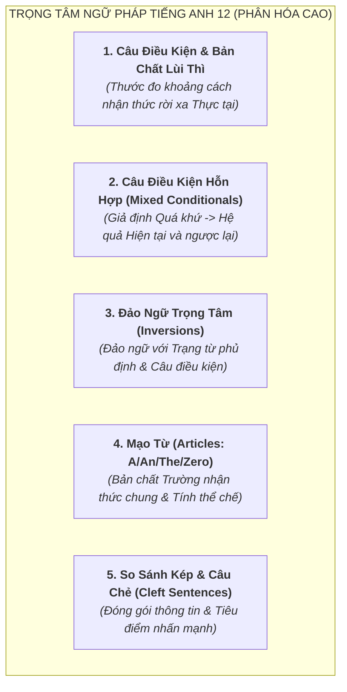

# Tổng Quan Chương Trình Tiếng Anh Lớp 12 (GDPT 2018)

Tài liệu chuẩn hóa kiến thức, cơ chế ngữ pháp nhận thức, từ vựng theo chủ điểm và các bẫy đề thi môn Tiếng Anh Lớp 12 theo Chương trình GDPT 2018 (SGK Kết nối tri thức - *Global Success*, Chân trời sáng tạo - *Friends Global*, Cánh diều - *Explore New Worlds*).

---

## 1. Hệ Thống Chủ Điểm (Themes & Units) Lớp 12

Chương trình Tiếng Anh 12 là bước chuẩn bị toàn diện cho ngưỡng cửa đại học, hội nhập toàn cầu và kỳ thi Tốt nghiệp THPT:
1. **Unit 1: Life Stories** (Những câu chuyện cuộc đời, tiểu sử vĩ nhân, tấm gương truyền cảm hứng).
2. **Unit 2: A Multicultural World** (Thế giới đa văn hóa, bản sắc văn hóa, sự hòa nhập và khác biệt).
3. **Unit 3: Green Living** (Lối sống xanh, phát triển bền vững, kinh tế tuần hoàn).
4. **Unit 4: Urbanisation** (Đô thị hóa, làn sóng di cư, thách thức hạ tầng đô thị).
5. **Unit 5: The World of Work** (Thị trường lao động, xu hướng việc làm, kỹ năng nghề nghiệp tương lai).
6. **Unit 6: Artificial Intelligence** (Trí tuệ nhân tạo, tự động hóa, cơ hội và thách thức đạo đức công nghệ).
7. **Unit 7: The World of Mass Media** (Thế giới truyền thông đại chúng, mạng xã hội, tin giả và báo chí).
8. **Unit 8: Wildlife Conservation** (Bảo tồn động vật hoang dã, sách đỏ, chống buôn bán thú quý hiếm).
9. **Unit 9: Career Paths** (Lộ trình sự nghiệp, chọn ngành chọn nghề, chuẩn bị phỏng vấn xin việc).
10. **Unit 10: Lifelong Learning** (Học tập suốt đời, tự nâng cao trình độ, thích ứng xã hội số).

---

## 2. Các Chuyên Đề Ngữ Pháp Trọng Tâm & Bản Chất Nhận Thức

### 2.1. Bản chất Lùi Thì trong Câu Điều Kiện & Câu Ước (Epistemic Distance)
* **Nghịch lý lớn của học sinh**: Tại sao nói về điều ước ở **hiện tại** mà lại dùng thì **quá khứ**? (`I wish I were taller`, `If I had money now, I would travel...`).
* **Bản chất Ngữ pháp Nhận thức**:
  - Thì trong tiếng Anh không chỉ đo **Thời gian vật lý (Chronological Time)** mà còn đo **Khoảng cách Thực tại (Epistemic Reality Distance)**.
  - Khi người nói dùng thì Hiện tại: Sự việc gắn liền với Thực tại 100%.
  - Khi người nói lùi 1 thì về Quá khứ: Người nói đang bước lùi **một bước khoảng cách ra xa khỏi Thực tại**, thông báo rằng: "Điều tôi đang nói là điều KHÔNG CÓ THẬT / GIẢ ĐỊNH TRÁI NGƯỢC THỰC TẾ".
* **Thang bậc khoảng cách thực tại**:
  * *Loại 0 & 1*: Hiện tại đơn $\to$ Có thật trong thực tế hoặc tương lai có thể xảy ra.
  * *Loại 2*: Lùi 1 thì (Quá khứ đơn) $\to$ Trái ngược với thực tế ở hiện tại.
  * *Loại 3*: Lùi 2 thì (Quá khứ hoàn thành) $\to$ Trái ngược với sự thật đã xảy ra trong quá khứ (vĩnh viễn không thể thay đổi).

---

### 2.2. Giải Mã Câu Điều Kiện Hỗn Hợp (Mixed Conditionals)
Trong đề thi phân hóa 8.5+, dạng câu điều kiện hỗn hợp là chiếc bẫy thường gặp nhất:
* **Hỗn hợp Loại 3 + Loại 2 (Giả định Quá khứ $\to$ Hệ quả Hiện tại)**:
  - *Công thức*: $\text{If} + S + \text{had } V_3, S + \text{would } V_0 \text{ (now)}$.
  - *Bản chất*: Một việc đã làm hoặc không làm trong quá khứ để lại hậu quả hiển hiện ngay lúc này.
  - *Ví dụ*: `If I had taken your advice yesterday, I wouldn't be in this trouble now.`
* **Hỗn hợp Loại 2 + Loại 3 (Bản chất Lâu dài ở Hiện tại $\to$ Hành vi Quá khứ)**:
  - *Công thức*: $\text{If} + S + V_{ed}, S + \text{would have } V_3$.
  - *Bản chất*: Bản tính hoặc hoàn cảnh cố định ở hiện tại đã chi phối hành động cụ thể trong quá khứ.
  - *Ví dụ*: `If she weren't so shy, she would have spoken at the conference last week.`

---

### 2.3. Bản chất Đảo Ngữ (Inversion) & Tiêu Điểm Nhận Thức
* **Cơ chế**: Khi người nói đưa một phó từ phủ định (*Never, Rarely, Seldom, Hardly, Under no circumstances*) hoặc cụm giới từ chỉ sự giới hạn (*Only when, Only after*) lên đầu câu, toàn bộ trật tự câu bị xáo trộn: **Trợ động từ bị kéo lên đứng trước Chủ ngữ** (giống hệt dạng câu hỏi nghi vấn).
* **Bản chất nhận thức**: Đây là thủ pháp kịch tính hóa (Dramatization) của người bản xứ nhằm rung chuông cảnh báo người nghe: "Hãy chú ý tối đa vào mức độ hiếm hoi hoặc tính chất phủ định tuyệt đối của sự việc này!".
* **Cặp đôi bẫy kinh điển**:
  - `Hardly / Scarcely + had + S + V3... WHEN + S + Ved`: Vừa mới... thì...
  - `No sooner + had + S + V3... THAN + S + Ved`: Vừa mới... thì...

---

### 2.4. Bản chất Mạo Từ: Trường Nhận Thức Chung (Common Ground Scope)
* `A / AN` (Indefinite): Người nói giới thiệu một đối tượng mới lần đầu tiên vào cuộc trò chuyện. Người nghe chưa hề biết cụ thể là đối tượng nào (*"I bought a book"*).
* `THE` (Definite): Đối tượng đã nằm trong **Vùng nhận thức chung (Common Ground)** của cả người nói và người nghe vì:
  1. Đã được nhắc tới ở câu trước.
  2. Là duy nhất trong vũ trụ (*the sun, the earth, the sky*).
  3. Cả hai người đều đang ở trong cùng một bối cảnh vật lý cụ thể (*"Close the window"* - cửa sổ của căn phòng này).
  4. Đi kèm cụm giới từ bổ nghĩa xác định phía sau (*"The book on the table"*).
* `ZERO ARTICLE` ($\emptyset$): Dùng khi nói về:
  1. Danh từ số nhiều hoặc không đếm được mang tính quy luật chung chung (*"Dogs are loyal animals"*).
  2. Khái niệm mang tính thể chế nguyên bản (*"go to school"* để đi học, *"go to bed"* để đi ngủ, *"be in hospital"* để chữa bệnh).
