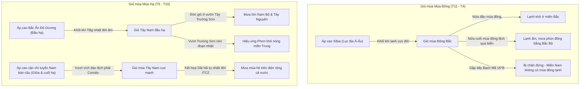

# Chuyên đề 12.1.2: Thiên nhiên Nhiệt đới Ẩm Gió mùa Việt Nam

> **Khối lớp**: Địa lí 12 — Địa lí Tự nhiên Việt Nam  
> **Chủ đề**: Thiên nhiên nhiệt đới ẩm gió mùa (Cơ chế gió mùa, tính chất nhiệt đới, ẩm và hệ quả địa lí)  
> **File đối chiếu SGK**: Bài 6 & Bài 7 SGK Địa lí 12 (GDPT 2018)  
> **Mục tiêu Video AI**: Bẻ khóa trọn vẹn cơ chế hoạt động của các luồng gió mùa tại Việt Nam; vì sao miền Bắc có mùa đông lạnh, vì sao miền Trung có gió phơn khô nóng và mưa lệch sang thu - đông.

---

## 1. Bản chất Cơ chế: Tại sao Việt Nam có Khí hậu Gió mùa Độc đáo?

Việt Nam nằm ở Đông Nam châu Á, tiếp giáp Biển Đông rộng lớn, nằm trong khu vực hoạt động gió mùa điển hình nhất thế giới. Khí hậu Việt Nam là sự giao tranh nhịp nhàng giữa hai khối hoàn lưu gió mùa:

---

## 2. Các Mắt xích Bản chất Giải thích Hiện tượng (Visualizable Steps)

### 2.1. Gió mùa Mùa Đông: Vì sao miền Bắc rét căm căm?
1. **Nguồn gốc**: Hình thành từ tâm áp cao Xibia khổng lồ ở phương Bắc (nhiệt độ tâm áp thường xuống dưới $-40^\circ\text{C}$).
2. **Đặc điểm đường đi**:
   - *Nửa đầu mùa đông (T11 - T1)*: Thổi thẳng qua lục địa Trung Quốc $\to$ tràn xuống nước ta theo hướng Đông Bắc mang tính chất **lạnh khô** (độ ẩm thấp, trời rét buốt, hanh khô).
   - *Nửa cuối mùa đông (T2 - T4)*: Tâm áp cao chuyển dịch ra biển $\to$ gió mùa Đông Bắc thổi lệch qua vịnh Bắc Bộ $\to$ hút ẩm từ biển mang vào đất liền gây nên hiện tượng **mưa phùn nồm ẩm** đặc trưng ở Đông Bắc Bộ và Bắc Trung Bộ.
3. **Phạm vi tác động & Ranh giới tự nhiên**:
   - Hoạt động chủ yếu từ dãy Bạch Mã ($16^\circ\text{B}$) trở ra Bắc.
   - Khi di chuyển xuống phía Nam, khối khí bị biến tính ấm dần và bị bức tường tự nhiên là **dãy Bạch Mã** chặn lại gần như hoàn toàn.
   - Phía Nam dãy Bạch Mã: Gió Tín phong bán cầu Bắc (hướng Đông Bắc) chiếm ưu thế, mang lại thời tiết nắng ráo, không có mùa đông lạnh.

### 2.2. Gió Tây Nam đầu mùa hạ & Hiện tượng "Gió Lào" (Gió Phơn)
1. **Nguồn gốc**: Khối khí nhiệt đới ẩm vịnh Bengan (Bắc Ấn Độ Dương) di chuyển theo hướng Tây Nam vào nước ta.
2. **Cơ chế Phơn (Foehn) vượt dãy Trường Sơn**:
   - Khi chạm sườn Tây Trường Sơn (phía Lào và Tây Nguyên), không khí ẩm bị đẩy lên cao $\to$ giãn nở đoạn nhiệt $\to$ nhiệt độ giảm theo tỉ lệ $-0.6^\circ\text{C} / 100\text{m}$ $\to$ hơi nước ngưng kết tạo mây đen dày đặc và trút mưa xối xả ở Nam Bộ và Tây Nguyên.
   - Khi vượt qua đỉnh núi sang sườn Đông Trường Sơn (phía dải đồng bằng ven biển miền Trung): không khí đã mất hết hơi ẩm $\to$ trút xuống chân núi bị nén đoạn nhiệt $\to$ nhiệt độ tăng vọt theo tỉ lệ $+1^\circ\text{C} / 100\text{m}$.
   - Kết quả: Khi xuống đến mặt đất miền Trung, gió biến thành luồng khí cực kỳ khô (độ ẩm $< 40\%$) và nóng rát (nhiệt độ vọt lên $38 - 40^\circ\text{C}$), dân gian gọi là "Gió Lào".

---

## 3. Câu chốt Bản chất (Key Takeaways)

> **Khí hậu Việt Nam không cố định mà là sự đối thoại không ngừng giữa lục địa khổng lồ và đại dương bao la.**
> Đồi núi đóng vai trò như những "bức bình phong" phân luồng khí hậu: Dãy Hoàng Liên Sơn chặn rét cho Tây Bắc, dãy Bạch Mã chặn lạnh cho miền Nam, và dãy Trường Sơn biến cơn mưa rào của Lào thành ngọn gió phơn khô cháy của miền Trung.
