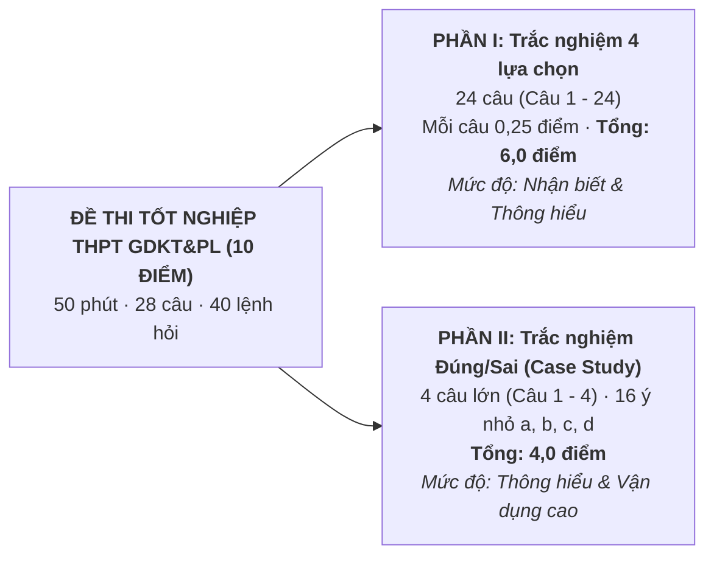

# Phân tích Cấu trúc Đề thi & Ma trận Tốt nghiệp THPT từ năm 2025 môn GDKT&PL

Tài liệu giải mã định dạng đề thi mới của Bộ Giáo dục và Đào tạo áp dụng cho học sinh học Chương trình GDPT 2018 (kỳ thi tốt nghiệp THPT từ năm 2025 trở đi).

---

## 1. Thông số Kỹ thuật & Cấu trúc Tổng thể

* **Hình thức thi**: Trắc nghiệm khách quan trên giấy.
* **Thời gian làm bài**: **50 phút**.
* **Tổng số câu hỏi**: **28 câu** (tương ứng với **40 lệnh hỏi**).
* **Thang điểm**: 10 điểm, phân bổ thành 2 phần rõ rệt:

---

## 2. Quy tắc Tính điểm Đột phá ở Phần II (Bẫy Lũy Tiến)

Điểm của Phần II không chia đều 0,25 điểm/ý mà tính lũy tiến theo số ý trả lời đúng trong từng câu:
- Thí sinh chỉ chọn chính xác **1 ý** trong 1 câu: được **0,1 điểm**.
- Thí sinh chọn chính xác **2 ý** trong 1 câu: được **0,25 điểm**.
- Thí sinh chọn chính xác **3 ý** trong 1 câu: được **0,5 điểm**.
- Thí sinh chọn chính xác cả **4 ý** trong 1 câu: được **1,0 điểm**.

> [!WARNING]
> Quy tắc tính điểm này khiến học sinh "đoán mò" hầu như không có cơ hội đạt điểm cao. Sai 1 ý là mất ngay một nửa số điểm của câu đó (từ 1,0 điểm tụt xuống 0,5 điểm). Vì vậy, học sinh bắt buộc phải hiểu sâu sắc bản chất pháp lý và kinh tế để không chọn nhầm.

---

## 3. Giải mã Mẫu Case Study Kinh Điển Phần II (Minh họa Đề thi Bộ GD&ĐT)

### Đề bài Tình huống (Case Study Đa chủ thể):
> *Doanh nghiệp X do ông An làm giám đốc ký hợp đồng cung ứng 10 tấn gạo sạch cho siêu thị Y do bà Bình làm đại diện. Đến hạn giao hàng, do giá gạo trên thị trường tăng vọt, ông An đã tự ý bán lô gạo đó cho một đại lý khác với giá cao hơn để kiếm lời, rồi đơn phương hủy hợp đồng với siêu thị Y. Bức xúc, bà Bình đã thuê anh Cường đến trụ sở doanh nghiệp X đập phá bàn ghế, đồng thời chụp ảnh đăng lên mạng xã hội bịa đặt rằng doanh nghiệp X kinh doanh gạo giả mốc độc hại, khiến doanh nghiệp X bị đối tác hủy hàng loạt đơn hàng khác.*

### Bốn lệnh hỏi Trắc nghiệm Đúng / Sai:
* **a)** Doanh nghiệp X đã vi phạm pháp luật dân sự khi không thực hiện đúng nghĩa vụ trong hợp đồng với siêu thị Y.
  - $\to$ **ĐÚNG**: Hợp đồng kinh tế đã ký kết có hiệu lực ràng buộc; tự ý hủy giao hàng để bán cho bên khác là hành vi vi phạm nghĩa vụ hợp đồng, phải chịu trách nhiệm dân sự (bồi thường thiệt hại, phạt vi phạm).
* **b)** Hành vi của bà Bình thuê anh Cường đập phá tài sản của doanh nghiệp X là thực hiện đúng quyền bảo vệ lợi ích hợp pháp của mình.
  - $\to$ **SAI**: Pháp luật không cho phép tự ý dùng bạo lực hủy hoại tài sản của người khác để đòi quyền lợi. Bà Bình và anh Cường đã có hành vi cố ý hủy hoại tài sản (có thể bị xử phạt hành chính hoặc truy cứu trách nhiệm hình sự nếu thiệt hại trên 2 triệu đồng).
* **c)** Việc bà Bình đăng tin bịa đặt lên mạng xã hội đã xâm phạm quyền được pháp luật bảo hộ về danh dự, nhân phẩm và uy tín của doanh nghiệp X.
  - $\to$ **ĐÚNG**: Tung tin giả, vu khống trên mạng xã hội là hành vi trái pháp luật, xâm hại danh dự, uy tín và quyền tài sản của doanh nghiệp.
* **d)** Ông An chỉ phải chịu trách nhiệm đạo đức kinh doanh mà không phải chịu bất kỳ trách nhiệm pháp lý nào vì chưa nhận tiền đặt cọc của siêu thị Y.
  - $\to$ **SAI**: Dù chưa nhận cọc, hợp đồng đã có hiệu lực pháp lý từ thời điểm ký kết. Hành vi bội ước gây thiệt hại cho siêu thị Y làm phát sinh trách nhiệm pháp lý dân sự theo Bộ luật Dân sự, không chỉ đơn thuần là đạo đức kinh doanh.

---

## 4. Phương pháp Biên kịch Video AI xử lý Câu hỏi Đề thi (B1 + B3)

1. **Tách nhân vật thành từng Card UI trực quan**:
   - Nhân vật `Ông An (DN X)`: Gắn nhãn vi phạm hợp đồng (Dân sự).
   - Nhân vật `Bà Bình (Siêu thị Y)`: Gắn nhãn thuê người đập phá + đăng tin giả vu khống (Dân sự + Hành chính/Hình sự).
   - Nhân vật `Anh Cường`: Gắn nhãn đồng phạm hủy hoại tài sản.
2. **Dùng Decision Tree (Cây Quyết định)**:
   - Dẫn dắt người xem qua 4 câu hỏi trắc nghiệm Đúng/Sai bằng cách chiếu đèn rọi vào từng mắt xích hành vi trên sơ đồ.
   - Khi chốt lệnh hỏi, hiển thị rõ ràng ký hiệu `✓ ĐÚNG` (màu xanh lá) hoặc `✗ SAI` (màu đỏ) kèm dòng lý giải cốt lõi $\le 20$ từ.
