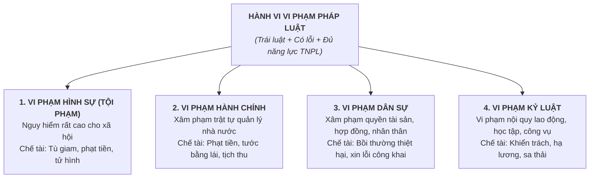

# Tổng quan Chương trình KTPL Lớp 12 (GDPT 2018)

Tài liệu chuẩn hóa kiến thức bám sát 3 bộ SGK: **Kết nối tri thức với cuộc sống**, **Cánh diều**, **Chân trời sáng tạo**.

---

## PHẦN I: KINH TẾ PHÁT TRIỂN & HỘI NHẬP QUỐC TẾ (ECONOMICS)

### Bài 1: Tăng trưởng và Phát triển kinh tế
* **Tăng trưởng kinh tế**: Sự gia tăng về quy mô sản lượng hàng hóa và dịch vụ của một nền kinh tế trong một thời kỳ nhất định (thường đo bằng tốc độ tăng trưởng GDP hoặc GNI).
* **Phát triển kinh tế (Toàn diện & Bền vững)**: Bao gồm 3 tiêu chí gắn kết không thể tách rời:
  1. *Tăng trưởng kinh tế cao và ổn định*.
  2. *Cơ cấu kinh tế chuyển dịch hợp lý và tiến bộ xã hội* (giảm nghèo, thu hẹp khoảng cách giàu nghèo, nâng cao chỉ số HDI).
  3. *Bảo vệ môi trường sinh thái* (kinh tế xanh, giảm phát thải carbon, sử dụng bền vững tài nguyên).

### Bài 2: Hội nhập kinh tế quốc tế
* **Khái niệm**: Quá trình gắn kết nền kinh tế quốc gia với nền kinh tế khu vực và thế giới thông qua thương mại tự do, đầu tư, chuyển giao công nghệ.
* **Các cấp độ hội nhập**: Song phương (giữa 2 quốc gia) $\to$ Khu vực (ASEAN, APEC) $\to$ Toàn cầu (WTO - Tổ chức Thương mại Thế giới).
* **Các hiệp định thương mại tự do thế hệ mới (FTA)**: CPTPP, EVFTA, RCEP... mở ra cơ hội tiếp cận thị trường khổng lồ nhưng đặt ra thách thức gay gắt về tiêu chuẩn môi trường, sở hữu trí tuệ và lao động.

### Bài 3 & 4: Bảo hiểm, An sinh xã hội & Quản lý Thu - Chi gia đình
* **Bảo hiểm Xã hội (BHXH)**:
  - *BHXH Bắt buộc*: Người lao động và người sử dụng lao động cùng đóng góp (chế độ: ốm đau, thai sản, tai nạn lao động, hưu trí, tử tuất).
  - *BHXH Tự nguyện*: Dành cho lao động tự do, công dân từ đủ 15 tuổi trở lên tự nguyện đóng góp để hưởng lương hưu.
* **Bảo hiểm Y tế (BHYT)**: Hình thức bảo hiểm bắt buộc do Nhà nước tổ chức để chăm sóc sức khỏe cộng đồng, không vì mục đích lợi nhuận.
* **Bảo hiểm Thất nghiệp (BHTN)**: Hỗ trợ tài chính và học nghề cho người lao động khi bị mất việc làm.
* **Quản lý Thu - Chi trong gia đình**: Phân định rõ nguồn thu cố định và thu nhập biến đổi; ưu tiên chi tiêu thiết yếu và luôn duy trì quỹ tài chính dự phòng cho các biến cố bất ngờ (bệnh tật, thất nghiệp).

---

## PHẦN II: PHÁP LUẬT VỀ KINH TẾ, XÃ HỘI & TRỌNG TÂM XỬ LÝ VI PHẠM (LAW)

### Bài 5: Quyền và Nghĩa vụ của Công dân về Kinh tế
* **Quyền tự do kinh doanh**: Công dân được tự do lựa chọn ngành nghề, hình thức tổ chức kinh doanh, quy mô, địa bàn mà **pháp luật không cấm**.
* **Nghĩa vụ của công dân trong kinh doanh**:
  - Nộp thuế đầy đủ, đúng hạn theo quy định của pháp luật.
  - Tuân thủ quy định về bảo vệ môi trường, an toàn vệ sinh thực phẩm, an toàn lao động.
  - Bảo vệ quyền lợi chính đáng của người tiêu dùng; không kinh doanh hàng giả, hàng kém chất lượng.

### Bài 6: Quyền và Nghĩa vụ về Văn hóa, Xã hội & Giáo dục
* **Quyền học tập của công dân**:
  - Học không hạn chế (từ tiểu học lên đến tiến sĩ).
  - Học bất cứ ngành nghề nào phù hợp với năng khiếu, sở thích, hoàn cảnh.
  - Học thường xuyên, học suốt đời (học chính quy, vừa học vừa làm, từ xa).
  - Mọi công dân đều được đối xử bình đẳng về cơ hội học tập.
* **Quyền sáng tạo của công dân**: Tự do nghiên cứu khoa học, phát minh, sáng chế, sáng tác văn học nghệ thuật và được bảo hộ quyền tác giả, quyền sở hữu công nghiệp.

### Bài 7 & 8: Pháp luật Lao động & Hôn nhân Gia đình
* **Pháp luật Lao động**:
  - Hợp đồng lao động phải được giao kết trên nguyên tắc tự nguyện, bình đẳng, thiện chí, hợp tác và trung thực.
  - Thời giờ làm việc bình thường không quá 8 giờ/ngày và 48 giờ/tuần.
  - Nghiêm cấm phân biệt đối xử, quấy rối tình dục, cưỡng bức lao động tại nơi làm việc.
* **Pháp luật Hôn nhân & Gia đình**:
  - Điều kiện kết hôn: Nam từ đủ **20 tuổi**, nữ từ đủ **18 tuổi**; kết hôn hoàn toàn tự nguyện; không mất năng lực hành vi dân sự.
  - Phân định rõ:
    * *Tài sản chung*: Tạo ra trong thời kỳ hôn nhân, tài sản được thừa kế chung hoặc tặng cho chung.
    * *Tài sản riêng*: Có trước khi kết hôn, tài sản được thừa kế riêng, tặng cho riêng trong thời kỳ hôn nhân.

---

### Bài 9 & 10: VI PHẠM PHÁP LUẬT VÀ TRÁCH NHIỆM PHÁP LÝ (ĐỈNH CAO TRỌNG TÂM ĐỀ THI TN THPT)

#### 1. Khái niệm và 3 Dấu hiệu Cấu thành Vi phạm Pháp luật
1. **Dấu hiệu 1: Phải là HÀNH VI thực tế của con người** (Hành động cụ thể hoặc không hành động khi có nghĩa vụ phải hành động). Ý nghĩ xấu trong đầu không bị coi là vi phạm pháp luật.
2. **Dấu hiệu 2: Hành vi đó TRÁI PHÁP LUẬT**, xâm phạm các quan hệ xã hội được pháp luật xác lập và bảo vệ.
3. **Dấu hiệu 3: Có LỖI của chủ thể** (Lỗi cố ý hoặc vô ý) và chủ thể phải có **NĂNG LỰC TRÁCH NHIỆM PHÁP LÝ** (Đủ độ tuổi luật định và có khả năng nhận thức, điều khiển hành vi; không mắc bệnh tâm thần).

#### 2. Bốn Loại Vi phạm Pháp luật & Chế tài Tương ứng (Ma trận Phân biệt Tuyệt đối)

| Tiêu chí | Vi phạm Hình sự | Vi phạm Hành chính | Vi phạm Dân sự | Vi phạm Kỷ luật |
| :--- | :--- | :--- | :--- | :--- |
| **Khái niệm** | Hành vi nguy hiểm cho xã hội bị quy định trong Bộ luật Hình sự (gọi là **Tội phạm**). | Hành vi vi phạm quy tắc quản lý nhà nước mà không phải tội phạm. | Hành vi xâm phạm quan hệ tài sản và quan hệ nhân thân. | Hành vi vi phạm nội quy, quy chế lao động, công vụ, học tập. |
| **Mức độ nguy hiểm** | Rất cao, đặc biệt nguy hiểm cho xã hội. | Thấp hơn tội phạm. | Gây thiệt hại về tài sản hoặc tinh thần cho chủ thể khác. | Ảnh hưởng trật tự nội bộ cơ quan, doanh nghiệp. |
| **Cơ quan áp dụng chế tài** | **Tòa án nhân dân** tuyên bản án hình sự. | Cơ quan quản lý nhà nước (CSGT, Quản lý thị trường, Chủ tịch UBND). | Tòa án / Trọng tài thương mại theo yêu cầu khởi kiện của đương sự. | Người đứng đầu cơ quan, doanh nghiệp, trường học. |
| **Hình thức chế tài chính** | Cảnh cáo, phạt tiền, cải tạo không giam giữ, **tù có thời hạn, tù chung thân, tử hình**. | Phạt cảnh cáo, **phạt tiền**, tước quyền sử dụng giấy phép/chứng chỉ hành nghề, tịch thu tang vật. | Buộc chấm dứt hành vi, xin lỗi công khai, **bồi thường thiệt hại**, nộp phạt vi phạm hợp đồng. | **Khiển trách, cảnh cáo, hạ bậc lương, cách chức, sa thải/đuổi việc**. |
| **Ví dụ minh họa** | Vận chuyển trái phép ma túy, cướp giật tài sản, cố ý gây thương tích nặng. | Đi xe máy vượt đèn đỏ, buôn bán lấn chiếm vỉa hè, xả rác nơi công cộng. | Chậm thanh toán tiền thuê nhà, quỵt nợ vay, vi phạm bản quyền sách ảnh. | Đi làm muộn liên tục, không tuân thủ quy trình an toàn lao động trong nhà máy. |

#### 3. Bẫy Tình huống Thường gặp trong Đề thi
* **Một hành vi có thể gánh nhiều loại trách nhiệm pháp lý cùng lúc**:
  - *Ví dụ kinh điển*: Tài xế xe tải say rượu lái xe vượt đèn đỏ, tông gãy chân người đi đường và làm hỏng xe máy của nạn nhân:
    1. Chịu **Trách nhiệm Hình sự**: Tội vi phạm quy định về tham gia giao thông đường bộ gây thương tích nặng.
    2. Chịu **Trách nhiệm Dân sự**: Bồi thường chi phí viện phí cấp cứu và tiền sửa xe máy cho nạn nhân.
    3. Chịu **Trách nhiệm Kỷ luật**: Bị công ty vận tải sa thải theo nội quy lao động cấm uống rượu bia khi lái xe.
