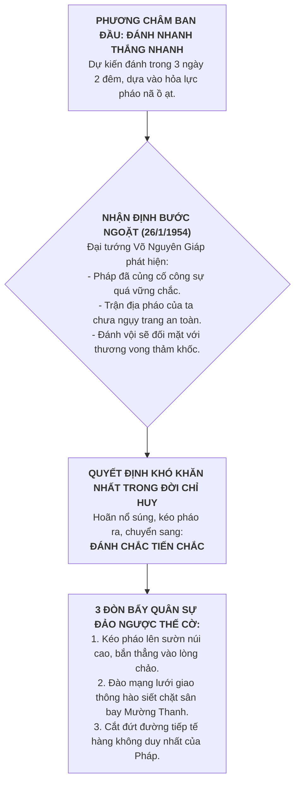

# Chủ đề 12.3.2: Cuộc kháng chiến chống thực dân Pháp (1945–1954) & Bước ngoặt Điện Biên Phủ

> **Thuộc**: Lớp 12 - Học kì 1 - Chương 12.3: Cách mạng tháng Tám 1945. Chiến tranh giải phóng dân tộc và bảo vệ Tổ quốc  
> **Khuôn mẫu trực quan (Archetype)**: Archetype 1 — Sa bàn Tác chiến & Quân sự (`TacticalMap`, `TroopManeuver`, `TerrainFeature`)  
> **Chuẩn kiến thức**: SGK Lịch sử 12 (Chương trình GDPT 2018)

---

## 1. Trọng tâm Bản chất: Chiến dịch Điện Biên Phủ (1954)
Trong toàn bộ cuộc kháng chiến chống Pháp (1945–1954), trọng tâm thi cử và bản chất quân sự tập trung cao độ ở **Chiến dịch Điện Biên Phủ (13/3 – 7/5/1954)** — đỉnh cao nghệ thuật quân sự Việt Nam.

---

## 2. Bàn cờ Chiến lược: Kế hoạch Navarre & "Con nhím" Điện Biên Phủ

### 2.1. Toan tính của Thực dân Pháp
* Tướng Navarre xây dựng Điện Biên Phủ thành **tập đoàn cứ điểm quân sự mạnh nhất Đông Dương** gồm 3 phân khu, 49 cứ điểm kiên cố, 16.200 quân tinh nhuệ, trang bị hỏa lực pháo binh và sân bay Mường Thanh hiện đại.
* **Tự tin của Pháp**: Cho rằng Điện Biên Phủ là "pháo đài bất khả xâm phạm", đặt giữa thung lũng lòng chảo để khiêu khích và nghiền nát quân chủ lực Việt Minh. Pháp tin rằng Việt Minh không bao giờ có thể vận chuyển pháo lớn qua địa hình đồi núi hiểm trở Tây Bắc.

### 2.2. Tình thế của Ta
* Ta mở chiến dịch với quyết tâm tiêu diệt toàn bộ tập đoàn cứ điểm để tạo bước ngoặt trên bàn đàm phán Geneva.
* **Nút thắt sinh tử**: Hậu cần xa xôi (hàng trăm km đường rừng), đối đầu trực diện với ưu thế không quân và pháo binh áp đảo của đối phương.

---

## 3. Quyết định Sinh tử: Bước chuyển từ "Đánh nhanh thắng nhanh" sang "Đánh chắc tiến chắc"

Đây là **bước ngoặt bản chất quan trọng nhất** của toàn bộ bài học:

---

## 4. Ba Đòn bẩy Sa bàn Remotion (Tactical Breakdown)

1. **Pháo đặt trên cao bắn thẳng (High-ground Artillery)**:
   - Thay vì để pháo dưới chân núi như quy ước chiến tranh phương Tây, bộ đội ta kéo pháo bằng tay lên các sườn núi cao bao quanh lòng chảo, khoét hầm kiên cố bắn thẳng xuống các cứ điểm Pháp. Pháo binh Pháp hoàn toàn bất ngờ và tê liệt vì không thể phản pháo.
2. **Hệ thống Giao thông hào Thắt cổ họng (The Trench Web)**:
   - Hàng trăm kilômét hào trục và hào tiếp cận siết chặt từng ngày, bao vây quanh các cứ điểm Him Lam, Độc Lập, Bản Kéo, đồi A1.
3. **Bóp nghẹt Sân bay Mường Thanh (Logistics Severance)**:
   - Giao thông hào cắt ngang đường băng sân bay Mường Thanh. Máy bay tiếp tế của Pháp buộc phải thả dù từ độ cao lớn $\to$ phần lớn lương thực, đạn dược rơi vào tay quân ta. Pháo đài Điện Biên Phủ biến thành "chiếc lồng tự giam" quân viễn chinh Pháp.

---

## 5. Kết quả & Dư ba Lịch sử
- Chiều ngày 7/5/1954, lá cờ "Quyết chiến Quyết thắng" tung bay trên nóc hầm Đờ Cát. 16.200 lính Pháp bị bắt sống hoặc tiêu diệt.
- Đập tan kế hoạch Navarre, buộc chính phủ Pháp phải ký **Hiệp định Geneva (21/7/1954)** chấm dứt chiến tranh, công nhận độc lập, chủ quyền, thống nhất và toàn vẹn lãnh thổ của Việt Nam.

---

## 6. Gợi ý Kịch bản Video AI (2:30 – 4:00)
- **Hook (Khoảnh khắc nghẹt thở)**: *"Sáng ngày 26 tháng 1 năm 1954, chỉ vài giờ trước khi lệnh nổ súng toàn mặt trận Điện Biên Phủ được ban ra, Đại tướng Võ Nguyên Giáp đã đưa ra một quyết định làm sửng sốt toàn bộ ban chỉ huy: Lập tức dừng cuộc tấn công, kéo pháo trở ra! Điều gì đã khiến vị tướng tổng tư lệnh chấp nhận một quyết định sinh tử đến như vậy?"*
- **Visual Remotion**:
  - `TacticalMap`: Bản đồ lòng chảo Điện Biên nhìn từ trên cao.
  - `TroopManeuver`: Vòng giao thông hào thắt chặt dần từ ngoài vào trung tâm Mường Thanh.
  - `PowerBalance`: So sánh hỏa lực không quân Pháp vs Mạng lưới hào và địa hình của Việt Minh.
