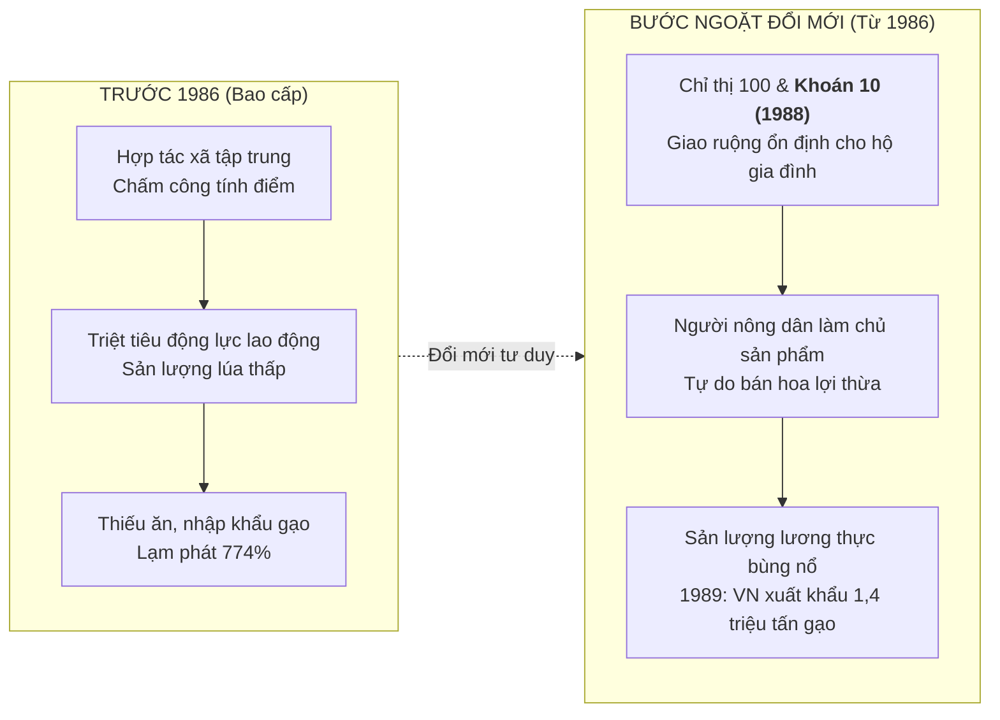

# Chủ đề 12.4.1: Khái quát về công cuộc Đổi mới từ năm 1986 đến nay

> **Thuộc**: Lớp 12 - Học kì 2 - Chương 12.4: Công cuộc Đổi mới ở Việt Nam từ năm 1986 đến nay  
> **Khuôn mẫu trực quan (Archetype)**: Archetype 3 — Giải phẫu Thể chế & Cơ chế Cải cách (`SystemWireframe`, `BottleneckResolver`)  
> **Chuẩn kiến thức**: SGK Lịch sử 12 (Chương trình GDPT 2018)

---

## 1. Bối cảnh Lịch sử: Khủng hoảng Kinh tế - Xã hội Trước 1986
- Sau năm 1975 thống nhất đất nước, Việt Nam áp dụng mô hình kinh tế **Kế hoạch hóa tập trung, quan liêu, bao cấp**:
  - Nhà nước quản lý toàn bộ phân phối lưu thông, ấn định giá cả và tem phiếu.
  - Nông nghiệp tổ chức theo hợp tác xã quy mô lớn, chấm công theo ngày bất kể năng suất cá nhân ("cha chung không ai khóc").
  - Lưu thông hàng hóa bị chia cắt bởi hàng rào "ngăn sông cấm chợ".
- **Hệ quả nghẹt thở**: Lạm phát phi mã lên tới **774% (năm 1986)**, thiếu đói triền miên, đất nước rơi vào khủng hoảng kinh tế - xã hội trầm trọng. Đổi mới trở thành mệnh lệnh sống còn: *"Đổi mới hay là chết"*.

---

## 2. Bước ngoặt Đại hội VI (12/1986): Nhìn thẳng vào sự thật

Đại hội đại biểu toàn quốc lần thứ VI của Đảng (tháng 12/1986) do Tổng Bí thư Nguyễn Văn Linh khởi xướng đã dũng cảm:
* "Nhìn thẳng vào sự thật, đánh giá đúng sự thật, nói rõ sự thật".
* Xác định trọng tâm đổi mới là **Đổi mới Kinh tế** kết hợp với đổi mới từng bước về chính trị.

---

## 3. Cơ chế Đột phá: Từ "Khoán hộ" đến Kinh tế Thị trường

### 3.1. Đòn bẩy Nông nghiệp: Khoán 10 (Nghị quyết 10 năm 1988)
* Đưa hộ gia đình trở thành đơn vị kinh tế tự chủ. Nông dân được nhận khoán đất lâu dài, sau khi nộp đủ sản lượng theo định mức thì được tự do định đoạt và hưởng trọn vẹn phần vượt khoán.
* **Kết quả thần kỳ**: Chỉ sau đúng 1 năm, từ một quốc gia thiếu đói triền miên phải nhập khẩu lương thực, đến năm 1989 Việt Nam đã lần đầu tiên **xuất khẩu được 1,4 triệu tấn gạo**.

### 3.2. Đổi mới Cơ cấu Kinh tế & Mở cửa Thị trường
* Xóa bỏ cơ chế bao cấp, tem phiếu và chính sách "ngăn sông cấm chợ".
* Phát triển **nền kinh tế nhiều thành phần** (Nhà nước, tập thể, tư nhân, có vốn đầu tư nước ngoài).
* Vận hành theo cơ chế thị trường có sự quản lý của Nhà nước định hướng XHCN.

---

## 4. Gợi ý Kịch bản Video AI (2:30 – 4:00)
- **Hook (Con số biết nói / Bóc tách hiểu lầm)**: *"Năm 1986, lạm phát ở Việt Nam chạm đỉnh kỷ lục 774%, người dân phải xếp hàng nhiều giờ chỉ để đổi vài lạng thịt bằng cuốn sổ tem phiếu rách nát. Nhưng chỉ 3 năm sau, một phép màu đã xảy ra: Việt Nam từ một nước phải ngửa tay nhận viện trợ lương thực đã vươn lên thành cường quốc xuất khẩu gạo hàng đầu thế giới. Điều gì đã kích hoạt cú lội ngược dòng ngoạn mục này?"*
- **Visual Remotion**:
  - `BottleneckResolver`: Minh họa nút thắt "ngăn sông cấm chợ & tem phiếu" $\to$ tháo gỡ bằng cơ chế Khoán 10.
  - `SystemWireframe`: Sơ đồ dòng chuyển động hàng hóa trước vs sau đổi mới.
