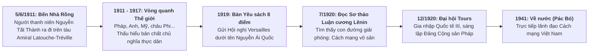

# Chủ đề 12.6.1: Khái quát cuộc đời và sự nghiệp của Hồ Chí Minh

> **Thuộc**: Lớp 12 - Học kì 2 - Chương 12.6: Hồ Chí Minh trong lịch sử Việt Nam  
> **Khuôn mẫu trực quan (Archetype)**: Archetype 5 — Hành trình Danh nhân & Tư tưởng (`JourneyMap`, `IdeologyEvolution`)  
> **Chuẩn kiến thức**: SGK Lịch sử 12 (Chương trình GDPT 2018)

---

## 1. Hành trình 30 Năm Bôn ba Tìm đường Cứu nước (1911–1941)

---

## 2. Điểm Đột phá Bản chất trong Tư duy của Người
- **Khác biệt với các bậc tiền bối**:
  - Phan Bội Châu: Sang phương Đông (Nhật Bản - phong trào Đông Du) nhờ cậy ngoại viện $\to$ Hồ Chí Minh nhận ra "đuổi hổ cửa trước, rước beo cửa sau".
  - Phan Châu Trinh: Dựa vào Pháp để khai hóa $\to$ Hồ Chí Minh nhận ra không thể xin xỏ lòng từ bi của kẻ cướp nước.
  - **Quyết định lịch sử**: Người chọn **đi thẳng sang phương Tây** — sang chính mẫu quốc đang cai trị dân tộc mình để tìm hiểu xem: *"Nước Pháp và các nước khác làm thế nào, rồi trở về giúp đồng bào ta"*.

---

## 3. Các Mốc son Vĩ đại
- **Năm 1930**: Hợp nhất các tổ chức cộng sản, thành lập Đảng Cộng sản Việt Nam tại Cửu Long (Hương Cảng, Trung Quốc).
- **Tháng 8/1945**: Chớp thời cơ ngàn năm có một, lãnh đạo toàn dân Tổng khởi nghĩa giành chính quyền.
- **2/9/1945**: Đọc bản Tuyên ngôn Độc lập tại Quảng trường Ba Đình, khai sinh nước Việt Nam Dân chủ Cộng hòa.
- **1945–1969**: Lãnh đạo cuộc kháng chiến trường kỳ chống Pháp và chống Mỹ.

---

## 4. Gợi ý Kịch bản Video AI (2:30 – 4:00)
- **Hook (Chi tiết thân quen nhưng uẩn khúc)**: *"Mùa hè năm 1911, một người thanh niên 21 tuổi bước lên chiếc tàu buôn của Pháp với hai bàn tay trắng. Các bậc tiền bối trước đó đều chọn sang Nhật Bản hoặc Trung Quốc, nhưng tại sao người thanh niên ấy lại một mình đi ngược dòng sang chính sào huyệt của chủ nghĩa thực dân phương Tây?"*
- **Visual Remotion**:
  - `JourneyMap`: Hải trình tàu chạy qua các đại dương, các trạm dừng chân sáng đèn (Sài Gòn $\to$ Marseille $\to$ Le Havre $\to$ New York $\to$ London $\to$ Paris $\to$ Moscow $\to$ Quảng Châu $\to$ Pác Bó).
  - `IdeologyEvolution`: Sơ đồ chuyển biến tư tưởng rõ ràng từng giai đoạn.
